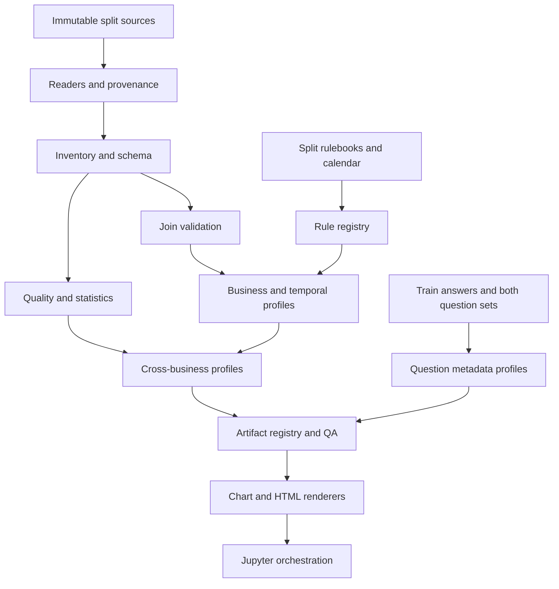
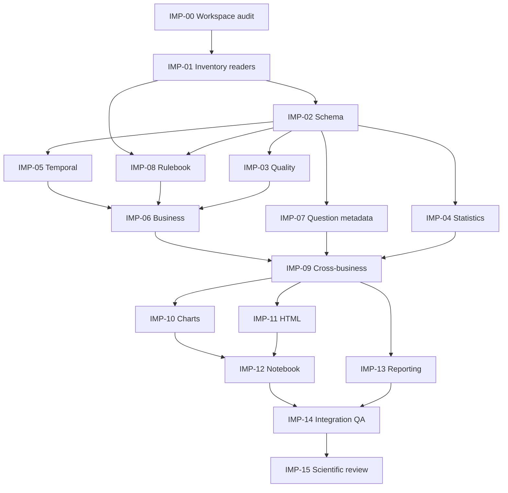

# DATAMATE — ADVANCED EXPLORATORY DATA ANALYSIS MASTER PLAN

**Dự án:** `MEGAXIS_ZALO_AI_CHALLENGE`  
**Workspace đích (máy người dùng):** `/Users/voanhnhat-ticoder-coder/Documents/ZALO_CHALLENGE/EDA_Data`  
**Artifact cần đặt tại workspace:** `EDA_Data/plan_eda.md`  
**Bản Markdown được biên soạn và kiểm tra trong phiên làm việc này:** `/mnt/data/plan_eda.md`  
**Ngày lập:** 2026-10-27  
**Chế độ:** **STRICT PLAN-ONLY** — KHÔNG triển khai EDA, KHÔNG sửa raw data, KHÔNG đào tạo Agent, KHÔNG tạo submission.  
**Tình trạng tổng thể:** **IMPLEMENTATION PLAN PREPARED / LOCAL SOURCE INSPECTION BLOCKED**. Xem mục Z.  
**Quy ước chứng cứ:** `ARCHIVE VERIFIED`, `ARCHIVE METADATA VERIFIED`, `PRIOR AUDIT DOCUMENTED`, `USER TREE DOCUMENTED`, `RULEBOOK VERIFIED`, `PROPOSED`, `UNVERIFIED`, `BLOCKED`, `NOT APPLICABLE`.

> **Giới hạn truy cập :** Hai file ZIP thực đã được kiểm tra trong môi trường đính kèm của hội thoại. Đường dẫn tuyệt đối của Mac **không được mount** vào môi trường thực thi này; nội dung `README.md` root, cấu hình package và source hiện hữu trên Mac **chưa được đọc trực tiếp**. Cây thư mục do người dùng cung cấp chỉ chứng minh cấu trúc tại thời điểm xuất cây, không chứng minh trạng thái filesystem hiện tại. Vì vậy mọi file Python, thư mục cấu hình, script test bên dưới đều được gắn nhãn **PROPOSED**, không được mô tả là đã tồn tại; AI Coding Agent phải hoàn tất Gate 00 trên máy thật trước khi tạo/sửa file.

## Mục lục

- [A. Executive Summary](#a-executive-summary)
- [B. DataMate Research Context](#b-datamate-research-context)
- [C. Objectives & Scope](#c-objectives--scope)
- [D. Source Dataset Inventory](#d-source-dataset-inventory)
- [E. Train/Public Test Data Structure](#e-trainpublic-test-data-structure)
- [F. File, Workbook & SQLite EDA](#f-file-workbook--sqlite-eda)
- [G. Schema Discovery & Relationship Analysis](#g-schema-discovery--relationship-analysis)
- [H. Data Quality EDA](#h-data-quality-eda)
- [I. Numerical Statistical EDA](#i-numerical-statistical-eda)
- [J. Categorical Statistical EDA](#j-categorical-statistical-eda)
- [K. Bivariate & Multivariate EDA](#k-bivariate--multivariate-eda)
- [L. Temporal & Calendar EDA](#l-temporal--calendar-eda)
- [M. Business-Specific EDA](#m-business-specific-eda)
- [N. Question & Answer EDA](#n-question--answer-eda)
- [O. Rulebook-Aware Analytics](#o-rulebook-aware-analytics)
- [P. Cross-Business & Cross-Split EDA](#p-cross-business--cross-split-eda)
- [Q. Global EDA](#q-global-eda)
- [R. Complete Visualization Catalogue](#r-complete-visualization-catalogue)
- [S. HTML Table Visualization Design System](#s-html-table-visualization-design-system)
- [T. Python Monorepo Architecture](#t-python-monorepo-architecture)
- [U. File-by-File Implementation Specification](#u-file-by-file-implementation-specification)
- [V. Jupyter Notebook Orchestration](#v-jupyter-notebook-orchestration)
- [W. Artifact & Reporting Architecture](#w-artifact--reporting-architecture)
- [X. Performance & Resource Strategy](#x-performance--resource-strategy)
- [Y. Testing & Verification Matrix](#y-testing--verification-matrix)
- [Z. Implementation Roadmap, Final QA & Definition of Done](#z-implementation-roadmap-final-qa--definition-of-done)
- [Phụ lục A — 44-business coverage ledger](#phụ-lục-a--44-business-coverage-ledger)
- [Phụ lục B — Risk register](#phụ-lục-b--risk-register)
- [Phụ lục C — Reproducibility & evidence](#phụ-lục-c--reproducibility--evidence)

## A. Executive Summary

**Mission:** Xây dựng blueprint thực thi EDA từ `file → workbook/sheet/table → schema → business → split → cross-business → toàn bộ dataset`, lấy bằng chứng từ dữ liệu thực và rulebook tương ứng; trình bày kết quả qua mô-đun Python, biểu đồ có tính khoa học và bảng HTML trong Jupyter Notebook. Không dùng EDA để suy diễn đáp án Public Test.

**How:** (1) xác nhận workspace, (2) inventory ZIP/extracted, (3) profiling theo định dạng, (4) schema/key/join, (5) quality/statistics/temporal, (6) doanh nghiệp và rulebook, (7) câu hỏi/đáp án được phép, (8) aggregate độc lập và so sánh, (9) chart/table, (10) Notebook, (11) QA/traceability. Mỗi phase có `GOAL/WHY/INPUT/FILES/ACTIONS/API/OUTPUT/TEST/PASS/FAIL/ROLLBACK`.

**Kết quả cuối của đợt PLAN-ONLY:** duy nhất file kế hoạch này (không sinh Python source/notebook/EDA outputs). **Kết quả của đợt triển khai tương lai:** manifest đầy đủ, báo cáo cho 44 doanh nghiệp, hệ thống visualization, QA bằng evidence/traceability và Notebook có thể chạy top-to-bottom. Các báo cáo này chưa tồn tại trong phiên hiện tại.

**Critical gates:** cấm tính KPI khi chưa khóa rulebook; cấm join khi chưa biết grain/cardinality; cấm công bố thống kê full khi mới sampling; cấm suy diễn ngành từ filename; cấm coi bản cây thư mục là kiểm chứng source code trên Mac.

## B. DataMate Research Context

- **Bài toán chính:** hỏi đáp tiếng Việt trên dữ liệu cấu trúc (CSV, Excel, SQLite), hỗ trợ dữ liệu nghiệp vụ không đồng nhất. **Không đồng nhất EDA với xây agent.**
- **Train:** có `questions.jsonl`, `answers.jsonl`, `rulebook.md`, `calendar.csv`, 30 business package. **Public Test:** có các thành phần tương ứng nhưng **không phát hành answers**.
- **Source hierarchy:** ① filesystem thật trên máy Mac khi có quyền; ② hai ZIP và metadata đã kiểm tra; ③ forensic audit trước (`MEGAXIS_DATAMATE_FORENSIC_AUDIT.json`); ④ rulebook README theo split/business; ⑤ thông tin cuộc thi chính thức nếu được cung cấp; ⑥ thư viện kỹ thuật/chuyên khảo được viện dẫn. Khi nguồn mâu thuẫn, lập conflict ticket, không âm thầm tự hòa giải.
- **Business semantics phải tách:** doanh thu ≠ tiền thu; ngày đặt ≠ ngày giao; tồn kho/công nợ là trạng thái as-of, không phải flow trong ngày; đơn và dòng đơn có grain khác; quy đổi đơn vị; âm lịch; trạng thái hủy/trả; tie-break; cách chuẩn hóa output.
- **Hai rulebook có khác biệt đã kiểm tra trực tiếp:** Public Test có luật bổ sung về báo cáo tiền mặt theo ca và trung bình mỗi thứ trong kỳ; tuyệt đối không reuse Train rulebook như thể giống nhau. Chi tiết đầy đủ phải được trích rule-ID khi triển khai.
- **Cơ chế xác minh:** câu hỏi phân tích → nguồn → trường → phép biến đổi read-only → phép tính → bảng/biểu đồ → evidence; mọi ô `UNKNOWN` phải có lý do.

## C. Objectives & Scope

| Nội dung | Trong phạm vi plan | Ngoài phạm vi |
|---|---|---|
| Inventory mọi file/sheet/table | Thiết kế kế hoạch & gate kiểm tra | Tính hết EDA thật trong phiên |
| CSV/Excel/SQLite/JSONL/README/Calendar | Quy trình inspect/read-only | Đổi tên/xóa/sửa raw |
| Schema/quality/statistics/time/business | Định nghĩa thuật toán & phép kiểm | Xuất KPI chưa qua QA |
| 44 doanh nghiệp và so sánh split | Per-business contract + evidence ledger | Áp chung rulebook hoặc schema |
| Questions/Train answers | Descriptive QA metadata, profiling loại output | Answer memorization/lookup inference |
| Visualization & Notebook | Kiến trúc modules và design specs | Viết Notebook source hoặc chạy EDA |
| Architecture | Thiết kế dựa trên snapshot + Gate-00 thật | Thay cấu trúc repo khi chưa đọc source |

**Định nghĩa chính xác:** `business_data_file` chỉ tính `.xlsx`, `.csv`, `.sqlite` trong thư mục doanh nghiệp; `archive_file` tính mọi member không phải directory (gồm README, calendar, rulebook, JSONL); `workbook` ≠ `worksheet`; `transaction` phải được xác lập theo grain nghiệp vụ; `row` không luôn là event/transaction.

**Privacy/security:** không in PII hoặc cell raw vào log/artifact; sample metadata/giá trị cần mask; không upload dữ liệu doanh nghiệp lên API ngoài; chỉ source mount read-only, SQLite `mode=ro`, không tự ghi vào raw. Không đưa dữ liệu nghiệp vụ trực tiếp vào HTML thiếu escaping.

## D. Source Dataset Inventory

### D.1. Mức độ bằng chứng và vị trí dữ liệu

| Source | Location | Bằng chứng | Kết luận |
|---|---|---|---|
| Archive Train | `/mnt/data/train.zip` (bản đính kèm) | `ARCHIVE VERIFIED` | SHA-256 khớp forensic audit |
| Archive Public Test | `/mnt/data/public_test.zip` | `ARCHIVE VERIFIED` | SHA-256 khớp forensic audit |
| Tree snapshot `EDA_Data` | `Văn bản đã dán (2).txt` | `USER TREE DOCUMENTED` | Có `raw_data/{train,public_test}`, `src/eda/notebook/eda.ipynb`, `src/eda/script/` và root `README.md` trong snapshot |
| Mac repository | `/Users/voanhnhat-ticoder-coder/Documents/ZALO_CHALLENGE/EDA_Data` | `BLOCKED` | Không truy cập trực tiếp từ phiên này |
| Prior audit | `MEGAXIS_DATAMATE_FORENSIC_AUDIT.json` | `PRIOR AUDIT DOCUMENTED` | Kết quả prior audit được tham chiếu; không tự nhận tái chạy toàn bộ |

### D.2. Baseline định lượng

| Metric | Train | Public Test | Provenance |
|---|---:|---:|---|
| Businesses | 30 | 14 | ZIP directory names + prior audit |
| ZIP file entries, excluding directories | 162 | 97 | Archive metadata |
| Excel workbooks | 107 | 69 | ZIP metadata + prior audit |
| Worksheets | 302 | 136 | Prior audit; verify on implementation |
| CSV including calendar | 21 | 11 | ZIP metadata + prior audit |
| SQLite databases | 1 | 1 | ZIP metadata |
| SQLite tables | 17 | 17 | Prior audit; revalidate schema |
| Question records | 3000 | 1000 | Prior audit |
| Answer records | 3000 | 0 (not provided) | ZIP presence + prior audit |
| Calendar rows | 1461 | 1461 | Prior audit |

**Archive SHA-256 được tính lại từ tệp tải lên trong phiên này:** Train `c1adbc654a301c30e4cf20b55d301381025f49db1162d88322b552d7472fea01`; Public Test `46fb50f926ed1510b9f099a53918f45e304b256680452c93e74401b4a5442c52`. Trường `archive_entries` KHÔNG được diễn giải là số file dữ liệu nghiệp vụ; nó bao gồm README, metadata và câu hỏi/đáp án.

### D.3. Kế hoạch inventory 7 cấp

1. **ARCHIVE:** đường dẫn, checksum, thành viên, kích thước nén/giải nén, CRC, zip-slip/symlink safety, parse lỗi và tổng member.
2. **FILE:** `source_id`, `split`, `business_id`, file type, logical path, raw size, hash, read status, README/rulebook metadata.
3. **WORKBOOK/SHEET:** kể cả hidden sheets, merged ranges, công thức và cached values, vùng dữ liệu thực, multirow headers, sheet grain.
4. **SQLITE TABLE/VIEW:** pragma schema, key, index, constraint, loại view, row counts, key columns; mở read-only.
5. **BUSINESS:** nguồn, kiểu biểu diễn, ngành *chỉ khi README xác minh*, grain, nguồn liên hệ, coverage và câu hỏi hỗ trợ.
6. **SPLIT:** quy tắc, câu hỏi, lịch, nguồn, business IDs; bất biến boundaries.
7. **GLOBAL:** profile tổng hợp theo định nghĩa rõ, tuyệt đối không cộng row các bảng khác grain thành số transaction.

**Gate inventory:** đối chiếu bộ 259 ZIP file entries với source raw inventory, và nếu local extraction có sai biệt thì xuất `EXTRA/MISSING/ALTERED`, dừng phân tích sai nguồn. Ignore các `.DS_Store`, thư mục hidden và `.venv/` khi xây business inventory, nhưng ghi policy loại trừ trong run manifest.

## E. Train/Public Test Data Structure

**Đường dẫn từ snapshot do người dùng cung cấp:**

```text
EDA_Data/
├── README.md                      [USER TREE DOCUMENTED: content UNVERIFIED]
├── plan/                          [USER TREE DOCUMENTED: layout]
│   └── plan_detail/eda/           [USER TREE DOCUMENTED]
├── raw_data/                      [USER TREE DOCUMENTED]
│   ├── train/
│   │   ├── data/biz_101 ... biz_130/
│   │   ├── questions.jsonl
│   │   ├── answers.jsonl
│   │   ├── rulebook.md
│   │   └── calendar.csv
│   └── public_test/
│       ├── data/dev_001 ... dev_014/
│       ├── questions.jsonl
│       ├── rulebook.md
│       └── calendar.csv
└── src/eda/
    ├── notebook/eda.ipynb         [USER TREE DOCUMENTED: code UNVERIFIED]
    └── script/                    [USER TREE DOCUMENTED: source contents UNVERIFIED]
```

**Khi triển khai:** đối chiếu source ZIP manifest với extracted tree mà không auto-overwrite. Nếu chỉ có ZIP, đọc metadata qua `ZipFile` hoặc giải nén vào staging mới *chỉ sau khi xác nhận chính sách ghi và an toàn path*, không ghi đè `raw_data`. Cấu hình locator quyết định thực tế, không dựa vào đường dẫn absolute trong module.

**Split isolation contract:** `DatasetContext(split, root, rulebook_path, calendar_path, questions_path, answers_path)`; `answers_path=None` cho Public Test và mọi yêu cầu tải `public_test/answers.jsonl` phải trả lỗi thiết kế. Mỗi derived measure có `rule_version`, `business_id`, `date_basis`, `source_ids`; cross-split comparison chỉ áp dụng lên metadata và thống kê có ngữ nghĩa so sánh được.

**Input schemas chưa khóa:** `questions.jsonl` dự kiến có `as_of_date` theo rulebook; tên khóa còn lại phải inspect thực tế tại Gate 01/07 trước khi chốt parser. Quy ước output list/table/boolean/date/number không được hardcode khi chưa xác minh full JSON schema. `SQLite schema` có thể khác CSV/Excel ngay cả khi cùng tên cột.

## F. File, Workbook & SQLite EDA

| Format | Discovery | How chi tiết | Edge cases | Verify |
|---|---|---|---|---|
| ZIP | `infolist`, CRC, safe path, size budget | Hash archive trước; lập manifest thành viên; kiểm tra encoding tên, zip-slip, duplicate normalized path | path traversal, Unicode NFD/NFC, repeated members, archive bomb | 1-to-1 against reference manifest |
| CSV | sniff delimiter trong bounded bytes; encoding candidates, original raw bytes | kiểm header, BOM, duplicate headers, quoted multiline, decimal separators, date tokens; phân biệt header và summary row | `;` vs `,`, mixed type, whitespace, subtotal lines | roundtrip sampling + full row count riêng |
| XLSX | `openpyxl.load_workbook` read-only data stream và normal read chỉ khi cần structural introspection; không sửa | liệt kê sheet hidden/visible; xác định data region, merged/format, formula/cached dual views, header candidate confidence | repeated headers, summary rows, `1900/1904` epochs, formulas cache absent, date serial | inspect coordinates + no silent dtype coercion |
| SQLite | `file:...?...mode=ro` với URI, `PRAGMA query_only=ON` | `sqlite_master`, `PRAGMA table_info/foreign_key_list/index_list`; giới hạn read size | composite key, views, absent FK declarations, text-stored dates | `PRAGMA integrity_check`, schema snapshot |
| README/Rulebook | Markdown parser/text read | ghi bối cảnh schema, units, business definitions, evidence span | mâu thuẫn doc-data, scope theo split | fact ledger with paragraph reference |
| JSONL | line streaming, strict JSON parsing | mỗi line một object, collect key/type metadata, unique `id` nếu có; enforce train answer isolation | empty lines, encoding, nested list/table answer, invalid type | row/ID alignment on Train only |
| Calendar | CSV profile/read only | xác nhận mapping solar↔lunar, leap month, holidays, coverage; không tự suy ra từ OS date | leap months, timezone, `as_of_date` outside coverage | exact row/day mapping and split provenance |

**No mutation rule:** `pd.to_datetime(errors='coerce')` hay normalization chỉ tạo derived inspection series; bảo toàn raw string/hash và tỷ lệ parse fail. Không sửa source. Header được phát hiện theo heuristic là `CANDIDATE` cho đến khi có bằng chứng xác nhận từ README/rules/sampling/human review.

## G. Schema Discovery & Relationship Analysis

**Step-by-step:** (1) xác định object grain; (2) phát hiện candidate PK (`not_null`, `unique`, stability); (3) nhận diện logical FK từ tên/cấu trúc/README; (4) tạo cặp join candidate *chưa xác minh*; (5) đo null-key/duplicate-key/orphans; (6) phân loại 1:1, 1:N, N:1, N:M; (7) tính fan-out factor trước/sau join; (8) reconcile aggregate tại grain chuẩn; (9) duyệt join an toàn; (10) đưa join unsafe vào risk matrix.

**Join correctness:** không tự kết luận join đúng vì `orphans=0`. Cần kiểm tra uniqueness, key normalization, time-validity, composite keys và `SUM(measure)` trước/sau join. Ví dụ join `orders` 1:N `order_lines` rồi join tiếp N:1 `payments` có thể tạo Cartesian multiplication nếu payment nhiều dòng mỗi order; phải pre-aggregate đúng grain hoặc áp dụng bridge phù hợp.

**Quan sát từ audit cũ cần regression test chứ không được coi là luật chung:** `biz_127` join key của `thanh_toan.csv` (`Mã GD`) với `don_hang.csv` (`Mã chứng từ`) từng cho 33.473 missing trên 33.473 dòng, nên không được tự nối vì tương đồng bề mặt; `biz_111` và `biz_129` dùng các alias cột khác nhau. Prior audit có `corrections` cho các join được xác nhận sai; coding agent phải đọc mục đó trước khi viết relation map.

**Relationship output contract:** `relation_id | split | business | left/right table | join keys | grain | candidate/verified | orphan_count | key_null_count | left/right duplicates | fanout | expected aggregate invariant | evidence | risk`.

**Sơ đồ:** Mermaid ER-ish graph chỉ tạo sau khi đủ evidence; cạnh suy đoán phải ghi `CANDIDATE`. Cấm giả định schema tương đương giữa `biz_101` và `dev_001` chỉ vì đều có file bán hàng.

## H. Data Quality EDA

| Dimension | How đo | Khi nào là issue | Evidence |
|---|---|---|---|
| Completeness | missing tokens, null counts, pattern co-missing | cột bắt buộc theo business contract mới được gắn lỗi | row/column range, rule |
| Validity | parse type/date/range/status/unit | vi phạm constraint có nguồn | raw example đã mask + rule |
| Consistency | cross-field, README vs schema, period consistency | mâu thuẫn không giải thích được | pair of observations |
| Uniqueness | exact row / business key / file overlap | duplicate trái grain/key rule | fingerprint + grain |
| Referential integrity | null FK, orphan keys, join fanout | FK candidate verified mà orphan | matching counts |
| Temporal | missing periods, overlaps, out-of-range | tùy event semantics & coverage | date field semantics |
| Financial/inventory | signed refunds, discounts, negative units, totals | chỉ gắn issue sau split-specific rule | rule ID + reconciled numbers |

**Missing ≠ invalid; negative ≠ wrong; duplicate ≠ accidental.** Cần phân loại `structural missing / unknown / not applicable / blank header / parser failure`. Tự tạo issue severity theo `impact_on_aggregate × prevalence × confidence`; độ nghiêm trọng không suy ra chỉ từ tỉ lệ missing.

**Baseline anomaly from prior audit:** có `summary_candidate_rows` trong `public_test/data/dev_010/don_hang.csv` và các file khác; lên kế hoạch cảnh báo subtotal/summary row trước khi aggregate, không tự xóa, không xem là kết luận đã xác minh nghĩa nghiệp vụ.

**Output:** `quality_finding_id, severity, business/split, source_id, field, count/denominator, evidence, hypothesis, alternative_explanation, verification, status, owner`; phát hành bảng `UNKNOWN` tách khỏi `ERROR`.

## I. Numerical Statistical EDA

**Gate 1 — semantic typing:** chỉ đo mean/SD cho quantity, price, amount, duration hoặc count được xác nhận; không tính mean cho product code, invoice number, postal/phone strings. Parse số với locale explicit, không `astype(float)` mù.

**Gate 2 — descriptive statistics:** N valid/missing/zero, min/max, mean/median, sample SD (ddof=1 nếu phù hợp), quartile/IQR, MAD (`median(|x-median(x)|)`, ghi rõ scale factor nếu dùng), skewness/kurtosis khi N đủ, zero inflation, robust quantile.

**Gate 3 — distributions:** empirical histogram (bin rule documented), ECDF, Q-Q khi phân tích phân phối cụ thể, KDE chỉ với biến thích hợp và bandwidth được ghi; heavy-tail/mixture/zero mass tách nhau; chart có đơn vị.

**Gate 4 — outliers:** IQR fences, modified z-score/MAD, robust quantile thresholds là *flags*; giữ outlier cho đến khi business/quality gate duyệt. Phân biệt anomaly thống kê với invalid source. Không winsorize để vẽ mà không công bố.

**Gate 5 — inference:** hypothesis testing hoặc bootstrap chỉ khi có câu hỏi khoa học và điều kiện lấy mẫu phù hợp; báo effect size, CI, multiple-testing control khi cần; Không rút ra causal claims từ association.

**Output:** numerical methods registry có `method, formula, assumption, applicable_types, exclusion_rule, grain, source, sample/full, confidence`.

## J. Categorical Statistical EDA

**How:** (1) chọn categorical semantic (nominal/ordinal/status), (2) đếm distinct chuẩn và distinct sau normalization *chỉ để so sánh*, (3) frequency/relative frequency, (4) rare/high-cardinality groups, (5) null tokens, (6) phân biệt alias do README định nghĩa và biến thể viết, (7) cross-tab theo domain, (8) kiểm mixed locale/diacritics/Unicode.

**Không tự gộp** `Bán`, `Bán lẻ`, `lẻ` thành cùng category hoặc tên hàng giống nhau nếu không có rule. Đối với status, ý nghĩa `Đang giao`, `Huỷ`, `Trả` phải gắn rulebook theo split. Với high cardinality, top-k chart kèm `Others` phải ghi tỷ lệ và không xóa tail khỏi full stat.

**Output:** categorical distribution, aliases candidate, invalid labels, status taxonomy, categories provenance.

## K. Bivariate & Multivariate EDA

| Pair | Method | Assumptions/gate | Tránh hiểu nhầm |
|---|---|---|---|
| Numeric–numeric | scatter/hexbin, Pearson, Spearman, robust association | cùng grain, đủ observations và không bị repeated join | nonlinear ≠ no relation |
| Categorical–numeric | grouped median/quantile, box/violin, effect size | mỗi group đủ support; không dùng ID numeric làm measure | comparison ≠ cause |
| Categorical–categorical | crosstab, proportions, Chi-square/Cramér V khi hợp lệ | expected frequencies, dependency structure | không lấy p-value làm effect size |
| High-dimensional numeric | missing-aware correlation/PCA khi cần | scaling, PSD/correlation stability, sample size | PCA chỉ khi có mục tiêu và rõ loadings |
| Temporal–measure | lag/seasonal decomposition nếu đủ coverage | thống nhất định nghĩa kỳ, không look-ahead | future event không phải historical signal |

**Join-first warning:** trước multivariate cần kiểm unique unit-of-analysis sau join; store `pre/post row count`, `pre/post sum of sensitive amounts`, `missing alignment`, `duplication multiplier` để chứng minh không nhân doanh thu.

## L. Temporal & Calendar EDA

**Các bước:** xác định event date (`order_date`, `payment_time`, `return_date`, `expiry`) riêng; timezone/locale, parse failures; coverage min–max, ngày hoạt động, ngày không giao dịch, missing periods; theo ngày/tuần/tháng; `as_of_date` trên từng question; calendar split matching; leap lunar month/Tết window; phân biệt point-in-time stock với period flow. Không dùng thời gian hệ thống.

**Rulebook-backed windows (cần gắn version khi thực thi):** `N ngày gần nhất` gồm hôm nay; tuần bắt đầu thứ Hai; khoảng `từ X đến Y` inclusive; `tháng này` kết thúc hôm nay; Tết từ 23 tháng Chạp đến mùng 10 tháng Giêng, tra calendar; trạng thái huỷ/trả có ngoại lệ thời điểm đã nêu trong rulebook; Public Test có thêm trung bình theo thứ trong kỳ. Giá trị trạng thái/mốc thời gian phải phục hồi đúng theo từng record/rule.

**Validation cases:** ngày 29/02; tháng trước không có ngày tương ứng; Tết qua hai năm dương; tháng nhuận âm lịch; thời điểm ca 13:59→14:00; xem sự kiện sau as_of_date; date serial Excel 1904; empty periods vs missing records.

**Calendar source:** Train và Public Test mỗi split lấy `calendar.csv` tương ứng. Audit trước cho 1461 dòng/split (2024-01-01–2027-12-31); đây là prior observation, recheck khi implement.

## M. Business-Specific EDA

**Mẫu bắt buộc CHO TỪNG business:** `business_id | business source README evidence | inventory | workbook/sheet/table register | schema/grain | entity map | join matrix | missing/duplicate/invalid | numeric/categorical | temporal | rulebook mapping | relevant available KPI | EDA-compatible question coverage | visuals | findings | limitations | source citations | pass/fail`. Không gộp thành một báo cáo chung. Xem **Phụ lục A** có 44 dòng với nguồn thực từ ZIP metadata.

**Business domain specializations (chỉ khi README/schema xác minh):**

- **Retail/Café/Restaurant:** phân biệt order header/item/payment/shipping/service fee, status, voucher, order value; chứng minh order-line aggregation đúng.
- **Pharmacy/health goods:** lot, expiry date, batch stock, unit conversion; không kết luận hết hạn nếu không biết ngày mốc và tồn kho lô.
- **Materials/hardware:** đa đơn vị (thùng, kg, viên...), conversion by SKU, price units; không cộng lượng khác đơn vị gốc.
- **Repair services:** ticket, mechanic, labor parts, status và thời gian hoàn tất; service completion ≠ merchandise sale.
- **Phone trade-in:** purchase/sale/old-phone receivables, separate ledger; không coi dòng thu máy cũ là cùng KPI bán hàng.
- **Accounts receivable/stock:** snapshot versus flows, debt balance, as-of cutoffs; không cộng gross outstanding theo kỳ như doanh thu.

**Mỗi business có checklist độc lập** với một dòng ledger, không tự gán ngành từ filename nếu chưa có README evidence.

## N. Question & Answer EDA

**Train 3.000 Q + 3.000 reference answers (audit prior):** xác minh unique ID, business ID, `as_of_date`, nested response schema; thống kê length (Unicode normalized + raw), ngôn ngữ thiếu dấu, abbreviations, relative time, requested metric, required join, filter, top-k, ordering, tie-break, type-specific constraints. Answer profiling chỉ aggregate theo `answer_type`, scalar/list/table shapes, date/rounding/alias, `unanswerable`, không xuất raw answer map.

**Public Test 1.000 Q:** lặp lại *chỉ questions*, không giả định reference answers; comparison metadata theo distribution/intent/domain/time complexity; tuyệt đối không tạo answers/answer lookup/SQL execution trả câu hỏi Public trong giai đoạn EDA.

**Train answer taxonomy từ audit trước (không tái tính tại phiên hiện tại):** `number=1884, percent=578, list=193, date=145, string=88, unanswerable=70, boolean=23, table=19` (tổng 3000). Implementation phải verify schema type và counts trước khi dùng.

**Question alignment:** phân loại `intent`, `target entity`, `required business evidence`, `input tables`, `join complexity`, `time expression`, `answer type`, `data sufficient?`, `uncertainty`; xem đây là metadata diagnostic, không trả lời trực tiếp các câu hỏi test.

**Cross-split:** so sánh confidence intervals của frequency khi có ý nghĩa; không gán label ý định như ground truth khi chỉ heuristic; có sample coding & inter-annotator agreement nếu cần nghiên cứu taxonomies.

## O. Rulebook-Aware Analytics

**Phương pháp:** (1) đọc rulebook từng split đầy đủ, (2) trích mục/bảng/quy tắc tạo ID `{split}.{section}.{rule_slug}`, (3) mapping rule → applicable business/schema/metric, (4) phân biệt source-defined và question override, (5) thiết kế pure function chỉ trả **method/derived metadata khi EDA**, (6) xây test cases từ rulebook, (7) QA độc lập trước visualization.

**Rulebook differentiation (đã đọc từ ZIP):** Train và Public Test đều xác lập nhiều default doanh thu, time/as-of, ranking; Public Test bổ sung các nhánh như báo cáo tiền mặt theo ca và trung bình thứ trong kỳ; giữ nguyên cả hai và lập `rule_diff` thay vì copy chung. Rulebook có trường hợp đơn trả một phần loại *cả đơn* khỏi doanh thu theo mặc định, và `shipping/tax/whole-order discount` không cộng/trừ theo cách giản lược thông thường. Đây là những ví dụ nguồn, không đại diện toàn bộ rules.

**Derived KPI registry:** `metric_id, business_id, split, grain, numerator, denominator, filters, status handling, as_of semantics, unit, rounding, NULL behavior, join_path, rule_id, source columns, tests`. Khi thiếu schema hoặc rule, trả `BLOCKED` thay vì mô tả số giả.

**Revenue consistency checks:** aggregate theo order-line, không trừ voucher whole-order nếu rulebook loại trừ; order date vs payment date; cancellation/returns precedence; group customer denominator includes walk-in; payment method of order ≠ later repayment. Thiết kế expected invariants trên synthetic fixtures, không chạy KPI trên dữ liệu thật trong đợt plan.

## P. Cross-Business & Cross-Split EDA

**Cách làm:** chuẩn hóa *metadata schema* theo semantic field roles (date, identifier, amount, quantity, category) nhưng không ép cột khác nghĩa thành một; aggregate coverage, volume, file format, key confidence, quality flags, temporal span, known rule diffs, question complexity. Giữ provenance của từng business; chỉ so sánh cùng loại metric với định nghĩa rõ.

**Schema similarity:** thống kê token/name/type/description similarity thành *candidate semantic mapping*, không tự kết luận join-key equivalence. Mỗi mapping phải có source, confidence và review status. Cross-split chart phải chú thích `different business populations`; không kết luận distribution shift định lượng nếu chưa định nghĩa population và metric.

**KPI comparison guard:** cross-business revenue chỉ tính nếu currency, unit, status, date basis, rule IDs tương thích; nếu khác thì `NOT COMPARABLE` không thêm số giả.

## Q. Global EDA

**Tổng hợp thống kê thật:** counts theo đơn vị `archive_member`, `business_source_file`, `workbook`, `worksheet`, `sqlite_table`, `business`, `question`, `reference_answer`, `calendar_day`; mỗi chart ghi mẫu số. Không cộng số dòng `orders + order_lines + customers` để gọi là transactions.

**Global outputs:** coverage matrix 44 businesses, source format registry, schema patterns, quality risk burden with denominators, temporal coverage comparison, rulebook diffs, question & answer metadata, method limitations, finding severity and provenance. `Global conclusion` chỉ khi mỗi business has PASS hoặc explicit `PARTIAL/BLOCKED` coverage. No silent skips.

## R. Complete Visualization Catalogue

**Chart contract bắt buộc:** chart ID, mục đích nghiên cứu, `input_artifact`, phép tính, loại chart, x/y, unit, split/business, population vs sampling, owner, file xuất, legend/caption/limitations, source evidence, check sum/invariant. Hệ thống chỉ tạo chart khi `data capability` và `rulebook` PASS, ngược lại render trạng thái `NOT APPLICABLE` kèm lý do. Tất cả chart có numeric label đọc được, accessibility không dựa màu đơn thuần, không dùng trục cắt đánh lừa, không suy luận quan hệ nhân quả.

**Bảng thiết kế cụ thể:**

| ID | Chart | Research question | Input + calculation | Type / x / y / unit | Group | Owner | Reconciliation | Limitation |
|---|---|---|---|---|---|---|---|---|
| `INV01` | Thành phần định dạng theo split | Nhóm định dạng nào phổ biến? | `file_manifest`; count business data files by split and extension | grouped bar; `type` / `count`; file | split | `inventory` | sum bars = source file count | calendar/README excluded |
| `INV02` | File size ECDF | File cực lớn chiếm tỷ trọng gì? | `file_manifest`; ECDF of file_size bytes | ECDF; `size` / `cumulative share`; bytes/% | split | `inventory` | ECDF ends at 1 | compressed size differs |
| `INV03` | Files per business | Độ phức tạp số nguồn mỗi business? | `file_manifest`; count files per business | horizontal bar; `business_id` / `file count`; file | split | `inventory` | group sums = files | not number of tables |
| `INV04` | Sheets per workbook | Workbook nào có nhiều sheets? | `sheet_registry`; count sheets per workbook | ranked bar; `workbook` / `sheet count`; sheet | split | `inventory` | count vs sheet_registry | formatting sheets count |
| `INV05` | SQLite tables by split | CSDL có bao nhiêu tables/views? | `sqlite_registry`; count actual tables exclude internal sqlite_* and separate views | bar; `split` / `table count`; table | object kind | `inventory` | schema list reconcile | view is not table |
| `INV06` | Rows per source object | Đâu là vùng dữ liệu lớn? | `table_registry`; row_count per table/sheet with grain tag | log-scale dot; `source object` / `row_count`; row | source kind | `inventory` | reconcile reader count | rows not transactions |
| `DQ01` | Missing ratios by field | Trường nào có thiếu dữ liệu? | `missing_registry`; missing_n/total_n | horizontal bar; `field` / `missing rate`; % | business | `quality` | n denominator present | structural missing |
| `DQ02` | Missingness co-pattern | Các cột cùng thiếu ra sao? | `co_missing_registry`; cooccurrence missing pair matrix | heatmap; `field` / `field`; frequency | business | `quality` | matrix symmetric | high-dimensional masking |
| `DQ03` | Duplicate business keys | Bản ghi trùng theo khóa nào? | `duplicate_registry`; count duplicates per approved key/grain | bar; `source` / `duplicate count`; row | key class | `quality` | raw fingerprint spot verify | legal repeated lines |
| `DQ04` | Invalid value categories | Lỗi định dạng gồm loại nào? | `invalid_registry`; count by documented validated rule | stacked bar; `type` / `count`; row | status | `quality` | sum severity counts | heuristic not definitive |
| `DQ05` | Orphans and fanout | Join nào gây sai lệch? | `relation_registry`; orphan + fanout per candidate relation | paired dot; `relation` / `ratio`; %/× | split | `schema` | join invariants | relations candidates |
| `DQ06` | Quality severity matrix | Vấn đề nào ảnh hưởng lớn? | `quality_findings`; count by severity and domain | heatmap; `domain` / `severity`; issue | business | `quality` | sum = findings | severity evidence-based |
| `NUM01` | Numeric histogram | Phân phối trường đo ra sao? | `numeric_profile`; binning with rule and under/overflow | histogram; `measure` / `count`; business unit | business | `statistics` | hist bin totals | zeros/outliers |
| `NUM02` | Numeric ECDF | Phân vị của biến đo? | `numeric_profile`; empirical cumulative | ECDF; `value` / `fraction`; unit/% | business | `statistics` | last y=1 | missing excluded |
| `NUM03` | Boxplot across business | Biến thiên nội bộ khác nhau? | `numeric_profile`; five-number summaries | boxplot; `business` / `measure`; business unit | split | `statistics` | quartiles reconcile | heterogeneous semantics |
| `NUM04` | Zero inflation per metric | Những biến nào nhiều zero? | `numeric_profile`; zero_n/valid_n | bar; `metric` / `zero %`; % | business | `statistics` | valid denominator | zero may be valid |
| `NUM05` | Quantile tails | Mức đuôi phân phối lớn cỡ nào? | `numeric_profile`; p50,p90,p95,p99,p999 | quantile line; `quantile` / `value`; unit | business | `statistics` | quantiles match reference | heavy tails |
| `CAT01` | Category frequency top-k | Các nhóm chiếm ưu thế? | `category_registry`; top-k + Others per full distribution | bar; `category` / `frequency`; count | business | `statistics` | totals include Others | alias unresolved |
| `CAT02` | Cardinality across fields | Cột nào có high cardinality? | `category_registry`; nunique per field | dot; `field` / `distinct`; count | business | `statistics` | distinct matches registry | IDs excluded from categoricals |
| `CAT03` | Status distribution | Trạng thái đơn phổ biến? | `category_registry`; split-specific labels no silent merge | stacked bar; `status` / `count`; row | business | `statistics` | status counts sum | status semantics differ |
| `BIV01` | Numeric relationship scatter | Hai measure có quan hệ? | `joined_safe_view`; same-grain pairs, bounded stratified sampling | scatter; `metric A` / `metric B`; units | business | `statistics` | axis vs sampled data | association not causation |
| `BIV02` | Correlation heatmap | Biến nào tương quan? | `numeric_features`; Pearson/Spearman depending conditions | heatmap; `feature` / `feature`; r/rho | business | `statistics` | symmetric diagonal=1 | join-induced correlation |
| `BIV03` | Group vs distribution | Nhóm nào có giá trị khác? | `joined_safe_view`; grouped quartiles | violin or boxplot; `category` / `measure`; unit | business | `statistics` | group counts match | small groups |
| `BIV04` | Crosstab categories | Hai biến phân loại liên kết? | `categorical_pair`; contingency n / row proportion | heatmap; `category A` / `category B`; row % | business | `statistics` | row percentages sum 100 | high cardinality |
| `TMP01` | Daily activity coverage | Ngày nào có nguồn ghi? | `temporal_registry`; active days/calendar days | calendar heatmap; `day` / `activity count`; day/count | business | `temporal` | counts reconcile | zero != missing |
| `TMP02` | Period coverage timeline | Nguồn nào có vùng thời gian nào? | `temporal_registry`; min max and gaps per source | Gantt-like timeline; `date` / `source`; day | business | `temporal` | min max match | multiple event dates |
| `TMP03` | Missing months | Thiếu kỳ nào? | `temporal_registry`; period index vs observed | heatmap; `month` / `business`; has_data | split | `temporal` | coverage vs date range | no transactions vs no data |
| `TMP04` | Weekday pattern | Thứ nào có mật độ? | `temporal_registry`; events by weekday / weekday exposures | bar; `weekday` / `avg daily count`; row/day | business | `temporal` | denominator calendar count | not causal |
| `TMP05` | Tết lunar window | Lịch âm bao phủ kỳ Tết nào? | `calendar_registry`; map Lunar 23/12 to 10/1 into solar dates | timeline; `solar date` / `window`; day | year/split | `temporal` | mapping from split calendar | calendar limits |
| `BUS01` | Sales/revenue distribution | Phân phối doanh thu được hỗ trợ? | `rule_aware_kpis`; valid orders and line amount per rule | histogram; `order revenue` / `orders`; currency | business | `business` | reconcile sum | only if schema verified |
| `BUS02` | Unit conversion audit | SKU nào có unit mapping mâu thuẫn? | `unit_registry`; compare source units to base unit documented | matrix; `SKU` / `unit`; conversion | business | `business` | dimensional checks | do not combine mixed units |
| `BUS03` | Inventory as-of profile | Tồn ở thời điểm nào? | `stock_registry`; as-of balance based on approved events | line; `as_of_date` / `stock`; base unit | SKU | `business` | balance reconciliation | event coverage |
| `BUS04` | Receivables aging | Nợ quá hạn theo nhóm nào? | `debt_registry`; as-of receivable by aging buckets | bar; `aging bucket` / `outstanding`; currency | business | `business` | debt ledger invariant | payment timing |
| `BUS05` | Lots and expiry timeline | Lô hàng/hạn dùng nào cần rà soát? | `batch_registry`; expiry vs as_of_date | timeline; `expiry date` / `lot`; day | business | `business` | lot key verification | lot stock needed |
| `QNA01` | Question length by split | Câu hỏi dài ngắn thế nào? | `question_registry`; char length/token count with consistent tokenizer | boxplot; `split` / `question length`; characters/tokens | business | `questions` | sample counts | tokenizer choices |
| `QNA02` | Intent taxonomy | Các loại intent phổ biến? | `question_annotations`; validated categorical counts | bar; `intent` / `count`; question | split | `questions` | annotation QA | heuristic labels |
| `QNA03` | Temporal phrase distribution | Cụm thời gian nào xuất hiện? | `question_annotations`; keyword+review time types | bar; `time expression` / `frequency`; question | split | `questions` | sum may exceed questions | multi-label |
| `QNA04` | Train answer type mix | Đáp án chuẩn có dạng gì? | `train_answer_metadata`; counts by type | bar; `answer type` / `count`; answer | train | `questions` | sum=3000 after read | train only |
| `QNA05` | Question join complexity | Câu hỏi cần mấy nguồn? | `question_alignment`; number of required entities from reviewed mapping | histogram; `required sources` / `count`; source/question | split | `questions` | annotation confidence | not proven solvability |
| `CBS01` | Schema diversity heatmap | Các business khác cấu trúc đến đâu? | `schema_registry`; semantic role presence, unknown separate | heatmap; `business` / `semantic role`; presence | split | `cross_business` | roles tied to evidence | role != join equivalent |
| `CBS02` | Quality by business | Business nào rủi ro dữ liệu? | `quality_findings`; rate weighted denominator + flags | dot; `business` / `issue rate`; % | split | `cross_business` | denominators consistent | risk not ranking quality absolute |
| `CBS03` | Source types by business | Split khác về định dạng? | `file_manifest`; count source types per business | stacked bar; `business` / `file count`; file | split | `cross_business` | stacked sum matches | source size differs |
| `GLB01` | Dataset coverage overview | Đã bao phủ mọi business/object? | `coverage_ledger`; pass/partial/blocked totals | bar; `status` / `business count`; business | split | `reporting` | PASS+PARTIAL+BLOCKED=44 | inventory vs analysis |
| `GLB02` | Global issue summary | Loại issue ảnh hưởng hệ thống? | `quality_findings`; count category×split | stacked bar; `issue category` / `count`; finding | split | `reporting` | sum matches evidence | unequal data volumes |

### R.1. Chart owner binding and output contract

Mỗi chart được quản lý theo ID của bảng R. Để không lặp business logic ở renderer, `owner` trong catalogue chỉ nhóm chịu trách nhiệm tính **prepared statistical frame**, còn file thực thi vẽ luôn là `visualization/chart_renderer.py`. Binding module cụ thể như sau:

| Prefix IDs | Prepared data owner (under `src/eda/script/`) | Render interface | Output path spec |
|---|---|---|---|
| `INV*` | `inventory/file_manifest.py`, `inventory/sheet_registry.py`, `inventory/sqlite_registry.py` | `render_chart(prepared_frame, spec)` | `figures/{run_id}/{split}/global/{chart_id}.png` |
| `DQ*` | `quality/findings.py`, `quality/missingness.py`, `schema/relations.py` | same | `figures/{run_id}/{split}/{business_id}/{chart_id}.png` |
| `NUM*`, `CAT*`, `BIV*` | `statistics/numeric.py`, `statistics/categorical.py`, `statistics/bivariate.py`, `statistics/multivariate.py` | same | `figures/{run_id}/{split}/{business_id}/{chart_id}.png` |
| `TMP*` | `temporal/coverage.py`, `temporal/calendar_registry.py` | same | `figures/{run_id}/{split}/{business_id}/{chart_id}.png` |
| `BUS*` | `business/domain_profiles.py`, `business/kpi_catalogue.py` | same | `figures/{run_id}/{split}/{business_id}/{chart_id}.png` |
| `QNA*` | `questions/question_profile.py`, `questions/answer_profile.py` (Train only) | same | `figures/{run_id}/{split}/global/{chart_id}.png` |
| `CBS*`, `GLB*` | `cross_business/schema_compare.py`, `cross_business/aggregate.py` | same | `figures/{run_id}/{split_or_both}/global/{chart_id}.png` |

**Validation algorithm chung cho mỗi chart:** lấy `prepared_frame` đã qua QA → assert `expected columns`, source hashes và dimension/unit → kiểm denominator / sample_n → render → tính hash figure → lưu spec+source+limitations vào `chart_registry.json` → so dữ liệu dùng vẽ với bảng thống kê (tolerance khai báo). Nếu không có `business_id` hoặc item thuộc global, dùng literal `global`; nếu chart cross-split, dùng group `both` và gắn nguồn của từng split. Mọi kết quả render phải truy ngược từ ảnh tới source artifacts, không truy thẳng file thô.

**Rendering rules:** output `src/eda/figures/<run_id>/<split>/<business_or_global>/<chart_id>.png` (PROPOSED), cùng `.json` manifest chứa source hash / denominator / sampling seed. Có thể dùng Matplotlib cho đồ thị tĩnh, Plotly chỉ sau Gate 00 xác nhận dependency/phục vụ nhu cầu tương tác; tránh dependency quá mức. Bảng trên xác định calculation ở tầng analysis; chart renderer **không** tự làm joins/KPIs. Visualization sample lấy theo rule (stratified or deterministic) nhưng full statistics cần full pass. Caption nêu n đầy đủ vs n sample.

**Chart QA:** render numerical on synthetic fixture, assert units/group totals/labels and no clipped tick labels, optional perceptual image regression; export paths theo run ID, tránh overwrite raw hoặc prior run. Không xuất các hình thật trong PLAN-ONLY.

## S. HTML Table Visualization Design System

**Mục tiêu:** Notebook báo cáo đẹp, bảng HTML an toàn, dễ đọc và có khả năng truy xuất dữ liệu chính xác. Không dùng `DataFrame._repr_html_` mặc định cho các báo cáo chính; tổ chức renderer riêng trong `src/eda/script/html_tables/`.

**Design tokens (đề xuất, không phải code đã cài):** nền sáng `#F7FAFF`, surface `#FFFFFF`, text `#142A43`, accent `#1769AA`, positive `#087B5A`, warning `#A36516`, error `#B32336`, neutral `#66768A`; spacing 4/8/12/16, table-row ≥36px, radius 8–12, border 1px, font system sans-serif, số `font-variant-numeric:tabular-nums`. Màu là secondary signal; status text luôn xuất hiện.

**Renderer contract:** `render_table(frame, spec, provenance) -> SafeHtmlArtifact`, `spec = {table_id,title,subtitle,caption,column_types,column_units,precision,highlight_rules,sort,visible_rows,max_width,status}`; output contain CSS scope `[data-eda-table-id]`, semantic `<table><caption><thead><tbody>`, header `scope`, accessible horizontal scroll, no untrusted markup interpolation; `pandas.Styler.format(escape='html')` hoặc escaping tương đương đã test. Numeric right aligned, unavailable=`N/A` nhưng giữ nguyên raw null in artifact, percentages with explicit denominator, currency with unit and rounding.

**Các bảng cần cung cấp:** `TBL01 Project Overview`, `TBL02 Source Inventory`, `TBL03 Sheet Registry`, `TBL04 SQLite Registry`, `TBL05 Column Metadata`, `TBL06 Missing`, `TBL07 Duplicates`, `TBL08 Invalid Values`, `TBL09 Numeric Stats`, `TBL10 Categorical`, `TBL11 Temporal`, `TBL12 Relationship/Fanout`, `TBL13 Business Profile`, `TBL14 KPI Catalogue`, `TBL15 Question/Answer`, `TBL16 Rulebook Comparison`, `TBL17 Cross-business`, `TBL18 Global Summary`, `TBL19 Findings & Evidence`, `TBL20 Coverage/Gate Status`. Mỗi bảng có `table_id`, input, columns, grain, source, owner, export, tests trong `table_registry`.

### S.1. HTML table registry — input, columns, verification

Tất cả bảng sử dụng `html_tables/table_specs.py` làm registry và `html_tables/table_renderer.py` làm renderer, không chứa phép biến đổi dữ liệu chính. `source artifact` chính xác sẽ được liên kết bằng manifest ở runtime.

| Table ID | Input artifact | Required minimum columns/grain | Verification |
|---|---|---|---|
| `TBL01` | `run_manifest` | `split,status,source_count,business_count` theo split | counts reconcile |
| `TBL02` | `file_manifest` | `source_id,split,business_id,type,size,hash,status` theo file | no missing member |
| `TBL03` | `sheet_registry` | `workbook,sheet,state,row_count,header_confidence` theo worksheet | workbook sheet match |
| `TBL04` | `sqlite_registry` | `database,object_type,name,key,rows` theo table/view | pragma reconciliation |
| `TBL05` | `column_registry` | `source,column,semantic_type,unit,parse_failure` theo column | dtype validation |
| `TBL06` | `missing_registry` | `source,column,n_missing,n_all,percent,kind` theo column | percentage equality |
| `TBL07` | `duplicate_registry` | `source,key,grain,n_duplicate,explanation` theo rule | no false row=transaction |
| `TBL08` | `validity_registry` | `rule,status,count,denominator,evidence` theo rule | evidence mandatory |
| `TBL09` | `numeric_stats` | `field,n,mean,median,sd,quantiles,unit` theo metric/field | independently recomputed |
| `TBL10` | `categorical_stats` | `field,category,count,share,unknown` theo field-category | total inclusive Others |
| `TBL11` | `temporal_profile` | `source,event_date,min,max,gaps,as_of` theo source-date semantic | split calendar |
| `TBL12` | `relation_evidence` | `left,right,keys,grain,cardinality,orphans,fanout,status` theo relation | join invariants |
| `TBL13` | `business_profile` | `business,split,source_count,schema_status,findings` theo business | coverage 44 |
| `TBL14` | `kpi_catalogue` | `metric,rule_id,grain,unit,formula_status` theo metric | business rule references |
| `TBL15` | `question_metadata` | `split,intent,answer_type_when_train,n,coverage` theo category | Train labels isolation |
| `TBL16` | `rule_diff` | `section,train_rule,public_rule,conflict_status` theo rule | split provenance |
| `TBL17` | `schema_compare` | `business,field_role,presence,confidence` theo business-role | semantic mapping approval |
| `TBL18` | `global_summary` | `scope,metric,value,denominator,coverage` theo metric | no row double-count |
| `TBL19` | `quality_findings` | `finding_id,severity,status,evidence,limitations` theo finding | errors evidenced |
| `TBL20` | `gate_ledger` | `phase,gate,status,reason,owner,artifact` theo phase/gate | no silent skips |

**Table owner verification:** `table_specs` validates required columns/grain before rendering; numeric display units are derived from the typed output (no implicit currency); every table has caption describing population/split, bound row count, source references, `full_n` vs `visible_n`. On missing required fields render `BLOCKED` with source reason rather than pretending an empty valid table.

**Security:** HTML-escape mọi cell, filename, captions; strip/escape HTML trong source; URL allowlist hoặc plain text; không cho render JS hoặc `javascript:` URL; render bounded rows/columns với nút tải file **chỉ sau khi các export đã được sanitize**, không inline toàn bộ dataset lớn; handle NaN/Inf/Unicode/newlines; không thay đổi DataFrame làm đẹp.

**Tests:** malicious `<script>`/`` render text, not executable; numeric -0/Inf, wide columns, 1000-char filenames, missing values, screen-reader header association, Notebook export. Source `Styler` docs: https://pandas.pydata.org/pandas-docs/stable/user_guide/style.html .

## T. Python Monorepo Architecture

**Architectural decision ADR-EDA-001 (PROPOSED):** giữ nguyên `EDA_Data/src/eda/script` và `EDA_Data/src/eda/notebook/eda.ipynb`. Không thêm Nx/Bazel/uv/Poetry chỉ vì có `.gemini/skills/nx-*` trong snapshot; kiểm root packaging/source trước. Existing `.venv` xuất hiện trong user tree nhưng **không được coi phiên bản package thật đã khóa** nếu chưa đọc `pyvenv.cfg` và dependency metadata.



**Import direction:** `common/config → readers → inventory/schema → quality/statistics/temporal/rulebook/business/questions → cross_business → artifacts/reporting/visualization/html_tables → orchestration → notebook`; renderer consume typed tables, no business data access; config/common may be imported downwards but not vice versa. `No circular imports` check with AST/static tool after environment audit.

**Isolation:** Data split part of every source ID and context; no caching across splits without split in key. `Raw input is read-only`, output only under proposed `src/eda/artifacts`, `reports`, `figures` after creation approved. Each module one primary responsibility; consolidate helpers only when truly shared. Python source convention mandated by owner: **no inline comments, no docstrings, no emojis, no ASCII-art**; descriptive naming, types, tests and Markdown documentation carry semantics. Notebook code cells only import/call/display.

**Public interfaces:** typed dataclasses/`TypedDict` or schema models as compatible with existing dependencies; examples `DatasetContext`, `SourceRecord`, `ColumnProfile`, `RelationEvidence`, `QualityFinding`, `MetricDefinition`, `ChartSpecification`, `TableSpecification`, `ArtifactManifest`, `GateResult`. Each includes `source_id`, `split`, `business_id` where applicable, `method_version`, `status`, `provenance`, `coverage_n`/`denominator`.

**Configuration:** propose `src/eda/configs/eda_config.yaml` *only if compatible* with current environment; otherwise Python dataclass config or existing config mechanism. Resolve paths relative to workspace root, `raw_train_root`, `raw_public_root`, `allowed_outputs`, `business_filter`, `read_only`, `sampling_seed`, `read_chunk_size`, `max_render_rows`, `time_budget_seconds`, `max_memory_mb`, `plot_theme`, `cache_policy`. Default `read_only=True`, prohibit destination within raw root, fail on missing split rulebook/calendar.

**Error strategy:** `SourceMissing`, `InvalidSchema`, `UnverifiedJoin`, `UnsupportedBusinessMetric`, `RulebookConflict`, `ResourceBudgetExceeded`, `UnsafeOutputPath`; do not silently replace with fabricated zero counts. Partial outputs have explicit status and missing source list; retry per business with checkpoint; no global success when a business silently skipped.

## U. File-by-File Implementation Specification

**Đây là các FILE PROPOSED, không phải file đã tồn tại.** Root tương đối chung: `src/eda/script/`; agent phải kiểm tra tên file có sẵn và dependency graph để reuse/refactor trước khi tạo. Mỗi file đảm nhiệm một trách nhiệm chính. `test_*.py` là tên test tương ứng trong `src/eda/tests/`, cũng chỉ là đề xuất.

| Python file (under `src/eda/script/`) | Public interface | Responsibility | Input | Output | Dependencies | Verification test |
|---|---|---|---|---|---|---|
| `common/context.py` | `DatasetContext, DatasetSplit` | split-aware root paths, identity, source policy | input config | typed context | stdlib | `test_context.py` |
| `common/contracts.py` | `SourceRecord/StatResult/GateResult` | typed immutable exchange schema | component data | typed records | stdlib | `test_contracts.py` |
| `common/paths.py` | `resolve_source, assert_safe_output` | ensure path containment and provenance | context,path | resolved safe path | pathlib | `test_paths.py` |
| `common/provenance.py` | `fingerprint_file, create_evidence` | hash and evidence lineage | source metadata | provenance record | hashlib | `test_provenance.py` |
| `common/errors.py` | `EdaError variants` | typed failure boundaries | error conditions | exceptions | stdlib | `test_errors.py` |
| `common/config.py` | `load_config,validate_config` | strict split/output/budget configuration | config file/root | EdaConfig | yaml optional | `test_config.py` |
| `readers/zip_reader.py` | `list_zip_members,verify_archive` | read ZIP and safety metadata | archive path | archive registry | zipfile | `test_zip_reader.py` |
| `readers/csv_reader.py` | `inspect_csv,iterate_csv` | detect/read CSV with bounded chunks | CSV path,parse spec | row iterator + schema | pandas,csv | `test_csv_reader.py` |
| `readers/excel_reader.py` | `inspect_workbook,iterate_sheet` | read sheet metadata and values (dual formula views) | workbook,sheet | sheet records | openpyxl | `test_excel_reader.py` |
| `readers/sqlite_reader.py` | `inspect_sqlite,query_readonly` | introspect/query SQLite read-only | db path,limit | table metadata/records | sqlite3 | `test_sqlite_reader.py` |
| `readers/jsonl_reader.py` | `iterate_jsonl,profile_json_schema` | stream question/answer JSONL | jsonl path | safe metadata | json | `test_jsonl_reader.py` |
| `readers/markdown_reader.py` | `read_business_readme,read_rulebook` | load scope-aware Markdown with line refs | markdown file | document blocks | stdlib | `test_markdown_reader.py` |
| `inventory/archive_manifest.py` | `build_archive_manifest` | archive member list and hashes | archive members | manifest | zip_reader | `test_archive_manifest.py` |
| `inventory/file_manifest.py` | `build_file_manifest` | inventory split/business files | archive/extracted | SourceRecord list | paths | `test_file_manifest.py` |
| `inventory/sheet_registry.py` | `build_sheet_registry` | inventory all workbook/sheet objects | xlsx files | sheet registry | excel_reader | `test_sheet_registry.py` |
| `inventory/sqlite_registry.py` | `build_sqlite_registry` | inventory every SQLite table/view | sqlite databases | DB registry | sqlite_reader | `test_sqlite_registry.py` |
| `schema/type_inference.py` | `infer_semantic_type` | safe dtype/semantic type candidates | column samples/evidence | type candidates | readers | `test_type_inference.py` |
| `schema/column_registry.py` | `build_column_registry` | column-level metadata, units, parse confidence | schema objects | column registry | type_inference | `test_column_registry.py` |
| `schema/key_candidates.py` | `find_candidate_keys` | uniqueness/null checks by grain | records+schema | key candidates | column_registry | `test_key_candidates.py` |
| `schema/relations.py` | `profile_relation,approve_relation` | FK/orphan/cardinality/fanout validation | join candidates | relation evidence | key_candidates | `test_relations.py` |
| `quality/missingness.py` | `profile_missingness` | typed null/missing patterns | records+contract | missing registry | schema | `test_missingness.py` |
| `quality/duplicates.py` | `profile_duplicates` | exact/business-key/overlap duplicates | records+grain | duplicate registry | schema | `test_duplicates.py` |
| `quality/validity.py` | `profile_validity` | parse status, range, constraint candidates | records+rules | validity findings | schema,rulebook | `test_validity.py` |
| `quality/integrity.py` | `profile_integrity` | referential/temporal consistency audit | verified relations | integrity findings | relations | `test_integrity.py` |
| `quality/findings.py` | `compile_findings` | evidence severity and status decisions | quality subprofiles | findings registry | quality | `test_findings.py` |
| `statistics/numeric.py` | `profile_numeric` | descriptive and robust numeric statistics | semantic numeric columns | numeric stats | numpy,pandas | `test_numeric.py` |
| `statistics/categorical.py` | `profile_categorical` | category counts/cardinality/aliases | semantic categorical | category stats | pandas | `test_categorical.py` |
| `statistics/bivariate.py` | `profile_bivariate` | same-grain pair comparisons | verified views | pair profile | statistics,schema | `test_bivariate.py` |
| `statistics/multivariate.py` | `profile_multivariate` | correlation/optional PCA and checks | compatible matrix | multivariate profile | numpy,scikit optional | `test_multivariate.py` |
| `temporal/date_fields.py` | `profile_date_fields` | date semantics, parseability, intervals | columns+README | temporal fields | schema | `test_date_fields.py` |
| `temporal/calendar_registry.py` | `validate_calendar` | split solar-lunar / leap mapping | calendar.csv | calendar registry | csv_reader | `test_calendar_registry.py` |
| `temporal/coverage.py` | `profile_time_coverage` | missing periods, active days, as-of cuts | temporal sources | time profiles | calendar_registry | `test_temporal_coverage.py` |
| `rulebook/rule_registry.py` | `compile_rule_registry` | extract/annotate section-specific business rules | split rulebooks | rule definitions | markdown_reader | `test_rule_registry.py` |
| `rulebook/rule_diff.py` | `compare_rulebooks` | detect explicit/implicit semantic deltas | two rule registries | diff report | rule_registry | `test_rule_diff.py` |
| `business/business_inventory.py` | `build_business_profile` | business source/schema/quality capability | business source artifacts | business registry | inventory/schema | `test_business_inventory.py` |
| `business/kpi_catalogue.py` | `build_kpi_catalogue` | rule-aware KPI definitions only | business+rule+relation | KPI metadata | rule_registry | `test_kpi_catalogue.py` |
| `business/unit_mapping.py` | `validate_unit_mapping` | unit compatibility and conversion candidates | source schema+README | unit registry | schema | `test_unit_mapping.py` |
| `business/domain_profiles.py` | `profile_business_domain` | industry-specific diagnostics as available | business capability | domain findings | business_inventory | `test_domain_profiles.py` |
| `questions/question_profile.py` | `profile_questions` | intent,time,shape,length metadata | train or public questions | question registry | jsonl_reader | `test_question_profile.py` |
| `questions/answer_profile.py` | `profile_train_answers` | train-only answer type and structure | train answers + questions | answer stats | jsonl_reader | `test_answer_profile.py` |
| `questions/alignment.py` | `profile_question_alignment` | map intent to source capability risks | questions+business capability | alignment risk | business_inventory | `test_alignment.py` |
| `cross_business/schema_compare.py` | `compare_schemas` | cross-business semantic field-role matrix | business schema registries | schema matrix | column_registry | `test_schema_compare.py` |
| `cross_business/aggregate.py` | `aggregate_business_profiles` | split-safe denominators and coverage | business reports | global profiles | business_inventory | `test_aggregate.py` |
| `visualization/chart_specs.py` | `validate_chart_spec` | typed chart metadata and gating | chart catalogue | validated specs | contracts | `test_chart_specs.py` |
| `visualization/chart_renderer.py` | `render_chart` | plot from prepared stats, no business calculations | prepared frame+spec | chart artifact | matplotlib | `test_chart_renderer.py` |
| `html_tables/table_specs.py` | `validate_table_spec` | caption/unit/type/status design | table catalogue | validated specs | contracts | `test_table_specs.py` |
| `html_tables/table_renderer.py` | `render_table` | escaped scoped HTML for Notebook | prepared frame+table spec | safe HTML | pandas.Styler | `test_table_renderer.py` |
| `reporting/artifact_registry.py` | `record_artifact,verify_artifact` | run/source hash/lineage/version registry | any artifact | manifest | provenance | `test_artifact_registry.py` |
| `reporting/business_report.py` | `assemble_business_report` | evidence-linked 18-field business report | business profiles | business report | quality,business | `test_business_report.py` |
| `reporting/global_report.py` | `assemble_global_report` | aggregate finding/scientific limits | cross business profile | global report | cross_business | `test_global_report.py` |
| `orchestration/pipeline.py` | `run_eda,run_phase` | ordered gated orchestration, recoveries | EdaConfig | run manifest and artifact refs | all upstream | `test_pipeline.py` |

**Package boundaries và dependency checks:** chỉ import qua public interfaces; `common` không import domain; `readers` không import chart; `schema` không import visualization; `business` không import Notebook; `reporting` consume artifact IDs; `orchestration` không trở thành nơi chứa data processing. `__init__.py` chỉ khi package layout đòi hỏi, không tạo vô tội vạ. `src/eda/tests/` được đề xuất để ánh xạ tests tương ứng, fixture synthetic hoàn toàn độc lập user data.

**Module side effects:** chỉ `artifact_registry` được cấp quyền ghi trong `allowed_outputs`; readers, analytics và renderers nhận dữ liệu đầu vào immutable, không mutate source/DataFrame; optional caches versioned by data hash/config/method/split. Các module có lỗi cần return `GateResult` hoặc raise typed exception, không âm thầm trả về 0.

**Compatibility decisions cần check tại Gate 00:** Python version (`.venv/pyvenv.cfg`), dependencies thực, `README.md` root, `.gemini/` rules và user-configured project standards, alias import từ `eda.ipynb`, existing code/test tree. Nếu có source cùng nhiệm vụ, chỉnh module hiện hữu thay vì clone file.

## V. Jupyter Notebook Orchestration

**Existing path per user tree:** `src/eda/notebook/eda.ipynb` (content `UNVERIFIED`). Không thay/viết trong giai đoạn plan. Thiết kế mọi code cell chỉ có `import`, `load config`, `run_eda` hoặc `read artifact`, `display_table/chart/report`; không `groupby`, `merge`, normalization, direct file parser, SQL, statistik hay complex loops trong Notebook.

**Workflow mẫu tương lai:** kernel start → import package once → `config = load_config()` → validate paths/read-only → `run_eda(config, phase=...)` → obtain `artifact_registry` → display prepared safe HTML / chart IDs → review status/evidence. Sections 10–12 chỉ chạy khi cả split objects/registries đã sẵn sàng; khi orchestration thực tế không thể theo thứ tự trực quan này thì chạy precompute pipeline trước rồi Notebook chỉ hiển thị.

| Section | Title | Import/call target (PROPOSED) | Input | Display |
|---|---|---|---|---|
| 00 | Environment & Config | `common.config,common.context` | config, source roots | environment & gate report |
| 01 | Dataset Overview | `inventory.file_manifest` | split manifest | overview HTML TBL01 and INV charts |
| 02 | File/Workbook/SQLite Inventory | `inventory.*` | source registries | TBL02-TBL04 and INV01-06 |
| 03 | Schema Discovery | `schema.column_registry,schema.relations` | column registry | keys/relationships and TBL05/TBL12 |
| 04 | Data Quality | `quality.findings` | quality registries | TBL06-08/TBL19, DQ charts |
| 05 | Numerical EDA | `statistics.numeric` | numeric profiles | TBL09, NUM charts |
| 06 | Categorical EDA | `statistics.categorical` | categorical profiles | TBL10, CAT charts |
| 07 | Bivariate & Multivariate | `statistics.bivariate,statistics.multivariate` | safe joined views | BIV charts + cautions |
| 08 | Temporal & Calendar | `temporal.coverage` | temporal profiles | TBL11, TMP charts |
| 09 | Business-by-Business | `business.business_inventory,business.domain_profiles` | per-business reports | 44 report index/TBL13/TBL14/BUS charts |
| 10 | Train Questions/Answers | `questions.question_profile,questions.answer_profile` | train metadata | TBL15,QNA04 |
| 11 | Public Test Questions | `questions.question_profile` | public metadata only | QNA01-03 and no answers |
| 12 | Split Rulebook Audit | `rulebook.rule_registry,rulebook.rule_diff` | rule registries | TBL16 and blockers |
| 13 | Cross-Business EDA | `cross_business.schema_compare` | semantic role matrix | TBL17,CBS charts |
| 14 | Global Dataset EDA | `cross_business.aggregate` | global metadata | TBL18,GLB charts |
| 15 | Quality & Agent Readiness | `reporting.business_report` | verified finding metadata | TBL19/TBL20 and caveats |
| 16 | Scientific Summary | `reporting.global_report` | global report | conclusions/limits/evidence |

**Notebook QA:** `nbformat` schema, kernel spec, fresh-kernel top-to-bottom execution using `nbclient`/`jupyter execute` only in implementation phase, outputs bounded, consistent TOC/captions, no hidden global variables, no widgets requiring Internet; when required data unavailable show `BLOCKED`, no silent skip. Notebook-export HTML must maintain escaped data and all legend/captions. Reference: https://nbclient.readthedocs.io/en/latest/client.html .

## W. Artifact & Reporting Architecture

**Đề xuất root output:** `src/eda/artifacts/<run_id>/`, `src/eda/reports/<run_id>/`, `src/eda/figures/<run_id>/`. Nếu existing repo dùng khác, áp dụng ADR sau Gate 00; không ghi vào `raw_data`. Run ID deterministic-friendly e.g. timestamp + hash prefix (timestamp describes creation not scientific identifier).

**Artifact families:** `archive_manifest.json`, `file_inventory.parquet`, `sheet_registry.parquet`, `sqlite_registry.json`, `column_registry.parquet`, `relation_evidence.parquet`, `quality_findings.parquet`, `numeric_stats.parquet`, `categorical_stats.parquet`, `temporal_profile.parquet`, `rule_registry.json`, `rule_diff.json`, `business_profile_index.json`, `question_profile.json`, `train_answer_profile.json` (aggregated metadata only), `cross_business_summary.parquet`, `global_summary.json`, `chart_registry.json`, `table_registry.json`, `gate_ledger.json`, `run_manifest.json` — all PROPOSED; actual formats depending deps and content safety, never unredacted business data export by default.

**Manifest contract:** `run_id, artifact_id, split, business_id, source_id, source_hash, rule_hash, config_hash, method_name/version, population_size, observed_n, sampled_n, sample_strategy/seed, skipped_n, status, generation_ts, output_relpath, evidence_refs, parent_artifact_ids, privacy_classification, content_checksum, QA_gate`.

**Idempotency:** derive cache key from `[source hash, normalized config, rulebook hash, method version, split, business_id]`; stale cache hard invalidation, safe atomic artifact write to temp then rename only in allowed output; partial business failure does not erase existing approved run. Logs mask customer names/phone/address, rows only as sanitized examples with consent.

## X. Performance & Resource Strategy

**Environment assessment:** snapshot shows `.venv` and Python 3.11 binary names but local environment remains `UNVERIFIED`; resource budget must be measured on Mac at IMP-00. Prior audit suggests ~3.66 million nonempty Excel rows across splits + >1m CSV rows, but exact definitions/duplicates differ; do not read all workbooks into memory together.

**Memory model:** one workbook/sheet or bounded CSV chunk at a time; dataframe peak bytes estimate and `peak_rss_mb`; SQLite paging/aggregation; use streaming online mean/variance, frequency sketches only when acceptable with error bound; exact counts where required; uncertainty labels for approximate metrics. No unrestricted parallel file loading on 16GB device. Cache metadata only, no full raw replicas without approved space budget.

**Sampling policy:** full coverage for filenames/sheets/table/schema, full statistical pass (streamed where possible) for mandatory counts/metrics; stratified/reservoir bounded samples **only** for plots/spot check; preserve population_N, sample_n, method, seed, CI/limitations. Guard high-cardinality pivot and pairplot O(p²), use feature selection guided by questions; enforce time/memory caps per business with retry and status.

**Recovery:** checksum input before/after when feasible; no source file writes; atomic outputs in artifacts only; fail fast missing rulebook/CSV parser correctness; `KeyboardInterrupt` leaves `INTERRUPTED` checkpoint. If workbook openpyxl `read_only=True` lacks structural metadata (merged ranges/styles), plan a separate bounded structure-only pass with `read_only=False` but do not load all books concurrently; compare dual formula and cached view, never attempt to calculate formulas as openpyxl does not evaluate them.

## Y. Testing & Verification Matrix

**Test philosophy:** synthetic fixtures verify algorithms, archived metadata verifies coverage, direct local source verification verifies final reality. Tránh test tạo/ghi dữ liệu trong `raw_data`; các `tmp_path`/in-memory SQLite/temporary notebooks thuộc test environment. Test priority `P0` chặn release/exit gate; `P1` cần giải thích trước khi final scientific review.

| Test ID | Component | Scenario | Expected result | Verification method | Priority |
|---|---|---|---|---|---|
| `T001` | ZIP | corrupt central directory/CRC | reader rejects; manifest failure | zipfile.testzip/hash comparison | P0 |
| `T002` | ZIP | zip-slip ../absolute/symlink/duplicate normalized members | unsafe member rejected; raw untouched | synthetic malformed ZIP | P0 |
| `T003` | Paths | output resolves into raw_data | block write | temp dir containment assert | P0 |
| `T004` | Paths | Mac root missing or not same snapshot | Gate 00 BLOCKED, no writes | test root existence and file list | P0 |
| `T005` | Inventory | all ZIP members vs extracted and expected counts | exact coverage or explicit diff | manifest diff | P0 |
| `T006` | Inventory | metadata count by category | all source categories distinguished | source_type breakdown check | P0 |
| `T007` | CSV | UTF-8 BOM + Vietnamese accents | decode stable, original preserved | fixture roundtrip | P0 |
| `T008` | CSV | commas embedded in quoted text/newline | no row fragmentation | fixture parse comparison | P0 |
| `T009` | CSV | semicolon + decimal comma | explicit locale parse no silent coercion | locale fixtures | P0 |
| `T010` | CSV | repeated headers/subtotal row | flag not drop; count tracked | fixture known positions | P0 |
| `T011` | Excel | multiple/hidden sheets | all sheets in registry | workbook fixture | P0 |
| `T012` | Excel | merged multirow header | header candidate+confidence not wrong schema | fixture coordinates | P0 |
| `T013` | Excel | formula with absent cached value | missing cache flagged; formula retained | formula workbook fixture | P0 |
| `T014` | Excel | 1900/1904 date epoch | date interpretation correct | epoch fixture | P1 |
| `T015` | SQLite | URI mode=ro, PRAGMA query_only | no mutation and no journal writes | readonly temp copy check hash | P0 |
| `T016` | SQLite | FK / indexes / composite PK | schema registry complete | sqlite in-memory fixture | P0 |
| `T017` | SQLite | view and sqlite internal tables | view separated and sqlite_* excluded appropriately | schema fixture | P1 |
| `T018` | Schema | same-looking IDs with different grain | candidate relation remains unverified | join fixtures | P0 |
| `T019` | Schema | missing join matches | orphans correctly counted | fixture manual expected | P0 |
| `T020` | Schema | 1:N and N:M fanout | multiplicative joins detected | synthetic join conservation | P0 |
| `T021` | Schema | biz_127 payment join regression | old invalid join not approved | prior audit correction inspection | P0 |
| `T022` | Quality | structural missing vs parse failure | separate categories | field metadata fixture | P0 |
| `T023` | Quality | exact duplicates vs valid order-line repeats | grain-specific labels | lineitem fixture | P0 |
| `T024` | Quality | negative refund line | not auto INVALID | refund fixture plus rule | P0 |
| `T025` | Quality | invalid status domain | flag with rule evidence | status fixture | P1 |
| `T026` | Numeric | mean median quantiles and ddof | match reference within tolerance | manual/numpy check | P0 |
| `T027` | Numeric | MAD/IQR zero inflation | zero outliers robust semantics | hand computed fixtures | P1 |
| `T028` | Numeric | ID numeric but semantic identifier | excluded from mean/correlation | type contract fixture | P0 |
| `T029` | Stats | correlation on duplicated joined rows | computation blocked until grain PASS | fanout fixture | P0 |
| `T030` | Stats | categorical with alias / Unicode variants | no silent merge; candidates logged | Unicode fixtures | P0 |
| `T031` | Time | as_of_date and future rows | future rows excluded where rule says so | boundary dates | P0 |
| `T032` | Time | last N days inclusive | exact N calendar dates | N=1,7 fixtures | P0 |
| `T033` | Time | Monday week boundary | correct Mon-Sun | week fixture | P0 |
| `T034` | Time | Tết window crossing solar years | calendar mapping exact | lunar fixture | P0 |
| `T035` | Time | lunar leap month | differentiate leap month | calendar fixture | P0 |
| `T036` | Time | public weekday average denominator | all matching weekdays incl zero-activity days | public rulebook fixture | P0 |
| `T037` | Rule | split-specific differences | public-specific rules never applied to train | rule_registry snapshot tests | P0 |
| `T038` | Rule | partial return excludes whole order | KPI definition matches rule | order synthetic fixture | P0 |
| `T039` | Rule | payment vs revenue difference | not conflated | orders/payments test | P0 |
| `T040` | Rule | shipping/service/discount/VAT semantics | KPI numerator correct | line-level synthetic expected | P0 |
| `T041` | Rule | customer group with walk-in denominator | denominator includes walk-in revenue | customer fixture | P0 |
| `T042` | Rule | unit conversion by SKU | no heterogeneous sums | units fixtures | P0 |
| `T043` | Questions | malformed JSONL/duplicate IDs | structured errors, no fake count | synthetic JSONL | P0 |
| `T044` | Questions | train answers only | public answer access fails | split context test | P0 |
| `T045` | Questions | answer type counts sum to Train N | type registry consistent | audit reconciliation | P0 |
| `T046` | Cross-business | business missing report | global status PARTIAL/BLOCKED | missing fixture | P0 |
| `T047` | Cross-business | source schemas same name different grain | NOT COMPARABLE unless mapped | cross-case fixture | P0 |
| `T048` | Charts | counts vs denominator source | plot points/totals equal input stats | chart-data verification | P0 |
| `T049` | Charts | full stats + sampled points | sample_n/pop_n in caption | sample registry validation | P0 |
| `T050` | Charts | wide labels/zero/negative log scale | no clipping/misleading axes | image snapshot/manual review | P1 |
| `T051` | HTML | injected <script> or onerror in cells | HTML escaped inert | DOM/static HTML inspection | P0 |
| `T052` | HTML | NaN/Inf/long text/wide table | legible, bounded and correct | fixture page render | P1 |
| `T053` | HTML | format display vs source frame | original DataFrame unchanged | pandas assert_frame_equal | P0 |
| `T054` | Artifact | source/config/rule changed | cache invalidated | fingerprint fixture | P0 |
| `T055` | Artifact | failed run midway | atomic partial manifest, no raw touched | failure injection | P0 |
| `T056` | Notebook | kernel from clean state | top-to-bottom no hidden variables | nbclient run copy | P0 |
| `T057` | Notebook | no heavy joins/processing code in cells | static check disallowed methods | AST/static notebook scan | P0 |
| `T058` | Integration | all modules import, no circular deps | module graph acyclic | import/static dep graph | P0 |
| `T059` | Integration | file hash before/after EDA | identical raw source | hash manifest compare | P0 |
| `T060` | Final QA | 44 businesses and 259 archive member coverage | full coverage or explicit BLOCKED rows | gate ledger assertions | P0 |

**Proposed verification commands — CHỈ CHẠY Ở IMPLEMENTATION, SAU GATE 00:**

```bash
cd "/Users/voanhnhat-ticoder-coder/Documents/ZALO_CHALLENGE/EDA_Data"
pwd
find . -maxdepth 3 -type f -not -path './.git/*' -not -path './.venv/*' | sort | head -120
python -m pytest src/eda/tests -q
python -m compileall -q src/eda/script
python -c "import nbformat; nbformat.validate(nbformat.read('src/eda/notebook/eda.ipynb', as_version=4))"
```

Đây là **verification command specifications**, chưa được chạy trên máy user. `pytest` không được xem là sẵn có trước Gate 00; nếu thiếu dependencies, thu thập evidence và xin phép theo project policy, không tự cài trong giai đoạn plan.

**Dynamic/budget tests:** giới hạn memory, runtime, file descriptors; repeated run determinism within documented numeric tolerance; check output paths never under raw, source hashes immutable. Không bắt buộc bitwise reproducibility của plots trên mọi OS/font/backend khi không khả thi; ghi environment manifest.

## Z. Implementation Roadmap, Final QA & Definition of Done

### Z.1. Phase-00–17 planning coverage & research gates (PLAN DESIGN)

Mỗi design phase tuân thủ **READ → UNDERSTAND → ANALYZE → DESIGN → VERIFY → FIX → EXIT GATE**. Việc lập kế hoạch đã được thực hiện từ prompt/tree/ZIP/audit, nhưng **READ LOCAL SOURCE** vẫn `BLOCKED` vì Mac workspace không mount. Các phase sau là phạm vi của tài liệu thiết kế, không phải EDA đã chạy.

| Design phase | Focus | Read/analyze/design | Expected output | Exit gate & status |
|---|---|---|---|---|
| 00 | Project & Context Recovery | root/readme/rules/config/notebook/source/imports | project discovery + existing architecture + source locator | Must inspect real Mac filesystem before architectural lock; **PARTIAL (local blocked)** |
| 01 | Complete Data Inventory | ZIP CRC/manifest and extracted source reconciliation | file/sheet/table/business coverage ledger | All observed archive entries accounted for or named deviations; **DESIGNED (not executed)** |
| 02 | Structured Data Profiling | CSV/Excel/SQLite/JSONL parse specifications and dtypes | per-format profile contracts | Every source type has reader + malformed-data behavior; **DESIGNED (not executed)** |
| 03 | Data Quality & Integrity | missing/duplicate/invalid/key/orphan/fanout | quality register schema | Provenance and semantics precede ERROR labels; **DESIGNED (not executed)** |
| 04 | Advanced Statistical EDA | numeric/categorical/bivariate/multivariate guarded methods | method selection matrix | Every method has datatype, formula, assumptions, tests; **DESIGNED (not executed)** |
| 05 | Temporal & Business EDA | event-time/as-of/calendar/rulebook/KPI | time+business rules catalogue | No split crossing; no metric without rule ID; **DESIGNED (not executed)** |
| 06 | Business-by-Business EDA | 44 source-specific reports and capability checks | 44-row report specification | Every business independently covered; **DESIGNED (not executed)** |
| 07 | Questions & Answers | train labels-only / public questions-only | typed question alignment profile | No public answers/lookup; **DESIGNED (not executed)** |
| 08 | Cross-business & Global | comparability and denominator/coverage | global aggregation design | No row count mislabeled transaction; **DESIGNED (not executed)** |
| 09 | Visualization Design | chart specification with provenance | chart catalogue + tests | Each chart answers a grounded question; **DESIGNED (not executed)** |
| 10 | HTML Table System | escaping, scoping, type formatting, status | 20 table contracts | Untrusted contents inert; original unchanged; **DESIGNED (not executed)** |
| 11 | Python Architecture | dependency graph and one-file-one-responsibility | file-by-file source design | Only adapt after Gate00; no circular imports; **DESIGNED (not executed)** |
| 12 | Notebook Architecture | display-only orchestration | 17 section blueprint | No processing inside notebook code cells; **DESIGNED (not executed)** |
| 13 | Artifact & Reporting | run manifests, hash, lineage and coverage | artifact registry contract | Cache split-safe and source immutable; **DESIGNED (not executed)** |
| 14 | Performance | memory and dataset processing budgets | streaming/chunk/sampling rules | Complete metadata and labeled estimates; **DESIGNED (not executed)** |
| 15 | Testing | reader/stat/business/chart/html/integration tests | T001-T060 acceptance suite | All P0 plan cases mapped to owners; **DESIGNED (not executed)** |
| 16 | Implementation Roadmap | dependency ordering & full specs | IMP00–IMP15 cards | Each phase contains mandatory 15 fields; **DESIGNED (not executed)** |
| 17 | Master Plan QA | cross-section tests and refactor | QA ledger in Z | Only checked claims marked VERIFIED; **DESIGNED (not executed)** |

### Z.2. Dependency graph & source/target protection



**Dependency adjustment:** IMP-08 thiết kế rule registry trước IMP-06; có thể triển khai IMP-08 ngay sau IMP-01 nếu schema mapping được khóa ở IMP-02. Trình tự theo graph quan trọng hơn thứ tự số đặt tên. QA/performance policies thuộc mọi phase, không phải chỉ kiểm tra ở cuối. Mọi source input read-only, không cài package/run pipeline trước Gate 00 approval.

### Z.3. Detailed implementation cards — mandatory contracts

Các file trong `FILES TO CREATE/MODIFY` chỉ mang tính **PROPOSED**. Source rules phải được kiểm tra trước khi mở PR. Mỗi card dưới đây là một implementation handoff hoàn chỉnh (Goal, Why, Inputs, Files, Algorithms, Functions, Actions, Outputs, Visuals, Tests, Verify, Acceptance, Failure, Rollback, Exit).

#### IMP-00 — Repository & Environment Verification

- **GOAL:** Hoàn tất repository & environment verification theo nguyên tắc split-aware, evidence-first.
- **WHY:** Giai đoạn này là prerequisite của dependency graph; thiếu bằng chứng sẽ dẫn đến kết quả EDA/Notebook thiếu tin cậy.
- **INPUT:** Workspace root, README, git status, Python environment, notebook and package files. Mọi source phải có `source_id` và trạng thái provenance.
- **FILES TO READ:** mục B,C,D,T của plan; trên Mac kiểm `EDA_Data/README.md`, relevant user rules, `raw_data/{split}/...`, source/test module liên quan đã tồn tại, Notebook trước khi sửa.
- **FILES TO CREATE:** `NONE pending Gate00` (PROPOSED; skip/merge nếu repo đã có tương đương).
- **FILES TO MODIFY:** chỉ file hiện hữu *cùng responsibility* sau local audit; Notebook được phép sửa ở IMP-12; không đụng bất kỳ file raw.
- **ALGORITHMS:** Architecture consistency, source provenance.
- **FUNCTIONS & INTERFACES:** `load_config`, `resolve_source`, Git/source review scripts (read-only); typed inputs/outputs, `GateResult` with explicit coverage and reason.
- **WORKFLOW:** read root README; list top-level ignoring .git/.venv internals; inspect .gemini rules and source notebook imports; compare mounted archive to raw_data; snapshot git diff read-only. Trình tự mỗi subtask: open source → inventory/understand → design/implement → synthetic fixture → reconcile → record evidence → check downstream impact → sign exit gate.
- **OUTPUT:** architecture discovery log + ADR adjustments; run manifest với input hash, rule version, selected business/split và error status.
- **VISUALIZATIONS/HTML:** Inventory preview / environment matrix; chỉ xuất sau khi metric đầu vào có bằng chứng, không tính business logic trong renderer.
- **TESTS:** validate paths/hashes; source tree compare; dependency import test; thêm regression case nếu gặp dữ liệu mới/bug.
- **VERIFICATION COMMANDS** *(chưa thực thi, chạy sau Gate 00)*: ``pwd; find . -maxdepth 3 ...; git status --short; python --version``; kiểm thêm `git diff --check`, source hashes và artifact registry.
- **ACCEPTANCE CRITERIA / PASS:** Root README/rules/Notebook actual content inspected and constraints adjusted; hashes match; no source modifications.
- **FAILURE RECOVERY:** No code writing; if root differs label BLOCKED and do not proceed; điều tra root cause, giảm scope nếu được phép nhưng ghi rõ partial, bổ sung test, không tiếp tục với đầu ra giả.
- **ROLLBACK:** restore prior note only (no source changes).
- **EXIT GATE:** PASS chỉ khi tất cả test P0 và bất biến thuộc phase được xác minh; nếu FAIL/BLOCKED, dừng mọi phase phụ thuộc, ghi bằng chứng và lý do.

#### IMP-01 — Data Inventory & Readers

- **GOAL:** Hoàn tất data inventory & readers theo nguyên tắc split-aware, evidence-first.
- **WHY:** Giai đoạn này là prerequisite của dependency graph; thiếu bằng chứng sẽ dẫn đến kết quả EDA/Notebook thiếu tin cậy.
- **INPUT:** Archive manifest, raw paths, split rulebooks, README corpus. Mọi source phải có `source_id` và trạng thái provenance.
- **FILES TO READ:** mục D,E,F,U của plan; trên Mac kiểm `EDA_Data/README.md`, relevant user rules, `raw_data/{split}/...`, source/test module liên quan đã tồn tại, Notebook trước khi sửa.
- **FILES TO CREATE:** `readers/*; inventory/archive_manifest.py; inventory/file_manifest.py; inventory/sheet_registry.py; inventory/sqlite_registry.py` (PROPOSED; skip/merge nếu repo đã có tương đương).
- **FILES TO MODIFY:** chỉ file hiện hữu *cùng responsibility* sau local audit; Notebook được phép sửa ở IMP-12; không đụng bất kỳ file raw.
- **ALGORITHMS:** Streaming archive metadata, CSV sniff, openpyxl dual access, SQLite ro.
- **FUNCTIONS & INTERFACES:** `verify_archive`, `build_file_manifest`, `inspect_workbook`, `inspect_sqlite`; typed inputs/outputs, `GateResult` with explicit coverage and reason.
- **WORKFLOW:** validate ZIP; enumerate all source member paths and extracted objects; detect compressed vs logical files; implement bounded read-only reader fixtures for CSV/Excel/SQLite; attach source hash. Trình tự mỗi subtask: open source → inventory/understand → design/implement → synthetic fixture → reconcile → record evidence → check downstream impact → sign exit gate.
- **OUTPUT:** typed source/worksheet/database registries; run manifest với input hash, rule version, selected business/split và error status.
- **VISUALIZATIONS/HTML:** INV01–INV06 / TBL02–TBL04 design; chỉ xuất sau khi metric đầu vào có bằng chứng, không tính business logic trong renderer.
- **TESTS:** T001-T017 and inventory 259 coverage; thêm regression case nếu gặp dữ liệu mới/bug.
- **VERIFICATION COMMANDS** *(chưa thực thi, chạy sau Gate 00)*: ``pytest -q src/eda/tests/test_zip_reader.py src/eda/tests/test_file_manifest.py``; kiểm thêm `git diff --check`, source hashes và artifact registry.
- **ACCEPTANCE CRITERIA / PASS:** Every source business member accounted; 30+14 discovered; unknowns explicitly listed.
- **FAILURE RECOVERY:** If count mismatch, log source diff, never quietly ignore; điều tra root cause, giảm scope nếu được phép nhưng ghi rõ partial, bổ sung test, không tiếp tục với đầu ra giả.
- **ROLLBACK:** remove only generated output temp, keep raw untouched.
- **EXIT GATE:** PASS chỉ khi tất cả test P0 và bất biến thuộc phase được xác minh; nếu FAIL/BLOCKED, dừng mọi phase phụ thuộc, ghi bằng chứng và lý do.

#### IMP-02 — Schema Discovery

- **GOAL:** Hoàn tất schema discovery theo nguyên tắc split-aware, evidence-first.
- **WHY:** Giai đoạn này là prerequisite của dependency graph; thiếu bằng chứng sẽ dẫn đến kết quả EDA/Notebook thiếu tin cậy.
- **INPUT:** Reader outputs and business README metadata. Mọi source phải có `source_id` và trạng thái provenance.
- **FILES TO READ:** mục F,G,U của plan; trên Mac kiểm `EDA_Data/README.md`, relevant user rules, `raw_data/{split}/...`, source/test module liên quan đã tồn tại, Notebook trước khi sửa.
- **FILES TO CREATE:** `schema/type_inference.py; schema/column_registry.py; schema/key_candidates.py; schema/relations.py` (PROPOSED; skip/merge nếu repo đã có tương đương).
- **FILES TO MODIFY:** chỉ file hiện hữu *cùng responsibility* sau local audit; Notebook được phép sửa ở IMP-12; không đụng bất kỳ file raw.
- **ALGORITHMS:** type inference + key uniqueness + cardinality + fanout.
- **FUNCTIONS & INTERFACES:** `infer_semantic_type`, `find_candidate_keys`, `profile_relation`; typed inputs/outputs, `GateResult` with explicit coverage and reason.
- **WORKFLOW:** parse schema without forced numeric ID; register units; candidate keys by uniqueness/null; test join cardinality, orphans, fanout, conservation. Trình tự mỗi subtask: open source → inventory/understand → design/implement → synthetic fixture → reconcile → record evidence → check downstream impact → sign exit gate.
- **OUTPUT:** column/PK/FK registry and relationship candidates; run manifest với input hash, rule version, selected business/split và error status.
- **VISUALIZATIONS/HTML:** Relation diagram / TBL05, TBL12; chỉ xuất sau khi metric đầu vào có bằng chứng, không tính business logic trong renderer.
- **TESTS:** T018-T021, source grain and join metrics; thêm regression case nếu gặp dữ liệu mới/bug.
- **VERIFICATION COMMANDS** *(chưa thực thi, chạy sau Gate 00)*: ``pytest -q src/eda/tests/test_type_inference.py src/eda/tests/test_relations.py``; kiểm thêm `git diff --check`, source hashes và artifact registry.
- **ACCEPTANCE CRITERIA / PASS:** No unsafe joins approved; explicit grain and join metrics available.
- **FAILURE RECOVERY:** Block unsafe relations; continue independent tables as PARTIAL; điều tra root cause, giảm scope nếu được phép nhưng ghi rõ partial, bổ sung test, không tiếp tục với đầu ra giả.
- **ROLLBACK:** discard only candidate relation artifacts.
- **EXIT GATE:** PASS chỉ khi tất cả test P0 và bất biến thuộc phase được xác minh; nếu FAIL/BLOCKED, dừng mọi phase phụ thuộc, ghi bằng chứng và lý do.

#### IMP-03 — Data Quality Analysis

- **GOAL:** Hoàn tất data quality analysis theo nguyên tắc split-aware, evidence-first.
- **WHY:** Giai đoạn này là prerequisite của dependency graph; thiếu bằng chứng sẽ dẫn đến kết quả EDA/Notebook thiếu tin cậy.
- **INPUT:** Verified schema, source data and relation candidates. Mọi source phải có `source_id` và trạng thái provenance.
- **FILES TO READ:** mục H,U của plan; trên Mac kiểm `EDA_Data/README.md`, relevant user rules, `raw_data/{split}/...`, source/test module liên quan đã tồn tại, Notebook trước khi sửa.
- **FILES TO CREATE:** `quality/missingness.py; quality/duplicates.py; quality/validity.py; quality/integrity.py; quality/findings.py` (PROPOSED; skip/merge nếu repo đã có tương đương).
- **FILES TO MODIFY:** chỉ file hiện hữu *cùng responsibility* sau local audit; Notebook được phép sửa ở IMP-12; không đụng bất kỳ file raw.
- **ALGORITHMS:** missingness classification, duplicate fingerprint, constraints.
- **FUNCTIONS & INTERFACES:** `profile_missingness`, `profile_duplicates`, `profile_validity`, `compile_findings`; typed inputs/outputs, `GateResult` with explicit coverage and reason.
- **WORKFLOW:** semantic missingness, exact/key overlap dupes, invalid parsed/rule constraints; classify severity with alternative explanations; mask PII. Trình tự mỗi subtask: open source → inventory/understand → design/implement → synthetic fixture → reconcile → record evidence → check downstream impact → sign exit gate.
- **OUTPUT:** quality register + issue evidence; run manifest với input hash, rule version, selected business/split và error status.
- **VISUALIZATIONS/HTML:** DQ01–DQ06 / TBL06–TBL08; chỉ xuất sau khi metric đầu vào có bằng chứng, không tính business logic trong renderer.
- **TESTS:** T022-T025 + source invariants; thêm regression case nếu gặp dữ liệu mới/bug.
- **VERIFICATION COMMANDS** *(chưa thực thi, chạy sau Gate 00)*: ``pytest -q src/eda/tests/test_missingness.py src/eda/tests/test_duplicates.py``; kiểm thêm `git diff --check`, source hashes và artifact registry.
- **ACCEPTANCE CRITERIA / PASS:** Every flagged ERROR has source evidence, denominator and rule; no auto data mutation.
- **FAILURE RECOVERY:** Downgrade unsupported ERROR to UNVERIFIED; điều tra root cause, giảm scope nếu được phép nhưng ghi rõ partial, bổ sung test, không tiếp tục với đầu ra giả.
- **ROLLBACK:** rollback derived quality artifacts only.
- **EXIT GATE:** PASS chỉ khi tất cả test P0 và bất biến thuộc phase được xác minh; nếu FAIL/BLOCKED, dừng mọi phase phụ thuộc, ghi bằng chứng và lý do.

#### IMP-04 — Statistical EDA

- **GOAL:** Hoàn tất statistical eda theo nguyên tắc split-aware, evidence-first.
- **WHY:** Giai đoạn này là prerequisite của dependency graph; thiếu bằng chứng sẽ dẫn đến kết quả EDA/Notebook thiếu tin cậy.
- **INPUT:** Schema/type contracts and quality flags. Mọi source phải có `source_id` và trạng thái provenance.
- **FILES TO READ:** mục I,J,K,U của plan; trên Mac kiểm `EDA_Data/README.md`, relevant user rules, `raw_data/{split}/...`, source/test module liên quan đã tồn tại, Notebook trước khi sửa.
- **FILES TO CREATE:** `statistics/numeric.py; statistics/categorical.py; statistics/bivariate.py; statistics/multivariate.py` (PROPOSED; skip/merge nếu repo đã có tương đương).
- **FILES TO MODIFY:** chỉ file hiện hữu *cùng responsibility* sau local audit; Notebook được phép sửa ở IMP-12; không đụng bất kỳ file raw.
- **ALGORITHMS:** streaming descriptive stats, ECDF, robust quantiles, optional association.
- **FUNCTIONS & INTERFACES:** `profile_numeric`, `profile_categorical`, `profile_bivariate`, `profile_multivariate`; typed inputs/outputs, `GateResult` with explicit coverage and reason.
- **WORKFLOW:** choose measurement variables; streaming stats; robust outlier flags; category frequencies; same-grain pair comparisons; PCA gated. Trình tự mỗi subtask: open source → inventory/understand → design/implement → synthetic fixture → reconcile → record evidence → check downstream impact → sign exit gate.
- **OUTPUT:** numeric/categorical/correlation summaries; run manifest với input hash, rule version, selected business/split và error status.
- **VISUALIZATIONS/HTML:** NUM/CAT/BIV families and TBL09–TBL10; chỉ xuất sau khi metric đầu vào có bằng chứng, không tính business logic trong renderer.
- **TESTS:** T026-T030 and formula comparisons; thêm regression case nếu gặp dữ liệu mới/bug.
- **VERIFICATION COMMANDS** *(chưa thực thi, chạy sau Gate 00)*: ``pytest -q src/eda/tests/test_numeric.py src/eda/tests/test_bivariate.py``; kiểm thêm `git diff --check`, source hashes và artifact registry.
- **ACCEPTANCE CRITERIA / PASS:** ID fields excluded; sampled stats marked; formulas correct on fixtures.
- **FAILURE RECOVERY:** Skip unsupported assumptions with NOT APPLICABLE; điều tra root cause, giảm scope nếu được phép nhưng ghi rõ partial, bổ sung test, không tiếp tục với đầu ra giả.
- **ROLLBACK:** restore previous trusted stat artifact.
- **EXIT GATE:** PASS chỉ khi tất cả test P0 và bất biến thuộc phase được xác minh; nếu FAIL/BLOCKED, dừng mọi phase phụ thuộc, ghi bằng chứng và lý do.

#### IMP-05 — Temporal EDA

- **GOAL:** Hoàn tất temporal eda theo nguyên tắc split-aware, evidence-first.
- **WHY:** Giai đoạn này là prerequisite của dependency graph; thiếu bằng chứng sẽ dẫn đến kết quả EDA/Notebook thiếu tin cậy.
- **INPUT:** Date field mapping, two calendars and per-question as_of_date. Mọi source phải có `source_id` và trạng thái provenance.
- **FILES TO READ:** mục L,U của plan; trên Mac kiểm `EDA_Data/README.md`, relevant user rules, `raw_data/{split}/...`, source/test module liên quan đã tồn tại, Notebook trước khi sửa.
- **FILES TO CREATE:** `temporal/date_fields.py; temporal/calendar_registry.py; temporal/coverage.py` (PROPOSED; skip/merge nếu repo đã có tương đương).
- **FILES TO MODIFY:** chỉ file hiện hữu *cùng responsibility* sau local audit; Notebook được phép sửa ở IMP-12; không đụng bất kỳ file raw.
- **ALGORITHMS:** date semantics, lunar mapping, inclusive/exclusive time windows.
- **FUNCTIONS & INTERFACES:** `validate_calendar`, `profile_date_fields`, `profile_time_coverage`; typed inputs/outputs, `GateResult` with explicit coverage and reason.
- **WORKFLOW:** parse date per source+event; flag gaps and ambiguity; cross-year Tết dates via split calendar; classify as-of availability and future events. Trình tự mỗi subtask: open source → inventory/understand → design/implement → synthetic fixture → reconcile → record evidence → check downstream impact → sign exit gate.
- **OUTPUT:** calendar mapping and time coverage; run manifest với input hash, rule version, selected business/split và error status.
- **VISUALIZATIONS/HTML:** TMP01–TMP05 / TBL11; chỉ xuất sau khi metric đầu vào có bằng chứng, không tính business logic trong renderer.
- **TESTS:** T031-T036 + leap/boundary cases; thêm regression case nếu gặp dữ liệu mới/bug.
- **VERIFICATION COMMANDS** *(chưa thực thi, chạy sau Gate 00)*: ``pytest -q src/eda/tests/test_calendar_registry.py src/eda/tests/test_temporal_coverage.py``; kiểm thêm `git diff --check`, source hashes và artifact registry.
- **ACCEPTANCE CRITERIA / PASS:** Both split calendars mapped without leakage and boundary tests pass.
- **FAILURE RECOVERY:** Failure in calendar blocks derived time KPIs; điều tra root cause, giảm scope nếu được phép nhưng ghi rõ partial, bổ sung test, không tiếp tục với đầu ra giả.
- **ROLLBACK:** invalidate only temporal derived artifacts.
- **EXIT GATE:** PASS chỉ khi tất cả test P0 và bất biến thuộc phase được xác minh; nếu FAIL/BLOCKED, dừng mọi phase phụ thuộc, ghi bằng chứng và lý do.

#### IMP-06 — Business-Specific EDA

- **GOAL:** Hoàn tất business-specific eda theo nguyên tắc split-aware, evidence-first.
- **WHY:** Giai đoạn này là prerequisite của dependency graph; thiếu bằng chứng sẽ dẫn đến kết quả EDA/Notebook thiếu tin cậy.
- **INPUT:** Approved joins, rule registry, README business context. Mọi source phải có `source_id` và trạng thái provenance.
- **FILES TO READ:** mục M,O,U của plan; trên Mac kiểm `EDA_Data/README.md`, relevant user rules, `raw_data/{split}/...`, source/test module liên quan đã tồn tại, Notebook trước khi sửa.
- **FILES TO CREATE:** `business/business_inventory.py; business/kpi_catalogue.py; business/unit_mapping.py; business/domain_profiles.py` (PROPOSED; skip/merge nếu repo đã có tương đương).
- **FILES TO MODIFY:** chỉ file hiện hữu *cùng responsibility* sau local audit; Notebook được phép sửa ở IMP-12; không đụng bất kỳ file raw.
- **ALGORITHMS:** business capability and rule-aware metric metadata.
- **FUNCTIONS & INTERFACES:** `build_business_profile`, `build_kpi_catalogue`, `validate_unit_mapping`; typed inputs/outputs, `GateResult` with explicit coverage and reason.
- **WORKFLOW:** read each README and source list; classify actual domain; map entities/metrics to source; domain diagnostics only where applicable; unit dimensions and business as-of logic. Trình tự mỗi subtask: open source → inventory/understand → design/implement → synthetic fixture → reconcile → record evidence → check downstream impact → sign exit gate.
- **OUTPUT:** 44 independent capability/quality reports; run manifest với input hash, rule version, selected business/split và error status.
- **VISUALIZATIONS/HTML:** BUS01–BUS05 / TBL13–TBL14; chỉ xuất sau khi metric đầu vào có bằng chứng, không tính business logic trong renderer.
- **TESTS:** T037-T042 and Appendix A 44 coverage; thêm regression case nếu gặp dữ liệu mới/bug.
- **VERIFICATION COMMANDS** *(chưa thực thi, chạy sau Gate 00)*: ``pytest -q src/eda/tests/test_business_inventory.py src/eda/tests/test_kpi_catalogue.py``; kiểm thêm `git diff --check`, source hashes và artifact registry.
- **ACCEPTANCE CRITERIA / PASS:** 44 businesses have reports/status; unsupported metrics explicitly N/A or BLOCKED.
- **FAILURE RECOVERY:** No KPI when missing grain or rule, report BLOCKED; điều tra root cause, giảm scope nếu được phép nhưng ghi rõ partial, bổ sung test, không tiếp tục với đầu ra giả.
- **ROLLBACK:** revert generated business reports not raw.
- **EXIT GATE:** PASS chỉ khi tất cả test P0 và bất biến thuộc phase được xác minh; nếu FAIL/BLOCKED, dừng mọi phase phụ thuộc, ghi bằng chứng và lý do.

#### IMP-07 — Question & Answer EDA

- **GOAL:** Hoàn tất question & answer eda theo nguyên tắc split-aware, evidence-first.
- **WHY:** Giai đoạn này là prerequisite của dependency graph; thiếu bằng chứng sẽ dẫn đến kết quả EDA/Notebook thiếu tin cậy.
- **INPUT:** Train/public questions, Train answers only. Mọi source phải có `source_id` và trạng thái provenance.
- **FILES TO READ:** mục N,U của plan; trên Mac kiểm `EDA_Data/README.md`, relevant user rules, `raw_data/{split}/...`, source/test module liên quan đã tồn tại, Notebook trước khi sửa.
- **FILES TO CREATE:** `questions/question_profile.py; questions/answer_profile.py; questions/alignment.py` (PROPOSED; skip/merge nếu repo đã có tương đương).
- **FILES TO MODIFY:** chỉ file hiện hữu *cùng responsibility* sau local audit; Notebook được phép sửa ở IMP-12; không đụng bất kỳ file raw.
- **ALGORITHMS:** question metadata taxonomy, Train answer aggregations.
- **FUNCTIONS & INTERFACES:** `profile_questions`, `profile_train_answers`, `profile_question_alignment`; typed inputs/outputs, `GateResult` with explicit coverage and reason.
- **WORKFLOW:** stream all question metadata; train-only answer statistics; review intent/time expressions; align required entity sources; compare train/public without labels leakage. Trình tự mỗi subtask: open source → inventory/understand → design/implement → synthetic fixture → reconcile → record evidence → check downstream impact → sign exit gate.
- **OUTPUT:** question taxonomies and train answer type stats; run manifest với input hash, rule version, selected business/split và error status.
- **VISUALIZATIONS/HTML:** QNA01–QNA05 / TBL15; chỉ xuất sau khi metric đầu vào có bằng chứng, không tính business logic trong renderer.
- **TESTS:** T043-T045 and Train 3,000/Public 1,000 counts; thêm regression case nếu gặp dữ liệu mới/bug.
- **VERIFICATION COMMANDS** *(chưa thực thi, chạy sau Gate 00)*: ``pytest -q src/eda/tests/test_question_profile.py src/eda/tests/test_answer_profile.py``; kiểm thêm `git diff --check`, source hashes và artifact registry.
- **ACCEPTANCE CRITERIA / PASS:** 3,000 + 1,000 question counts and Train 3,000 answer counts; public label absent.
- **FAILURE RECOVERY:** On public answer detection fail closed; điều tra root cause, giảm scope nếu được phép nhưng ghi rõ partial, bổ sung test, không tiếp tục với đầu ra giả.
- **ROLLBACK:** invalidate question annotations for affected run.
- **EXIT GATE:** PASS chỉ khi tất cả test P0 và bất biến thuộc phase được xác minh; nếu FAIL/BLOCKED, dừng mọi phase phụ thuộc, ghi bằng chứng và lý do.

#### IMP-08 — Rulebook-Aware EDA

- **GOAL:** Hoàn tất rulebook-aware eda theo nguyên tắc split-aware, evidence-first.
- **WHY:** Giai đoạn này là prerequisite của dependency graph; thiếu bằng chứng sẽ dẫn đến kết quả EDA/Notebook thiếu tin cậy.
- **INPUT:** Train/Public rulebook and business schema. Mọi source phải có `source_id` và trạng thái provenance.
- **FILES TO READ:** mục O,U của plan; trên Mac kiểm `EDA_Data/README.md`, relevant user rules, `raw_data/{split}/...`, source/test module liên quan đã tồn tại, Notebook trước khi sửa.
- **FILES TO CREATE:** `rulebook/rule_registry.py; rulebook/rule_diff.py` (PROPOSED; skip/merge nếu repo đã có tương đương).
- **FILES TO MODIFY:** chỉ file hiện hữu *cùng responsibility* sau local audit; Notebook được phép sửa ở IMP-12; không đụng bất kỳ file raw.
- **ALGORITHMS:** split rulebook parsing/versioned diff and synthesized invariants.
- **FUNCTIONS & INTERFACES:** `compile_rule_registry`, `compare_rulebooks`; typed inputs/outputs, `GateResult` with explicit coverage and reason.
- **WORKFLOW:** extract rules section by section; identify differences; map to business capability; derive pure metric definitions; synthetic fixtures of revenue/return/cash/calendar. Trình tự mỗi subtask: open source → inventory/understand → design/implement → synthetic fixture → reconcile → record evidence → check downstream impact → sign exit gate.
- **OUTPUT:** versioned, split-specific rule/metric contract; run manifest với input hash, rule version, selected business/split và error status.
- **VISUALIZATIONS/HTML:** TBL16 / rule changes chart only if defensible; chỉ xuất sau khi metric đầu vào có bằng chứng, không tính business logic trong renderer.
- **TESTS:** T036-T042 with explicit rule-id mapping; thêm regression case nếu gặp dữ liệu mới/bug.
- **VERIFICATION COMMANDS** *(chưa thực thi, chạy sau Gate 00)*: ``pytest -q src/eda/tests/test_rule_registry.py src/eda/tests/test_rule_diff.py``; kiểm thêm `git diff --check`, source hashes và artifact registry.
- **ACCEPTANCE CRITERIA / PASS:** All KPI formulas reference matching split rule ID, no global inherited wrong default.
- **FAILURE RECOVERY:** If business rule ambiguous, set BLOCKED not guessed; điều tra root cause, giảm scope nếu được phép nhưng ghi rõ partial, bổ sung test, không tiếp tục với đầu ra giả.
- **ROLLBACK:** rollback incompatible derived KPI definitions.
- **EXIT GATE:** PASS chỉ khi tất cả test P0 và bất biến thuộc phase được xác minh; nếu FAIL/BLOCKED, dừng mọi phase phụ thuộc, ghi bằng chứng và lý do.

#### IMP-09 — Cross-Business & Global EDA

- **GOAL:** Hoàn tất cross-business & global eda theo nguyên tắc split-aware, evidence-first.
- **WHY:** Giai đoạn này là prerequisite của dependency graph; thiếu bằng chứng sẽ dẫn đến kết quả EDA/Notebook thiếu tin cậy.
- **INPUT:** 44 business reports and split-safe metadata. Mọi source phải có `source_id` và trạng thái provenance.
- **FILES TO READ:** mục P,Q,U của plan; trên Mac kiểm `EDA_Data/README.md`, relevant user rules, `raw_data/{split}/...`, source/test module liên quan đã tồn tại, Notebook trước khi sửa.
- **FILES TO CREATE:** `cross_business/schema_compare.py; cross_business/aggregate.py` (PROPOSED; skip/merge nếu repo đã có tương đương).
- **FILES TO MODIFY:** chỉ file hiện hữu *cùng responsibility* sau local audit; Notebook được phép sửa ở IMP-12; không đụng bất kỳ file raw.
- **ALGORITHMS:** semantic schema roles + harmonized metadata aggregates.
- **FUNCTIONS & INTERFACES:** `compare_schemas`, `aggregate_business_profiles`; typed inputs/outputs, `GateResult` with explicit coverage and reason.
- **WORKFLOW:** cross-business semantic grouping; check comparability; compute denominator-aware metadata rollups; attach skipped/blocked counts. Trình tự mỗi subtask: open source → inventory/understand → design/implement → synthetic fixture → reconcile → record evidence → check downstream impact → sign exit gate.
- **OUTPUT:** schema matrix and global registry; run manifest với input hash, rule version, selected business/split và error status.
- **VISUALIZATIONS/HTML:** CBS and GLB charts / TBL17–TBL18; chỉ xuất sau khi metric đầu vào có bằng chứng, không tính business logic trong renderer.
- **TESTS:** T046,T047,T060 and counts reconciled; thêm regression case nếu gặp dữ liệu mới/bug.
- **VERIFICATION COMMANDS** *(chưa thực thi, chạy sau Gate 00)*: ``pytest -q src/eda/tests/test_schema_compare.py src/eda/tests/test_aggregate.py``; kiểm thêm `git diff --check`, source hashes và artifact registry.
- **ACCEPTANCE CRITERIA / PASS:** 44-business denominator exactly reconciled; business-grain preserved.
- **FAILURE RECOVERY:** Global stays PARTIAL if any unexplained omissions; điều tra root cause, giảm scope nếu được phép nhưng ghi rõ partial, bổ sung test, không tiếp tục với đầu ra giả.
- **ROLLBACK:** recompute from approved source artifacts.
- **EXIT GATE:** PASS chỉ khi tất cả test P0 và bất biến thuộc phase được xác minh; nếu FAIL/BLOCKED, dừng mọi phase phụ thuộc, ghi bằng chứng và lý do.

#### IMP-10 — Scientific Chart System

- **GOAL:** Hoàn tất scientific chart system theo nguyên tắc split-aware, evidence-first.
- **WHY:** Giai đoạn này là prerequisite của dependency graph; thiếu bằng chứng sẽ dẫn đến kết quả EDA/Notebook thiếu tin cậy.
- **INPUT:** Prepared statistical/quality/temporal/KPI artifacts. Mọi source phải có `source_id` và trạng thái provenance.
- **FILES TO READ:** mục R,U của plan; trên Mac kiểm `EDA_Data/README.md`, relevant user rules, `raw_data/{split}/...`, source/test module liên quan đã tồn tại, Notebook trước khi sửa.
- **FILES TO CREATE:** `visualization/chart_specs.py; visualization/chart_renderer.py` (PROPOSED; skip/merge nếu repo đã có tương đương).
- **FILES TO MODIFY:** chỉ file hiện hữu *cùng responsibility* sau local audit; Notebook được phép sửa ở IMP-12; không đụng bất kỳ file raw.
- **ALGORITHMS:** matplotlib deterministic renderer, visual guard.
- **FUNCTIONS & INTERFACES:** `validate_chart_spec`, `render_chart`; typed inputs/outputs, `GateResult` with explicit coverage and reason.
- **WORKFLOW:** implement chart-id catalogue; render from prepared tables; titles/axes/unit/limitation/provenance; bounded sampled plots; verify figures against underlying stats. Trình tự mỗi subtask: open source → inventory/understand → design/implement → synthetic fixture → reconcile → record evidence → check downstream impact → sign exit gate.
- **OUTPUT:** chart exports + chart registry; run manifest với input hash, rule version, selected business/split và error status.
- **VISUALIZATIONS/HTML:** All eligible chart catalogue IDs; chỉ xuất sau khi metric đầu vào có bằng chứng, không tính business logic trong renderer.
- **TESTS:** T048-T050 and chart-data reconciliation; thêm regression case nếu gặp dữ liệu mới/bug.
- **VERIFICATION COMMANDS** *(chưa thực thi, chạy sau Gate 00)*: ``pytest -q src/eda/tests/test_chart_specs.py src/eda/tests/test_chart_renderer.py``; kiểm thêm `git diff --check`, source hashes và artifact registry.
- **ACCEPTANCE CRITERIA / PASS:** Chart data == prepared metrics; captions/units/sample sizes not omitted.
- **FAILURE RECOVERY:** Skip chart requiring missing metric, log reason; điều tra root cause, giảm scope nếu được phép nhưng ghi rõ partial, bổ sung test, không tiếp tục với đầu ra giả.
- **ROLLBACK:** remove only newly created chart run directory.
- **EXIT GATE:** PASS chỉ khi tất cả test P0 và bất biến thuộc phase được xác minh; nếu FAIL/BLOCKED, dừng mọi phase phụ thuộc, ghi bằng chứng và lý do.

#### IMP-11 — HTML Table Renderer

- **GOAL:** Hoàn tất html table renderer theo nguyên tắc split-aware, evidence-first.
- **WHY:** Giai đoạn này là prerequisite của dependency graph; thiếu bằng chứng sẽ dẫn đến kết quả EDA/Notebook thiếu tin cậy.
- **INPUT:** Prepared report DataFrames and styling contract. Mọi source phải có `source_id` và trạng thái provenance.
- **FILES TO READ:** mục S,U của plan; trên Mac kiểm `EDA_Data/README.md`, relevant user rules, `raw_data/{split}/...`, source/test module liên quan đã tồn tại, Notebook trước khi sửa.
- **FILES TO CREATE:** `html_tables/table_specs.py; html_tables/table_renderer.py` (PROPOSED; skip/merge nếu repo đã có tương đương).
- **FILES TO MODIFY:** chỉ file hiện hữu *cùng responsibility* sau local audit; Notebook được phép sửa ở IMP-12; không đụng bất kỳ file raw.
- **ALGORITHMS:** HTML safe formatting, CSS scope, pandas Styler.
- **FUNCTIONS & INTERFACES:** `validate_table_spec`, `render_table`; typed inputs/outputs, `GateResult` with explicit coverage and reason.
- **WORKFLOW:** implement scoped CSS/semantic table; escaping and output budgets; status + source metadata; format numbers without mutation. Trình tự mỗi subtask: open source → inventory/understand → design/implement → synthetic fixture → reconcile → record evidence → check downstream impact → sign exit gate.
- **OUTPUT:** escaped scoped HTML tables; run manifest với input hash, rule version, selected business/split và error status.
- **VISUALIZATIONS/HTML:** TBL01–TBL20; chỉ xuất sau khi metric đầu vào có bằng chứng, không tính business logic trong renderer.
- **TESTS:** T051-T053 with injection fixture; thêm regression case nếu gặp dữ liệu mới/bug.
- **VERIFICATION COMMANDS** *(chưa thực thi, chạy sau Gate 00)*: ``pytest -q src/eda/tests/test_table_renderer.py``; kiểm thêm `git diff --check`, source hashes và artifact registry.
- **ACCEPTANCE CRITERIA / PASS:** XSS-safe, accessible, bounded; DataFrame remains intact.
- **FAILURE RECOVERY:** Unsafe markup blocks release; điều tra root cause, giảm scope nếu được phép nhưng ghi rõ partial, bổ sung test, không tiếp tục với đầu ra giả.
- **ROLLBACK:** revert generated HTML artifacts only.
- **EXIT GATE:** PASS chỉ khi tất cả test P0 và bất biến thuộc phase được xác minh; nếu FAIL/BLOCKED, dừng mọi phase phụ thuộc, ghi bằng chứng và lý do.

#### IMP-12 — Notebook Orchestration

- **GOAL:** Hoàn tất notebook orchestration theo nguyên tắc split-aware, evidence-first.
- **WHY:** Giai đoạn này là prerequisite của dependency graph; thiếu bằng chứng sẽ dẫn đến kết quả EDA/Notebook thiếu tin cậy.
- **INPUT:** Trusted registries/renderers, prior notebook source. Mọi source phải có `source_id` và trạng thái provenance.
- **FILES TO READ:** mục V,U của plan; trên Mac kiểm `EDA_Data/README.md`, relevant user rules, `raw_data/{split}/...`, source/test module liên quan đã tồn tại, Notebook trước khi sửa.
- **FILES TO CREATE:** `src/eda/notebook/eda.ipynb MODIFY (after audit)` (PROPOSED; skip/merge nếu repo đã có tương đương).
- **FILES TO MODIFY:** chỉ file hiện hữu *cùng responsibility* sau local audit; Notebook được phép sửa ở IMP-12; không đụng bất kỳ file raw.
- **ALGORITHMS:** nbformat/nbclient + display-only cell architecture.
- **FUNCTIONS & INTERFACES:** `run_eda`, `render_table`, `render_chart`; typed inputs/outputs, `GateResult` with explicit coverage and reason.
- **WORKFLOW:** read existing notebook cell-by-cell; minimally refactor imports/config/calls; orchestrate prepared outputs; no join/clean/stat math in cells. Trình tự mỗi subtask: open source → inventory/understand → design/implement → synthetic fixture → reconcile → record evidence → check downstream impact → sign exit gate.
- **OUTPUT:** 17-section display-only notebook; run manifest với input hash, rule version, selected business/split và error status.
- **VISUALIZATIONS/HTML:** Notebook 17 sections, no new heavy logic; chỉ xuất sau khi metric đầu vào có bằng chứng, không tính business logic trong renderer.
- **TESTS:** T056-T058 + nbformat validation; thêm regression case nếu gặp dữ liệu mới/bug.
- **VERIFICATION COMMANDS** *(chưa thực thi, chạy sau Gate 00)*: ``python -c "import nbformat; nbformat.validate(nbformat.read('src/eda/notebook/eda.ipynb',as_version=4))"``; kiểm thêm `git diff --check`, source hashes và artifact registry.
- **ACCEPTANCE CRITERIA / PASS:** Fresh run passes with correct artifacts and no disallowed logic in cells.
- **FAILURE RECOVERY:** Restore git copy of notebook if clean run fails; điều tra root cause, giảm scope nếu được phép nhưng ghi rõ partial, bổ sung test, không tiếp tục với đầu ra giả.
- **ROLLBACK:** git restore notebook only with user-approved local procedure.
- **EXIT GATE:** PASS chỉ khi tất cả test P0 và bất biến thuộc phase được xác minh; nếu FAIL/BLOCKED, dừng mọi phase phụ thuộc, ghi bằng chứng và lý do.

#### IMP-13 — Artifacts & Reporting

- **GOAL:** Hoàn tất artifacts & reporting theo nguyên tắc split-aware, evidence-first.
- **WHY:** Giai đoạn này là prerequisite của dependency graph; thiếu bằng chứng sẽ dẫn đến kết quả EDA/Notebook thiếu tin cậy.
- **INPUT:** Approved result artifacts and registries. Mọi source phải có `source_id` và trạng thái provenance.
- **FILES TO READ:** mục W,U của plan; trên Mac kiểm `EDA_Data/README.md`, relevant user rules, `raw_data/{split}/...`, source/test module liên quan đã tồn tại, Notebook trước khi sửa.
- **FILES TO CREATE:** `reporting/artifact_registry.py; reporting/business_report.py; reporting/global_report.py` (PROPOSED; skip/merge nếu repo đã có tương đương).
- **FILES TO MODIFY:** chỉ file hiện hữu *cùng responsibility* sau local audit; Notebook được phép sửa ở IMP-12; không đụng bất kỳ file raw.
- **ALGORITHMS:** versioned manifest, atomic writes, cache fingerprints.
- **FUNCTIONS & INTERFACES:** `record_artifact`, `assemble_business_report`, `assemble_global_report`; typed inputs/outputs, `GateResult` with explicit coverage and reason.
- **WORKFLOW:** add hash lineage, run metadata, PII safety, atomic writes/cached invalidation; report source-level decisions and completion state. Trình tự mỗi subtask: open source → inventory/understand → design/implement → synthetic fixture → reconcile → record evidence → check downstream impact → sign exit gate.
- **OUTPUT:** versioned evidence manifests and report index; run manifest với input hash, rule version, selected business/split và error status.
- **VISUALIZATIONS/HTML:** Reports, tables, chart registry manifests; chỉ xuất sau khi metric đầu vào có bằng chứng, không tính business logic trong renderer.
- **TESTS:** T054,T055 and report coverage; thêm regression case nếu gặp dữ liệu mới/bug.
- **VERIFICATION COMMANDS** *(chưa thực thi, chạy sau Gate 00)*: ``pytest -q src/eda/tests/test_artifact_registry.py src/eda/tests/test_global_report.py``; kiểm thêm `git diff --check`, source hashes và artifact registry.
- **ACCEPTANCE CRITERIA / PASS:** Every artifact has checksum/lineage/split and stale cache blocked.
- **FAILURE RECOVERY:** Stale artifacts removed from active registry not raw; điều tra root cause, giảm scope nếu được phép nhưng ghi rõ partial, bổ sung test, không tiếp tục với đầu ra giả.
- **ROLLBACK:** switch pointer back to last valid manifest.
- **EXIT GATE:** PASS chỉ khi tất cả test P0 và bất biến thuộc phase được xác minh; nếu FAIL/BLOCKED, dừng mọi phase phụ thuộc, ghi bằng chứng và lý do.

#### IMP-14 — Tests & Integration QA

- **GOAL:** Hoàn tất tests & integration qa theo nguyên tắc split-aware, evidence-first.
- **WHY:** Giai đoạn này là prerequisite của dependency graph; thiếu bằng chứng sẽ dẫn đến kết quả EDA/Notebook thiếu tin cậy.
- **INPUT:** All source modules, fixtures, source hash baselines. Mọi source phải có `source_id` và trạng thái provenance.
- **FILES TO READ:** mục Y,Z của plan; trên Mac kiểm `EDA_Data/README.md`, relevant user rules, `raw_data/{split}/...`, source/test module liên quan đã tồn tại, Notebook trước khi sửa.
- **FILES TO CREATE:** `src/eda/tests/test_*.py (file names from U)` (PROPOSED; skip/merge nếu repo đã có tương đương).
- **FILES TO MODIFY:** chỉ file hiện hữu *cùng responsibility* sau local audit; Notebook được phép sửa ở IMP-12; không đụng bất kỳ file raw.
- **ALGORITHMS:** unit+integration+regression+security cases T001–T060.
- **FUNCTIONS & INTERFACES:** `pytest`, static notebooks/import checks; typed inputs/outputs, `GateResult` with explicit coverage and reason.
- **WORKFLOW:** run full suites on Mac read-only and synthetic fixtures; parallel only where safe; verify no raw mutation and no public label leakage. Trình tự mỗi subtask: open source → inventory/understand → design/implement → synthetic fixture → reconcile → record evidence → check downstream impact → sign exit gate.
- **OUTPUT:** release test evidence and gate ledger; run manifest với input hash, rule version, selected business/split và error status.
- **VISUALIZATIONS/HTML:** QA status tables/coverage ledger; chỉ xuất sau khi metric đầu vào có bằng chứng, không tính business logic trong renderer.
- **TESTS:** T001-T060 P0 & relevant P1; thêm regression case nếu gặp dữ liệu mới/bug.
- **VERIFICATION COMMANDS** *(chưa thực thi, chạy sau Gate 00)*: ``python -m pytest src/eda/tests -q``; kiểm thêm `git diff --check`, source hashes và artifact registry.
- **ACCEPTANCE CRITERIA / PASS:** All P0 PASS; P1 resolved or signed limitation; raw archive hashes unchanged.
- **FAILURE RECOVERY:** Block release on P0 failure, log root cause; điều tra root cause, giảm scope nếu được phép nhưng ghi rõ partial, bổ sung test, không tiếp tục với đầu ra giả.
- **ROLLBACK:** rollback last unapproved code edits using git status/diff.
- **EXIT GATE:** PASS chỉ khi tất cả test P0 và bất biến thuộc phase được xác minh; nếu FAIL/BLOCKED, dừng mọi phase phụ thuộc, ghi bằng chứng và lý do.

#### IMP-15 — Final Scientific Review

- **GOAL:** Hoàn tất final scientific review theo nguyên tắc split-aware, evidence-first.
- **WHY:** Giai đoạn này là prerequisite của dependency graph; thiếu bằng chứng sẽ dẫn đến kết quả EDA/Notebook thiếu tin cậy.
- **INPUT:** Reports, evidence registry, method assumptions, all QA gates. Mọi source phải có `source_id` và trạng thái provenance.
- **FILES TO READ:** mục A-Z and appendices của plan; trên Mac kiểm `EDA_Data/README.md`, relevant user rules, `raw_data/{split}/...`, source/test module liên quan đã tồn tại, Notebook trước khi sửa.
- **FILES TO CREATE:** `NO NEW CODE by default; fix only discovered issues` (PROPOSED; skip/merge nếu repo đã có tương đương).
- **FILES TO MODIFY:** chỉ file hiện hữu *cùng responsibility* sau local audit; Notebook được phép sửa ở IMP-12; không đụng bất kỳ file raw.
- **ALGORITHMS:** scientific method reconciliation, source-to-claim trace.
- **FUNCTIONS & INTERFACES:** `check_final_run`, independent sample recomputation; typed inputs/outputs, `GateResult` with explicit coverage and reason.
- **WORKFLOW:** read all results and definitions; recompute spot checks independent; check coverage 44 business, chart/table units, sensitivity, limitation; finalize scientific conclusions. Trình tự mỗi subtask: open source → inventory/understand → design/implement → synthetic fixture → reconcile → record evidence → check downstream impact → sign exit gate.
- **OUTPUT:** final reproducibility dossier; run manifest với input hash, rule version, selected business/split và error status.
- **VISUALIZATIONS/HTML:** Final scientific summaries and limitations; chỉ xuất sau khi metric đầu vào có bằng chứng, không tính business logic trong renderer.
- **TESTS:** T060 + independent review checklist; thêm regression case nếu gặp dữ liệu mới/bug.
- **VERIFICATION COMMANDS** *(chưa thực thi, chạy sau Gate 00)*: ``python -m pytest src/eda/tests -q && git diff --check``; kiểm thêm `git diff --check`, source hashes và artifact registry.
- **ACCEPTANCE CRITERIA / PASS:** All findings cited, 44 businesses accounted, no cross-split answer leakage.
- **FAILURE RECOVERY:** PARTIAL until every exclusion justified; điều tra root cause, giảm scope nếu được phép nhưng ghi rõ partial, bổ sung test, không tiếp tục với đầu ra giả.
- **ROLLBACK:** revoke release status, keep audit trail.
- **EXIT GATE:** PASS chỉ khi tất cả test P0 và bất biến thuộc phase được xác minh; nếu FAIL/BLOCKED, dừng mọi phase phụ thuộc, ghi bằng chứng và lý do.

### Z.4. Change management & refactor loop

**Algorithm:** `IDENTIFY (finding ID) → REPRODUCE (minimal fixture / source evidence) → ROOT CAUSE → PROPOSE FIX → IMPACT ANALYSIS (modules + phases + catalogues) → PATCH → REGRESSION TEST → RECHECK ALL INVARIANTS → CLOSE`. Nếu patch liên quan KPI, audit Rulebook/KPI tests trước chart. Nếu patch liên quan source locator, audit inventory/schema. Nếu liên quan chart HTML, verify escape and data numerical equality. Không đánh dấu PASS khi chỉ kiểm tra cấu trúc file mà chưa chạy integration sau triển khai.

**Git policy triển khai:** trước patch chụp `git status --short`, xác định code user modified và không overwrite; rollback theo diff/file cụ thể với user permission; không xóa unknown tracked/untracked artifacts. Raw data hashes là hard invariant.

### Z.5. Final plan QA (phiên tạo Markdown hiện tại)

| Check | Quy tắc | Status |
|---|---|---|
| Prompt requirements | Đủ A–Z + 18 design phases + 16 implementation cards + 15 fields mỗi card | CHECKED PROGRAMMATICALLY |
| Source archive | SHA-256 Train/Public khớp prior audit | VERIFIED |
| Source inventory | ZIP counts and 44 business names from actual archive | VERIFIED |
| Mac workspace | Direct access to user Mac / README / source / notebook | BLOCKED |
| Existing architecture | Tree provided includes `src/eda/script` and `notebook/eda.ipynb` | USER TREE DOCUMENTED |
| Rulebook split | Two actual rulebooks read; differences acknowledged | VERIFIED |
| Plan-only | Không tạo Python modules/notebook/EDA artifacts | PASS |
| Statistical methods | Grain, assumptions, units, denominator, uncertainty stated | DESIGN QA |
| Visualization | Chart catalogue with input/calculation/axes/unit/tests | DESIGN QA |
| HTML | Escaping, non-mutation, accessible/table contract | DESIGN QA |
| Roadmap | Phase dependencies and recovery/rollback | DESIGN QA |
| Markdown | Anchors/sections/tables/path references validated after file write | VERIFIED BY LOCAL PLAN QA SCRIPT |

**Not permitted completion slogan:** không tuyên bố `DATA SCOPE VERIFIED` theo nghĩa toàn bộ Mac workspace live khi Gate 00 vẫn BLOCKED. Có thể xác nhận ZIP scope và thiết kế của Master Plan, không xác nhận implementation.

### Z.6. Definition of Done — tách theo sản phẩm bàn giao

**PLAN DoD:** [x] A–Z; [x] source metadata/ZIP verified; [x] 44 business coverage plan; [x] full method catalogue; [x] file-by-file blueprint; [x] notebook plan; [x] chart and table contracts; [x] testing and detailed phase roadmap; [x] Markdown/link/path QA; [x] source protection; [ ] actual Mac workspace/source-read checkpoint (**BLOCKED**); [ ] complete business README/rules code semantics review on Mac (**BLOCKED**).

**IMPLEMENTATION DoD (FUTURE, NOT DONE):** [ ] 44 business reports with PASS/PARTIAL/BLOCKED; [ ] 259 archive file manifest reconciliation with local extraction; [ ] all sheets/tables; [ ] safe joins; [ ] correct time and rulebook KPIs; [ ] charts/tables; [ ] Notebook clean-kernel execution; [ ] all P0 tests; [ ] no original file edits; [ ] final report with provenance and method limitations.

**CURRENT CONCLUSION:** `EDA MASTER PLAN DOCUMENT PRODUCED AND DOCUMENT-LEVEL QA VERIFIED; MAC WORKSPACE AUDIT BLOCKED; EDA IMPLEMENTATION NOT STARTED.` Đây là mô tả trung thực hơn khẩu hiệu hoàn thành tuyệt đối khi chưa đọc code trên Mac.

## Phụ lục A — 44-business coverage ledger

**Nguồn chính:** danh mục tên file trong `train.zip`, `public_test.zip` được đọc bằng ZIP metadata; cột `Focus` là **heuristic planning hypothesis** từ filename, không phải kết luận ngành/semantics; phải đối chiếu README/schema khi triển khai. `Business files` loại README; `Meta` gồm README nếu có. Business report bắt buộc cho TẤT CẢ 44 IDs ngay cả business có 1 file.

| Split | Business ID | Business files (xlsx/csv/sqlite) | Example actual source file | Source-specific EDA priority (PROPOSED) | Evidence/status |
|---|---|---|---|---|---|
| `train` | `biz_101` | 1 (0/1/0) | `ban_hang.csv` | single CSV sales: header, grain and periods | `ARCHIVE METADATA VERIFIED` / semantics `PROPOSED` |
| `train` | `biz_102` | 2 (2/0/0) | `DanhSachQuyDoi.xlsx` | order detail + unit conversion: keys and units | `ARCHIVE METADATA VERIFIED` / semantics `PROPOSED` |
| `train` | `biz_103` | 2 (2/0/0) | `DanhSachQuyDoi.xlsx` | order details + conversion; cross-year semantic check | `ARCHIVE METADATA VERIFIED` / semantics `PROPOSED` |
| `train` | `biz_104` | 2 (2/0/0) | `DanhSachQuyDoi.xlsx` | order details + conversion; no assume same schema as biz_102 | `ARCHIVE METADATA VERIFIED` / semantics `PROPOSED` |
| `train` | `biz_105` | 6 (6/0/0) | `BangGia.xlsx` | multiple ledgers: order, stock, receivables | `ARCHIVE METADATA VERIFIED` / semantics `PROPOSED` |
| `train` | `biz_106` | 10 (10/0/0) | `DanhSachKhachHang.xlsx` | invoice/detail + cashbook fanout and reconciliation | `ARCHIVE METADATA VERIFIED` / semantics `PROPOSED` |
| `train` | `biz_107` | 1 (1/0/0) | `SoBanHang.xlsx` | single workbook: multiple sheets and grain | `ARCHIVE METADATA VERIFIED` / semantics `PROPOSED` |
| `train` | `biz_108` | 7 (7/0/0) | `DanhSachKhachHang.xlsx` | invoice, intake, stock: PK/FK/quantity | `ARCHIVE METADATA VERIFIED` / semantics `PROPOSED` |
| `train` | `biz_109` | 2 (2/0/0) | `DanhSachHoaDonChiTiet.xlsx` | invoice detail vs sales periods | `ARCHIVE METADATA VERIFIED` / semantics `PROPOSED` |
| `train` | `biz_110` | 1 (0/1/0) | `danh_sach_hoa_don.csv` | single invoices CSV: dates/status | `ARCHIVE METADATA VERIFIED` / semantics `PROPOSED` |
| `train` | `biz_111` | 5 (0/5/0) | `san_pham.csv` | CSV order+detail+payments; key aliases and joins | `ARCHIVE METADATA VERIFIED` / semantics `PROPOSED` |
| `train` | `biz_112` | 3 (3/0/0) | `Danh sách hàng hóa.xlsx` | repeated monthly sales files / conversion | `ARCHIVE METADATA VERIFIED` / semantics `PROPOSED` |
| `train` | `biz_113` | 1 (1/0/0) | `SoBanHang.xlsx` | single workbook with unknown sheet structure | `ARCHIVE METADATA VERIFIED` / semantics `PROPOSED` |
| `train` | `biz_114` | 1 (0/1/0) | `ban_hang.csv` | CSV sales with Unicode/date parse | `ARCHIVE METADATA VERIFIED` / semantics `PROPOSED` |
| `train` | `biz_115` | 4 (4/0/0) | `Danh sách hàng hóa.xlsx` | delivery note and debt aging metadata | `ARCHIVE METADATA VERIFIED` / semantics `PROPOSED` |
| `train` | `biz_116` | 1 (1/0/0) | `Bao_cao_ban_hang.xlsx` | business report workbook; summary rows | `ARCHIVE METADATA VERIFIED` / semantics `PROPOSED` |
| `train` | `biz_117` | 7 (7/0/0) | `SoGiaoHang.xlsx` | retail/orders/receivables/stock cross-register | `ARCHIVE METADATA VERIFIED` / semantics `PROPOSED` |
| `train` | `biz_118` | 4 (4/0/0) | `Danh sách hàng hóa.xlsx` | delivery and debt cross-register | `ARCHIVE METADATA VERIFIED` / semantics `PROPOSED` |
| `train` | `biz_119` | 10 (10/0/0) | `DanhSachKhachHang.xlsx` | lots and expiration batch + invoice line joins | `ARCHIVE METADATA VERIFIED` / semantics `PROPOSED` |
| `train` | `biz_120` | 10 (10/0/0) | `DanhSachKhachHang.xlsx` | lots and expiration + quantity matching | `ARCHIVE METADATA VERIFIED` / semantics `PROPOSED` |
| `train` | `biz_121` | 2 (2/0/0) | `DonHang_ChiTiet.xlsx` | order details vs export data and join grain | `ARCHIVE METADATA VERIFIED` / semantics `PROPOSED` |
| `train` | `biz_122` | 9 (9/0/0) | `DonHang_ChiTiet_1.xlsx` | lot/order/unit mapping + cross-month files | `ARCHIVE METADATA VERIFIED` / semantics `PROPOSED` |
| `train` | `biz_123` | 1 (0/0/1) | `pos.sqlite` | SQLite 17 tables: FKs, views, schema and read-only | `ARCHIVE METADATA VERIFIED` / semantics `PROPOSED` |
| `train` | `biz_124` | 13 (12/1/0) | `BanHang_KhachHang.xlsx` | wide multi-ledger: lot/prices/payments/stock | `ARCHIVE METADATA VERIFIED` / semantics `PROPOSED` |
| `train` | `biz_125` | 1 (0/1/0) | `ban_hang.csv` | single CSV sales handling | `ARCHIVE METADATA VERIFIED` / semantics `PROPOSED` |
| `train` | `biz_126` | 1 (1/0/0) | `SoBanHang.xlsx` | single workbook sheet metadata | `ARCHIVE METADATA VERIFIED` / semantics `PROPOSED` |
| `train` | `biz_127` | 5 (0/5/0) | `san_pham.csv` | CSV order-payment mistaken join regression | `ARCHIVE METADATA VERIFIED` / semantics `PROPOSED` |
| `train` | `biz_128` | 8 (8/0/0) | `DanhSachHoaDonPhongBan.xlsx` | invoice department/detail key compatibility | `ARCHIVE METADATA VERIFIED` / semantics `PROPOSED` |
| `train` | `biz_129` | 5 (0/5/0) | `san_pham.csv` | CSV order detail payment aliases | `ARCHIVE METADATA VERIFIED` / semantics `PROPOSED` |
| `train` | `biz_130` | 3 (3/0/0) | `Danh sách hàng hóa.xlsx` | sales split across multiple workbooks | `ARCHIVE METADATA VERIFIED` / semantics `PROPOSED` |
| `public_test` | `dev_001` | 2 (2/0/0) | `Danh sách hàng hóa.xlsx` | sales vs item catalog and transaction dates | `ARCHIVE METADATA VERIFIED` / semantics `PROPOSED` |
| `public_test` | `dev_002` | 18 (18/0/0) | `BanHang_T1_2025.xlsx` | many monthly files + unit conversion | `ARCHIVE METADATA VERIFIED` / semantics `PROPOSED` |
| `public_test` | `dev_003` | 7 (6/1/0) | `BaoCaoCa.xlsx` | sales/payment vs expenses and inventory | `ARCHIVE METADATA VERIFIED` / semantics `PROPOSED` |
| `public_test` | `dev_004` | 7 (7/0/0) | `SoGiaoHang.xlsx` | receivables/shipping/stock and conversion | `ARCHIVE METADATA VERIFIED` / semantics `PROPOSED` |
| `public_test` | `dev_005` | 23 (23/0/0) | `BanHang_Thang05_2026.xlsx` | monthly pharmacy/batch/expiry/units | `ARCHIVE METADATA VERIFIED` / semantics `PROPOSED` |
| `public_test` | `dev_006` | 1 (0/0/1) | `pos.sqlite` | SQLite 17 tables, public-specific rulebook | `ARCHIVE METADATA VERIFIED` / semantics `PROPOSED` |
| `public_test` | `dev_007` | 3 (0/3/0) | `chi_tiet_nhap_hang.csv` | multi-CSV invoice/detail/purchase joins | `ARCHIVE METADATA VERIFIED` / semantics `PROPOSED` |
| `public_test` | `dev_008` | 4 (4/0/0) | `ChiTietHoaDon_1.xlsx` | multi-period invoice sheets, procurement joins | `ARCHIVE METADATA VERIFIED` / semantics `PROPOSED` |
| `public_test` | `dev_009` | 1 (0/1/0) | `danh_sach_hoa_don.csv` | single invoices CSV parse | `ARCHIVE METADATA VERIFIED` / semantics `PROPOSED` |
| `public_test` | `dev_010` | 5 (0/5/0) | `san_pham.csv` | CSV summary candidate rows/joins | `ARCHIVE METADATA VERIFIED` / semantics `PROPOSED` |
| `public_test` | `dev_011` | 1 (1/0/0) | `SoBanHang.xlsx` | single workbook business profile | `ARCHIVE METADATA VERIFIED` / semantics `PROPOSED` |
| `public_test` | `dev_012` | 2 (2/0/0) | `DanhSachTho.xlsx` | service/repair and labor source semantics | `ARCHIVE METADATA VERIFIED` / semantics `PROPOSED` |
| `public_test` | `dev_013` | 3 (3/0/0) | `BanHang_2026.xlsx` | annual sales + management workbook | `ARCHIVE METADATA VERIFIED` / semantics `PROPOSED` |
| `public_test` | `dev_014` | 3 (3/0/0) | `SoBanHang.xlsx` | sales + receivables + trade-in flows | `ARCHIVE METADATA VERIFIED` / semantics `PROPOSED` |

**44-business execution invariant:** mỗi ID phải xuất `README_READ | SOURCE_MANIFEST_PASS | GRAIN_CONFIDENCE | QUALITY_REPORT | TEMPORAL_REPORT | RULE_APPROVED_OR_NA | QUESTION_CAPABILITY | FIGURE_COVERAGE | REPORT_STATUS`. `README_READ` trong hiện tại chưa được xác nhận đầy đủ theo từng business; tương lai không thể PASS nếu chưa đọc.

## Phụ lục B — Risk register

| Risk ID | Threat | Impact | Prevention/verification | Fallback |
|---|---|---|---|---|
| R01 | Mac source khác snapshot | Kiến trúc đè source thật | Gate00 + git status, README, notebook inspection | BLOCKED & amend architecture |
| R02 | ZIP vs extracted mismatches | Sai coverage hoặc dữ liệu cũ | Manifest+SHA256+CRC and path diff | isolate questionable source |
| R03 | Xlsx multirow header/summary rows | Schema và aggregate sai | dual pass / source README / candidate header review | mark PARTIAL and do not compute KPIs |
| R04 | Wrong joins and fanout | Nhân đôi doanh thu | key uniqueness + cardinality + aggregate invariant | relation BLOCKED |
| R05 | Missing ≠ data error | Sai findings | missingness taxonomy | downgrade to UNVERIFIED |
| R06 | Rulebook split leakage | Sai nghiệp vụ | rule ID mandatory in every measure | split-scoped cache invalidation |
| R07 | Calendar/leap/Tết errors | Sai thời gian | split calendar and edge-date tests | time metric BLOCKED |
| R08 | Public answers leakage | Vi phạm scope | enforce answers_path None for public | fail closed |
| R09 | Unit/currency mix | Tổng lượng vô nghĩa | dimensional compatibility gate | incomparable groups separated |
| R10 | HTML injection / sensitive records | UI security/privacy | escape cells and mask PII | sanitized metadata only |
| R11 | Memory exhaustion | Crashes/no reproducibility | stream, batch, bounded sample/resource monitors | checkpoint business + retry |
| R12 | Cached stale outputs | False conclusion | hash dataset+rule+config+method+split | invalidate cache |
| R13 | Numeric IDs as quantities | Misleading stats | semantic typing | skip unapproved numeric |
| R14 | Assuming missing table ≡ zero | Wrong coverage | distinguish NOT APPLICABLE/BLOCKED/zero | explicit status and denominators |
| R15 | Silent partial coverage | Biased global results | Gate ledger with 44 businesses and all objects | global result PARTIAL |

## Phụ lục C — Reproducibility & evidence

**File lineage:** (1) `Văn bản đã dán (1)(4).txt` — user Master Prompt (2.203 lines); (2) `Văn bản đã dán (2).txt` — user `EDA_Data` tree snapshot (26.764 lines, dominated by `.venv`, not actual source contents); (3) `train.zip`, `public_test.zip` — actual attachment source archives; (4) `MEGAXIS_DATAMATE_FORENSIC_AUDIT.json` — prior forensic audit, provenance `PARTIALLY_ANALYZED_SEMANTIC_AUDIT_PENDING` and header heuristic warnings. User tree **does not grant executable access to Mac**.

**Method references (documentation to review during implementation, not permission to alter data):**

- pandas `Styler`: https://pandas.pydata.org/pandas-docs/stable/user_guide/style.html (HTML escaping; formatting).
- SQLite URI read-only: https://www.sqlite.org/uri.html (`mode=ro`, beware `immutable=1` unless verified truly immutable).
- openpyxl: https://openpyxl.readthedocs.io/en/stable/optimized.html (optimized read-only mode, worksheet limits).
- nbclient: https://nbclient.readthedocs.io/en/latest/client.html (fresh notebook execution).
- Python zipfile: https://docs.python.org/3/library/zipfile.html (integrity/archive traversal precautions).
- NIST EDA Handbook: https://www.itl.nist.gov/div898/handbook/eda/section1/eda11.htm (EDA and assumptions).

**Knowledge state labels:** `ARCHIVE VERIFIED` means a ZIP actually read and hash checked here; `PRIOR AUDIT DOCUMENTED` means previous forensic values reported in an uploaded JSON (do not relabel as recomputed); `USER TREE DOCUMENTED` means names from static tree, not live file inspection; `RULEBOOK VERIFIED` means split-specific Markdown viewed inside ZIP; `PROPOSED` means future design; `BLOCKED` means unavailable Mac file/source or insufficient business evidence. All executable code is future work.

**Handover to Coding Agent:** bắt đầu **IMP-00**, validate workspace, read root `README.md`, source, notebook, rules, `.venv` metadata và detailed source manifest; cập nhật mọi `PROPOSED` file mapping sau khi xác minh. Chỉ sau Gate00 PASS mới tiếp tục IMP01–IMP15 theo dependencies. User-facing file name giữ **`plan_eda.md`**; copy bản được bàn giao vào root workspace được nêu, không đổi `script` thành `scripts`.

