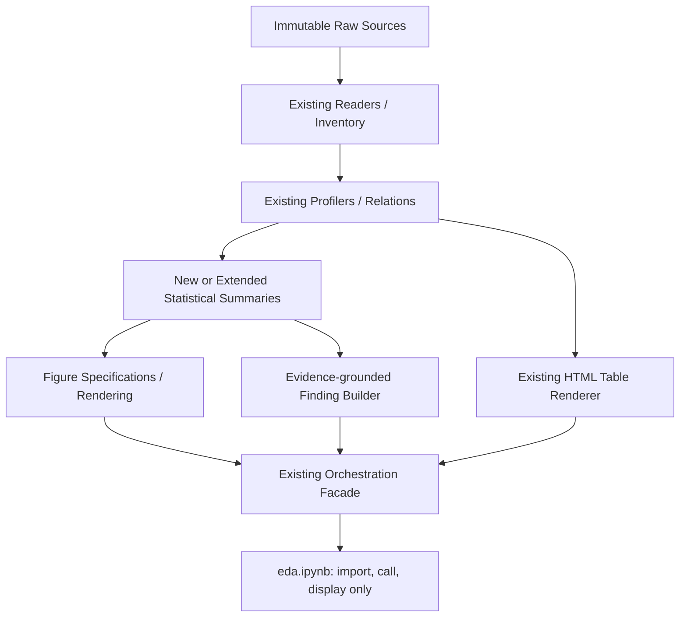
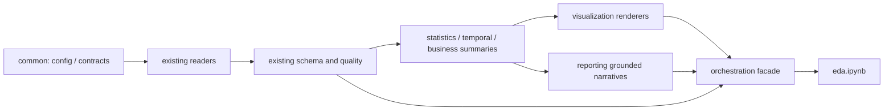
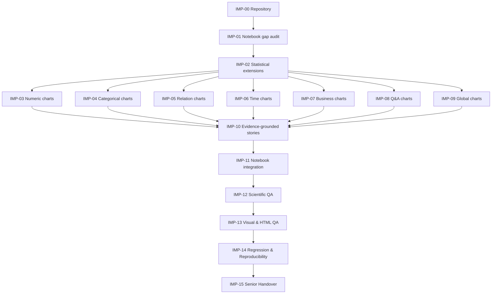
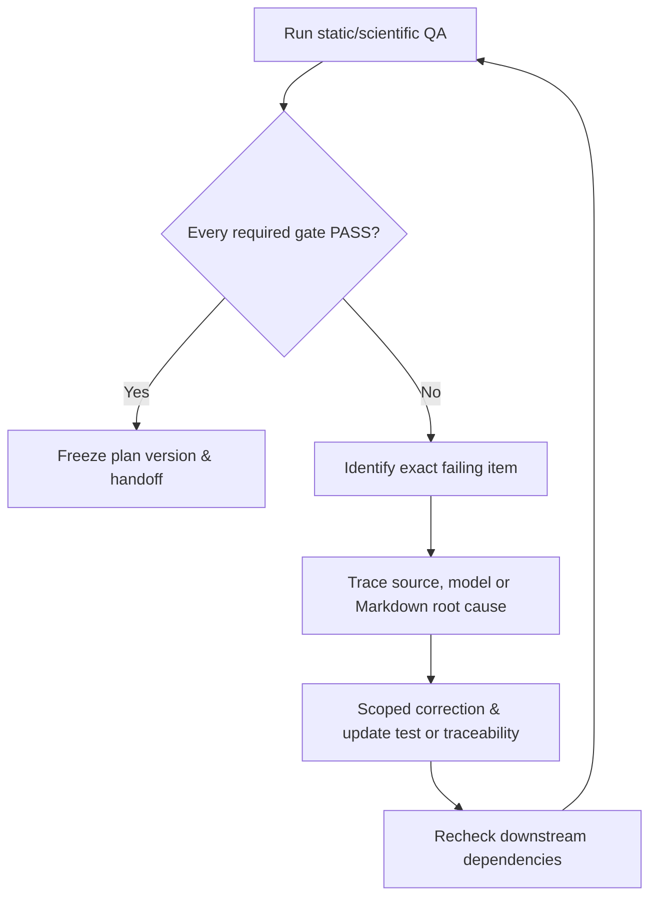

# DATAMATE — ADVANCED EDA VISUALIZATION & SCIENTIFIC DATA STORYTELLING IMPROVEMENT PLAN

**Project:** MEGAXIS_ZALO_AI_CHALLENGE · **Challenge:** DataMate — Talking To Your Data Through Agentic AI  
**Document class:** Scientific improvement plan · **Execution mode:** STRICT PLAN-ONLY · **Language:** Tiếng Việt  
**Status:** `PLANNED WITH DOCUMENTED BLOCKERS` — Notebook đính kèm đã kiểm toán; source sống trên Mac và Master Plan đã chỉnh sửa chưa truy cập trực tiếp.  
**Đích đặt file trên Mac:** `/Users/voanhnhat-ticoder-coder/Documents/ZALO_CHALLENGE/EDA_Data/plan/plan_detail/eda/plan_eda_visualization_improvement.md`  
**Absolute non-goals:** Không sửa raw data; không viết/sửa Python modules, không sửa `eda.ipynb`, không chạy toàn bộ EDA, không cài dependencies, không sửa raw datasets, không huấn luyện Agent, không tạo submission.

> **Quy tắc ưu tiên nguồn:** (1) file trực tiếp trên Mac sau khi Coding Agent kiểm tra; (2) Notebook `eda.ipynb` đính kèm và stored outputs; (3) Master Plan đã chỉnh sửa trên Mac; (4) previous `plan_eda.md` và forensic audit **chỉ làm tài liệu tham chiếu lịch sử**; (5) thể lệ và rulebook từng split. Mọi chênh lệch phải ghi vào discrepancy ledger; không tự thay thế bản mới bằng bản cũ.

## Mục lục
- [A. Executive Summary](#a-executive-summary)
- [B. Current DataMate EDA Context](#b-current-datamate-eda-context)
- [C. Repository & Source Inventory](#c-repository--source-inventory)
- [D. Existing Notebook Full Audit](#d-existing-notebook-full-audit)
- [E. Current Python Architecture](#e-current-python-architecture)
- [F. Existing Artifact & HTML Table Audit](#f-existing-artifact--html-table-audit)
- [G. Data Coverage & Statistical Gaps](#g-data-coverage--statistical-gaps)
- [H. Numerical Statistical EDA Improvement](#h-numerical-statistical-eda-improvement)
- [I. IQR, Outliers & Robust Statistics](#i-iqr-outliers--robust-statistics)
- [J. Categorical EDA Improvement](#j-categorical-eda-improvement)
- [K. Bivariate & Multivariate EDA](#k-bivariate--multivariate-eda)
- [L. Correlation & Association Analysis](#l-correlation--association-analysis)
- [M. Temporal & Seasonality EDA](#m-temporal--seasonality-eda)
- [N. Business-Specific EDA](#n-business-specific-eda)
- [O. Question & Answer EDA](#o-question--answer-eda)
- [P. Cross-Business & Global EDA](#p-cross-business--global-eda)
- [Q. Complete Scientific Visualization Catalogue](#q-complete-scientific-visualization-catalogue)
- [R. Vietnamese Markdown & Data Storytelling](#r-vietnamese-markdown--data-storytelling)
- [S. HTML Table & Figure Design System](#s-html-table--figure-design-system)
- [T. Python Monorepo Extension Architecture](#t-python-monorepo-extension-architecture)
- [U. File-by-File Implementation Specification](#u-file-by-file-implementation-specification)
- [V. Jupyter Notebook Restructuring Blueprint](#v-jupyter-notebook-restructuring-blueprint)
- [W. Artifact & Report Architecture](#w-artifact--report-architecture)
- [X. Performance & Resource Strategy](#x-performance--resource-strategy)
- [Y. Testing, Verification & Regression Matrix](#y-testing-verification--regression-matrix)
- [Z. Detailed Implementation Roadmap, QA & Definition of Done](#z-detailed-implementation-roadmap-qa--definition-of-done)
- [Phụ lục 1. Business Coverage Ledger (44 doanh nghiệp)](#phụ-lục-1-business-coverage-ledger-44-doanh-nghiệp)
- [Phụ lục 2. Design-Phase Traceability (00–18)](#phụ-lục-2-design-phase-traceability-0018)
- [Phụ lục 3. Risk Register & Open Questions](#phụ-lục-3-risk-register--open-questions)
- [Phụ lục 4. Audit Evidence & Source Provenance](#phụ-lục-4-audit-evidence--source-provenance)

## A. Executive Summary

### A.1. Vấn đề và mục tiêu
Notebook hiện tại có cấu trúc Data Understanding tốt về kiểm kê và hiển thị HTML nhưng stored outputs tập trung ở bảng. Nhiệm vụ cải tiến là hình thành **báo cáo khoa học trực quan bằng tiếng Việt**, thể hiện: câu hỏi nghiên cứu → bằng chứng dữ liệu → phép thống kê → bảng → biểu đồ → diễn giải có provenance → hạn chế → kết luận, trong khi giữ nguyên mọi số liệu hợp lệ và ranh giới monorepo.

**Quan sát VERIFIED từ notebook đính kèm:** 34 cells (17 Markdown, 17 code), 17 section từ 00–16; code-cell execution counts lưu 1–17; 21 `display_data` HTML table outputs, 3 `execute_result`, 1 `stream`; không có `image/png`, `image/svg+xml` hoặc plotly widget trong stored outputs. `run_eda(config)` được gọi một lần, các bảng được hiển thị qua `run.table_html(table_id, split)`. Những quan sát này chỉ xác nhận **bản xuất đính kèm**, không chứng minh repository hiện tại không có chart modules.

**Bốn mục tiêu cần kiểm chứng bằng công việc triển khai tương lai:** (1) mở rộng thống kê phù hợp với từng semantic type; (2) biểu đồ có phương pháp và kiểm định; (3) nội dung giải thích tiếng Việt bám artifact; (4) Notebook gọn, dễ đọc, tách compute khỏi presentation. Đánh giá hiệu quả bằng coverage có điều kiện và trải nghiệm đọc của senior, không bằng số lượng hình tối đa.

### A.2. Provenance classes và cơ chế chặn suy đoán
`NOTEBOOK-STORED VERIFIED` = trực tiếp thấy trong cell/output đính kèm; `ARCHIVE VERIFIED` = đọc manifest archive hiện có; `HISTORICAL AUDIT` = báo cáo cũ chưa chạy lại; `TREE SNAPSHOT` = cây thư mục đã gửi trước (có thể cũ); `SOURCE CODE UNVERIFIED` = source `.py` chưa có bản sao; `LIVE MAC BLOCKED` = không truy cập Mac; `DESIGN PROPOSED` = đề xuất tương lai; `NOT APPLICABLE` và `BLOCKED` cho trường hợp thiếu nguồn/phương pháp. **Không đánh tráo `NOTEBOOK-STORED VERIFIED` thành `LIVE EXECUTION PASS`.**

### A.3. Read-only and rollback policy
Nhiệm vụ hiện tại chỉ tạo Markdown độc lập. Trong giai đoạn implementation tương lai: mọi file sinh mới thuộc output/artifacts, dữ liệu `raw_data/` được mount/read-only; tạo branch/commit checkpoint trước khi sửa mã, rollback ở phạm vi file thay đổi; không rollback/xóa raw data. Nếu source chưa khớp, dừng gate chứ không tự tạo lại cấu trúc.

## B. Current DataMate EDA Context

DataMate dùng CSV, Excel và SQLite của nhiều doanh nghiệp, gồm hai split `train` và `public_test`. Mỗi split có `questions.jsonl`, `calendar.csv`, `rulebook.md` riêng; chỉ Train có `answers.jsonl`. EDA là bước **Data Understanding**, không được sinh đáp án Public Test, lookup đáp án theo ID, huấn luyện Agent hoặc suy luận rằng mọi câu hỏi đều trả lời được.

**Định nghĩa phân biệt bắt buộc:** `file count` khác `worksheet count`, `table row` khác `order count`, `order line` khác `invoice`, `transaction timestamp` khác `payment timestamp`, `revenue` khác `cash collected`, `stock snapshot` khác `inventory ledger`. Các chart sử dụng business metrics chỉ khi rulebook split + README + grain + join lineage được phê duyệt; nếu không, chart `BLOCKED` với lý do. Không lẫn dữ liệu các doanh nghiệp theo tên cột giống nhau.

**Cảnh báo đặc thù:** Notebook Scientific Summary lưu 30/30 Train businesses có report entry nhưng 3/30 trạng thái `PARTIAL` (`biz_103`, `biz_118`, `biz_130`); đây không phải 30/30 business KPI đã kiểm toán. `relations = [r for r in run.bundle('train').relations if r.status == 'APPROVED']` cho output `2`, trong khi summary nói tới 237 *candidate join relations* chưa được phê duyệt. Không tính business KPI qua những candidate joins chỉ vì tồn tại trong registry.

## C. Repository & Source Inventory

### C.1. Canonical paths, chưa tự xác minh live

| Role | Absolute path on user's Mac | Trạng thái |
|---|---|---|
| Workspace root | `/Users/voanhnhat-ticoder-coder/Documents/ZALO_CHALLENGE/EDA_Data` | `LIVE MAC BLOCKED` |
| Existing master plan | `.../EDA_Data/plan/plan_detail/eda/plan_eda.md` | `LIVE MAC BLOCKED`; **không được ghi đè** |
| New improvement plan | `.../EDA_Data/plan/plan_detail/eda/plan_eda_visualization_improvement.md` | `DESIGN PROPOSED` |
| Notebook | `.../EDA_Data/src/eda/notebook/eda.ipynb` | **Attached copy VERIFIED**; local parity `BLOCKED` |
| Module source | `.../EDA_Data/src/eda/script` | Tên `script`, **không phải `scripts`** |
| Raw data | `.../EDA_Data/raw_data/train` và `.../EDA_Data/raw_data/public_test` | `TREE SNAPSHOT`, phải kiểm tra local |
| Artifacts | `.../EDA_Data/src/eda/artifacts` | Có trong stored `EdaConfig`, **live chưa xác minh** |

### C.2. Source-of-truth inspection protocol (Coding Agent thực hiện trong tương lai)
1. `pwd`, `git status --short --branch`, `find . -maxdepth 4 -type f` nhưng loại `.git`, `.venv`, caches, generated reports.
2. Đọc `README.md`, mọi `AGENTS.md`, `.cursor/rules`, `.gemini` project instructions **nếu có**, Master Plan gốc, config và test. Nếu hướng dẫn mâu thuẫn, ghi conflict và ưu tiên chỉ dẫn project owner còn hiệu lực.
3. Liệt kê thực tế `src/eda/script`, `src/eda/notebook`, `src/eda/artifacts`, `src/eda/reports`, `src/eda/figures`; đối chiếu cây thư mục và Notebook copy; **không mặc định thư mục vắng trong snapshot là vắng hiện nay**.
4. Hash notebook local và bản copy; so sánh source cells (không so sánh output byte với nghĩa semantic nếu timestamp khác). Kiểm tra registry thực tế, public interfaces, test coverage, import path, runtime configs.
5. Liệt kê và xác nhận `train.zip`/`public_test.zip` hoặc extracted directories; không giải nén lại nếu manifest extracted đã đầy đủ. Dùng SQLite read-only. Phải trả về matrix `EXISTING / REUSE / EXTEND / NEW / BLOCKED`, tuyệt đối không tạo duplicate modules.

### C.3. Archive baseline (metadata only)
| Mục | Train | Public Test | Evidence |
| --- | --- | --- | --- |
| Businesses | 30 | 14 | HISTORICAL AUDIT + archive manifest |
| Total files | 162 | 97 | ZIP member list rechecked |
| Excel workbooks | 107 | 69 | ZIP member extension |
| Excel worksheets | 302 | 136 | HISTORICAL AUDIT; chưa scan lại ở lần này |
| CSV | 21 | 11 | ZIP member extension |
| SQLite databases | 1 | 1 | ZIP member extension |
| SQLite tables | 17 | 17 | HISTORICAL AUDIT |
| Questions | 3.000 | 1.000 | HISTORICAL AUDIT |
| Reference answers | 3.000 | Không phát hành | HISTORICAL AUDIT / rulebook |

Các con số là **baseline reference để reconciliation**, không phải phép EDA mới. Trong implementation, tái xác minh manifest và object registry; source/rows khác thì cập nhật coverage ledger, không ép số liệu mới khớp benchmark cũ.

## D. Existing Notebook Full Audit

### D.1. Toàn bộ 34 cells — forensic mapping
File đính kèm có 17 Markdown headings (`## 00`–`## 16`) xen kẽ 17 code cells, execution counts 1 đến 17. `run_eda(config)` gọi tại code cell 3, `run.table_html` gọi tổng 21 lần ở 13 code cells. **21 outputs đều HTML tables; không có embedded plot outputs.** Các mô tả/nhận xét bên dưới lấy từ *stored output* chứ không xác minh runtime mới.

| Section | Code cell index (0-based) | Observed API | Table IDs | HTML outputs | Figure | Nội dung đã thấy |
| --- | --- | --- | --- | --- | --- | --- |
| 00 | 1 | config | — | 0 | 0 stored figures | Khởi tạo config, tìm `src/eda/script`, import `run_eda` |
| 01 | 3 | `run_eda(config)` | — | 0 | 0 stored figures | Tạo run, trả run_id |
| 02 | 5 | `run.table_html` | TBL01, TBL02, TBL03, TBL04 | 4 | 0 stored figures | Inventory, sheets, SQLite |
| 03 | 7 | `run.table_html` | TBL05, TBL12 | 2 | 0 stored figures | Schema, join candidates |
| 04 | 9 | `run.table_html` | TBL06, TBL07, TBL08, TBL19 | 4 | 0 stored figures | Missing, duplicates, invalid, findings |
| 05 | 11 | `run.table_html` | TBL09 | 1 | 0 stored figures | Numerical summaries |
| 06 | 13 | `run.table_html` | TBL10 | 1 | 0 stored figures | Categorical frequency |
| 07 | 15 | `run.bundle` | — | 0 | 0 stored figures | Đếm APPROVED relations; stored output = 2 |
| 08 | 17 | `run.table_html` | TBL11 | 1 | 0 stored figures | Temporal registry |
| 09 | 19 | `run.table_html` | TBL13, TBL14 | 2 | 0 stored figures | Business/KPI catalog |
| 10 | 21 | `run.table_html` | TBL15 | 1 | 0 stored figures | Train question/answer metadata |
| 11 | 23 | `run.table_html` | TBL15 | 1 | 0 stored figures | Public question metadata |
| 12 | 25 | `run.table_html` | TBL16 | 1 | 0 stored figures | Split rulebook diff |
| 13 | 27 | `run.table_html` | TBL17 | 1 | 0 stored figures | Cross-business semantic role |
| 14 | 29 | `run.table_html` | TBL18 | 1 | 0 stored figures | Global coverage |
| 15 | 31 | `run.table_html` | TBL20 | 1 | 0 stored figures | Phase gate ledger |
| 16 | 33 | `load_registry`/`global_report` | — | 0 | 0 stored figures | Scientific summary, limited to stored report |

### D.2. Gap classification — tránh viết lại những gì đã có
| Loại | Định nghĩa | Trường hợp điển hình | Future action |
|---|---|---|---|
| IMPLEMENTED + RENDERED | Logic và output đều xuất hiện | Các bảng TBL01–TBL20 | Reuse, thêm cách đọc và chart |
| IMPLEMENTED BUT UNVERIFIED SOURCE | Thấy output, chưa xem mã `.py` | Numeric statistics / rulebook registry | Audit source trước khi bổ sung |
| STORED FIGURE ABSENT | Không có hình trong notebook đính kèm | Mọi section | Kiểm tra chart registry hiện có trên Mac |
| RENDERING GAP | Dữ liệu phân tích có nhưng không giải thích trực quan | 05, 06, 08, 13 | Chart + captions + findings |
| LOGIC/SCIENTIFIC GAP UNVERIFIED | Không thể xác định chỉ từ Notebook | Association, robust quantiles, all join gates | Đọc source + artifacts trước khi gọi là thiếu |
| PARTIAL / BLOCKED | Không đủ dữ liệu/quan hệ hoặc gate chưa pass | 3 Train businesses, candidate joins | Đào sâu provenance, không ép chart |

### D.3. Bất thường đáng ưu tiên
- Section 07 hiện cho biết `2` quan hệ `APPROVED`, **chưa phải bảng hệ số tương quan**; không vẽ correlation heatmap tùy ý trên candidate joins.
- Section 16 summary nói `27 PASS / 3 PARTIAL` cho Train; `720 high` findings (trên 1.263 findings) là **phân loại trong stored registry**, không phải 720 giao dịch sai được xác minh. Cần phân loại candidate relation/structural-missing trước khi viết nhận xét.
- TBL05 có ~2.317 hàng data, TBL10 có 5.000, TBL19 có 1.263 và TBL17 có ~1.338: rất dài cho Notebook trình bày. Tách bảng overview + top critical + cách truy cập full artifact; không bỏ số liệu gốc.
- Nhiều bảng trong Notebook chỉ gọi `split='train'`; Public Test hiện chỉ hiển thị riêng `TBL15('public_test')` ở section 11 và tổng hợp chung. Kế hoạch chart và table bổ sung phải có tab/split selection rõ, không gộp quy tắc Train/Public.
- Static Markdown hiện mô tả mục đích bằng tiếng Anh; thêm narrative tiếng Việt bằng dữ liệu thật, nhưng **không ghi trước kết luận phân phối**.

## E. Current Python Architecture

**Điều đã đọc từ notebook:** `common.config.load_config`, `common.config.config_to_dict`, `orchestration.pipeline.run_eda`, `run.table_html`, `run.bundle`, `reporting.artifact_registry.load_registry`, `run.global_report`. **Điều chưa đọc:** các file `.py` thực tế, dependency graph, `run` object implementation, tests, renderer CSS, storage schema. Danh sách dưới đây chỉ là *public surfaces observed*, không đồng nghĩa source đã được audit.



**Dependency rule:** `common` độc lập; `readers/inventory` → `schema/profiling` → `quality/statistics/temporal/business` → `visualization/reporting` → `orchestration` → Notebook. Rendering tuyệt đối không tự query raw data hoặc chạy business calculations. Vòng phụ thuộc và import hidden sẽ làm EXIT GATE 12 FAIL. Không tự áp đặt Nx, Poetry, uv hoặc UI framework mới.

**Reuse-first:** nếu đã có `statistics/numeric_*.py` hoặc `visualization/chart_*.py` thực tế thì extend module/adapter hiện có và điều chỉnh plan; chỉ tạo mới khi đã chứng minh không có trách nhiệm tương đương. Các file được đề xuất ở U đều ghi `PROPOSED / REUSE-OR-EXTEND`.

## F. Existing Artifact & HTML Table Audit

**API observed:** `run.table_html(table_id, split)` và `load_registry(run.output_root)`. Không biết renderer internals, chart registry hoặc cache schema thực tế; cần xem source. Đối với mỗi `TBLxx`, audit: bảng hiển thị là summary, detail hay row-limited; có hash/source_id, split, business, row total, sampling, chart-compatible aggregate, full artifact link/file hay không.

**Observed registry (stored HTML labels):**

| ID | Observed title | Lớp dữ liệu / nơi render |
| --- | --- | --- |
| TBL01 | Project Overview | split-level coverage |
| TBL02 | Source Inventory | file manifest |
| TBL03 | Sheet Registry | workbook/sheet detail |
| TBL04 | SQLite Registry | table/view listing |
| TBL05 | Column Metadata | semantic and physical typing |
| TBL06 | Missing Values | missing count/ratio by field |
| TBL07 | Duplicates | duplicate classes |
| TBL08 | Invalid Values | validation findings |
| TBL09 | Numeric Statistics | mean/median/std/quantiles |
| TBL10 | Categorical Statistics | category/share |
| TBL11 | Temporal Profile | event role/coverage |
| TBL12 | Relationship and Fanout | join candidates |
| TBL13 | Business Profile | business coverage |
| TBL14 | KPI Catalogue | rule-aware definitions |
| TBL15 | Question and Answer Metadata | per-split metadata |
| TBL16 | Rulebook Comparison | rule differences |
| TBL17 | Cross-business Schema Comparison | field-role presence |
| TBL18 | Global Summary | split and business coverage |
| TBL19 | Findings and Evidence | quality findings |
| TBL20 | Coverage and Gate Status | phase status |

**Yêu cầu cải tiến:** `table overview` hiển thị <= 25–50 dòng theo cấu hình, có sort/filter ở backend và provenance; `full detail` xuất artifact riêng, truy xuất offline và không làm notebook nặng. Khi bảng giữ nguyên method `run.table_html`, bổ sung renderer `run.figure(...)`/`run.findings(...)` **chỉ là interface proposal**, phải xem thực tế facade để chọn tên hàm. Không ghi raw khách hàng hoặc thông tin cá nhân lên biểu đồ/HTML.

## G. Data Coverage & Statistical Gaps

### G.1. Data-to-visualization eligibility gate
Đánh giá mỗi `(split, business_id, source_id, sheet/table, field, semantic_role)` theo:
1. **Bằng chứng nguồn:** file/sheet tồn tại, đọc được, hash và grain xác định; tên file mojibake được map chứ không sửa raw.
2. **Phân loại semantics:** `numeric_measure`, `numeric_id`, `categorical`, `ordinal`, `temporal`, `monetary`, `quantity`, `text`, `boolean`, `code`, `unknown`. Mặc định `numeric_id` không đủ điều kiện histogram/Pearson.
3. **Eligibility:** số giá trị hợp lệ, unique ratio, missing ratio, unit, dynamic range, sampling bias, date role, join cardinality, rulebook dependency.
4. **Status:** `APPLICABLE`, `NOT APPLICABLE`, `MISSING INPUT`, `UNVERIFIED`, `PROPOSED`, `BLOCKED`. Ghi reason và required evidence. Không xem N/A là lỗi.
5. **Traceability:** mỗi chart nối đến `source_ids`, `profile_artifact`, `metric_id`, `figure_id`, `finding_id`; chart có raw population và filter description.

### G.2. Statistical Gap Matrix (current = visible display, not backend truth)
| Statistical domain | Notebook hiện cho thấy | Gap cần kiểm tra trong source | Thứ tự triển khai |
| --- | --- | --- | --- |
| Numeric distribution | TBL09 full summary | Histogram/ECDF/quantile, skewness, MAD, robust CV, zero ratio | P0 |
| Outlier | Summary / validity tables | IQR vs MAD, denominator, signed quantities, logical exceptions | P0 |
| Categorical | TBL10 frequency | Top-k, Pareto, entropy when meaningful, split-safe proportions | P0 |
| Join/association | TBL12 relations, 2 approved printed | Approved same-grain correlation and association, no fanout | P0 |
| Time | TBL11 coverage | Date role charts, event density, seasonality caution | P0 |
| Business-specific | TBL13/TBL14 | Per-business appropriate chart and honest N/A | P0 |
| Train/Public questions | TBL15 per split | Question length, intent uncertainty, coverage gaps | P1 |
| Cross-business | TBL17/TBL18 | Comparable semantic roles + coverage | P1 |
| Scientific narrative | English static paragraphs + summary stream | Vietnamese grounded findings, evidence links, limitations | P0 |
| Rendering | 21 very large HTML outputs | Bounded overview, lazy detail, figure offline export | P0 |

### G.3. Coverage denominator discipline
`coverage_file = inspected_files / discovered_files`; `coverage_sheet = inspected_sheets / discovered_sheets`; `chart_eligibility = eligible_field_slices / considered_field_slices`; `chart_completion = rendered_and_validated / eligible_planned_charts`; **mọi denominator phải công bố**. Không dùng `chart_count / total_columns` vì nhiều cột là ID, text hay không hợp lý. Không cộng số hàng của các bảng khác grain để nói tổng giao dịch.

## H. Numerical Statistical EDA Improvement

**Population và semantic guards:** Từ column metadata, chỉ chọn numeric measurements/monetary/quantities được hiểu rõ. Mỗi metric có `source_id`, `grain`, `population_filter`, `n_total`, `n_valid`, `n_missing`, `unit`, `method`, `precision`, `status`. ID/IMEI/số điện thoại/mã sản phẩm **không** được tính mean/std/correlation.

**Phương pháp:** mean, sample/population variance (nêu `ddof`), std, median, mode nếu meaningful, min/max, quantiles p01/p05/p25/p50/p75/p95/p99, IQR, MAD (raw vs normalized factor ghi rõ), skewness/kurtosis (nêu convention), zero/negative rates, right-tail sensitivity, quantile spread. `CV=std/abs(mean)` chỉ dùng khi ratio-scale, `|mean|` không gần 0; tránh so sánh CV với biến âm/hai phía không có ý nghĩa. Quantile trên stream phải ghi exact/approx method và error bound; summary chart dùng cùng metric source.

**Histogram:** bin bằng Freedman–Diaconis `h=2*IQR*n^(-1/3)` khi hợp lệ, fallback Scott/Sturges/định nghĩa miền khi IQR 0; không tạo quá nhiều bins nếu discrete. So sánh full vs sampled với metadata. **KDE:** chỉ với biến gần liên tục và mẫu hợp lý; nêu bandwidth. **ECDF:** có thể dùng với discrete, thể hiện đúng bước nhảy. **Violin:** cẩn thận nội suy density trên dữ liệu rời rạc. **Log:** chỉ nếu `x>0` hoặc sử dụng symmetric log với signed data có lý do; không impute 0 chỉ để log.

**Kiểm định:** trên fixture có số 0, âm, null, giá trị lặp, outlier đơn, phân phối đa mode; reconciliation n_total = valid+missing+invalid theo định nghĩa disjoint; biểu đồ histogram bin sum phải bằng số quan sát được đưa vào (trừ explicit excluded). Tất cả findings cần n và đơn vị.

## I. IQR, Outliers & Robust Statistics

Với giá trị numeric hợp lệ (sau **lọc ngữ nghĩa**, không loại bừa số âm), tính:

\[Q_1 = Q_{0.25},\quad Q_3=Q_{0.75},\quad IQR=Q_3-Q_1\]
\[L=Q_1-1.5 IQR,\quad U=Q_3+1.5 IQR\]
\[r_{out}=\frac{\#\{x_i < L\;\text{hoặc}\;x_i > U\}}{n_{valid}}\]

**Special cases:** `n_valid=0` → N/A; `IQR=0` → flagged as degenerate, không mặc định mọi khác biệt là lỗi; repeated integer-valued counts cần chính sách rời rạc; signed revenues/returns có thể hợp lệ. **MAD** = median absolute deviations from median; robust z = `0.67449*(x-median)/MAD` chỉ khi `MAD>0`, ngưỡng phải công bố là convention. Xuất bảng threshold, upper/lower counts, raw sample (masked), per-group stratification, impact of extreme values on mean vs median. Không loại bản ghi outlier khi EDA; so sánh distribution full và clipped *view* (nếu dùng) phải ghi n excluded, không biến đổi file gốc.

**Định nghĩa bất thường:** `STATISTICAL FLAG ≠ INVALID RECORD ≠ BUSINESS-RULE VIOLATION`. Không dùng IQR thay cho rulebook. Mỗi flagged group phải có evidence IDs, reasons và status awaiting semantic validation. Gate PASS khi tính IQR/ratio tái hiện được từ numerical summary và figure annotation.

## J. Categorical EDA Improvement

Với categorical/ordinal/boolean/text-derived candidate đã được xác nhận, tính `n_total`, `n_nonnull`, `n_unique`, top-k counts, proportions với mẫu số nêu rõ, null/unknown/others tách biệt, rare tail, entropy tùy loại, status-code coverage, alias candidates theo README. Không tự merge `Sữa A` và `SUA A` nếu chưa có quyết định nghiệp vụ; **tên nhóm đã chuẩn hóa chỉ dùng cho hiển thị nếu phép gộp hợp lệ**.

Chart: horizontal bar for top-k (sorted và ties deterministic), Pareto với cumulative share lấy đúng denominator, categorical missingness, group composition, cardinality and imbalance. Với high cardinality tránh 5000 nhãn, chỉ top 15 hoặc top 20 + Others, đủ tổng count bằng n valid; nếu top-k ties, tie-break deterministic và ghi lý do. Ordinal giữ trật tự nghiệp vụ, không sort chữ cái mặc định. Dữ liệu cá nhân ở cấp khách hàng không render identifiers; chỉ dùng tổng hợp được phép.

## K. Bivariate & Multivariate EDA

### K.1. Eligibility before association
Chỉ tính quan hệ khi các biến cùng grain ở cùng source hoặc qua **APPROVED join đã chứng minh cardinality**. Lập `relationship audit`: source keys, null keys, duplicate keys, matched/unmatched, row multiplication (`fanout = joined_rows / original_rows` nếu có nghĩa), filter conservation, order/line grain. Không biến một quan hệ candidate thành approved bằng cách thử xem chart đẹp không.

### K.2. Các nhóm
- Numeric–numeric: scatter cho n nhỏ, hexbin/density cho n lớn, trend line với assumptions nêu rõ; cảnh báo spurious correlation do time trend.
- Categorical–numeric: group medians/quantiles, box/violin, sample sizes riêng; nhóm quá ít n gộp `Other` có giải thích.
- Categorical–categorical: crosstab counts hoặc row/column percentages, Cramér's V nếu test assumptions phù hợp.
- Multivariate: feature eligibility matrix, pairplot 3–6 biến, faceted small multiples có đơn vị; PCA *only if* có câu hỏi nghiên cứu, scaling và missing policy, không mặc định bắt buộc.

**Statistical tests không chạy để trang trí:** nếu ANOVA/Kruskal/chi-square được đề xuất, nêu H0, assumptions, multiple testing correction, effect size, confidence interval và sampling design; không biến p-value thành bằng chứng nhân quả.

## L. Correlation & Association Analysis

- **Pearson**: covariance tuyến tính cho two quantitative variables, nặp pairwise đầy đủ, zero variance → undefined; Spearman (rank monotonic) khi phù hợp; Kendall tau-b cho nhiều ties/small ranks (chi phí O(n log n) hoặc phù hợp algorithm).
- **Cramér's V**: `sqrt(chi2/(n*min(r-1,c-1)))`; sử dụng correction for bias khi cần, thận trọng small expected cell counts; ordinal association có thể cần phương pháp khác.
- **Heatmap contract**: mỗi cell (metric, pair, sample n, missing policy, significance/effect interpretation), mask n nhỏ/undefined, axes Vietnamese labels + units, symmetric matrix and diagonal checks; cấm tuyệt đối numeric ID trong correlation.
- **Cross-business**: correlation trong từng business trước; chỉ meta-compare effect sizes nếu hai biến/units/grain và event windows tương thích; không gộp dòng thô hai shop để tạo “global correlation”.
- **Interpretation**: hệ số khác 0 không chứng minh causal; mạnh/yếu không tự dùng threshold tùy ý, lưu `threshold_definition`, uncertainty và sample selection.

**Check:** test synthetic independent and perfectly correlated data; null and constant columns; n<3; switch Pearson/Spearman; fanout negative case must return `BLOCKED` rather than numeric correlation.

## M. Temporal & Seasonality EDA

Date fields phải có `event_role`: order, order_line, payment, return, delivery, stock_snapshot, inventory_movement, registration, expiry, question_as_of. Không thay các thời điểm này cho nhau. Dựa trên `calendar.csv` của split để xác nhận weekday, lunar date/Tết, leap lunar months; không dùng ngày local hiện tại thay `as_of_date`.

**Chart candidates:** coverage timeline, event density/day, weekly/monthly counts, day-of-week profiles with denominator, month-of-year heatmap, missing periods versus no activity, question as-of coverage, holiday window plots, payment-vs-order timestamp lag. Chọn endpoint interval rõ `[start,end]`; quy tắc `last N days` bao gồm as_of, week Monday-start, current month truncates to as_of; previous-month comparable period theo rulebook.

**Seasonality gate:** đòi nhiều chu kỳ và đủ coverage; 1–2 năm dữ liệu phân mảnh không tự chứng minh seasonal signal. Tháng có 0 hoạt động chỉ là zero nếu kỳ có coverage và shop hoạt động được chứng minh; kỳ ngoài dữ liệu → missing/out-of-scope. Đánh dấu censored window khi as-of cắt một tháng; không so nó với toàn tháng đủ 30 ngày mà không chuẩn hóa.

## N. Business-Specific EDA

Các khả năng nghiệp vụ dưới đây là **candidate families**; chỉ render khi từng business thật sự có cột, quan hệ và rulebook tương ứng.

| Family | Data prerequisites | Suitable charts | Blocking evidence |
|---|---|---|---|
| Revenue/orders | Order/event date, amount, status, rulebook | Amount histogram, order value quantiles, cancellation mix, time series | Missing statuses / join fanout |
| Inventory | Stock quantity, unit conversion, snapshot date | Zero stock, stock level, value distribution, aging when timestamp exists | No reliable snapshot or unit ratio |
| Debt/payments | Order total/terms/payment events and rules | Outstanding amount, age buckets, payment lag | COD/e-commerce filters not resolved |
| Purchase/suppliers | Supplier ID, purchase lines, date/price | Purchase value dist, concentration, time | Missing supplier link |
| Pharmacy | Batch, expiry date, remaining qty, cost basis | Expiry window, batch counts, stock-risk | Batch ↔ stock/grain unresolved |
| Café/restaurant | POS line/order/product/category/service fee | Category mix, hourly order density, topping mix | Cannot distinguish topping/service fee |
| Building materials | UOM mappings, quantity, warehouse | Unit-converted quantities, inventory mix | Conversion unclear |
| Motorcycle repair | Visit row/plate/mechanic/service description | Visits over time, job-category distribution | Privacy, definition of visit/repair |
| Phones | Model, IMEI, warranty, instalment, trade-in | Model mix, warranty events, debt aging | IMEI PII, instalment vs revenue |
| Mother & baby | Product attributes and membership join | Product sizes/types, membership timing | Size semantics missing |

**Split rulebooks are different.** Train and Public cannot share derived KPI definitions without explicit semantic agreement; raw distributions may be compared at metadata level. Business-level scorecard must show `eligible chart count`, `blocked metrics`, `unsupported semantics`, `source evidence` and `business report coverage status`.

## O. Question & Answer EDA

**Question object:** `id`, `business_id`, `question`, `as_of_date`. Chỉ lấy Train references để mô tả answer metadata; Public không có labels. Mục tiêu là hiểu yêu cầu của Agent tương lai, **không sinh dự đoán**.

- Question length theo character, whitespace tokens và optional Vietnamese tokenization (ghi rõ tokenizer); share không dấu, lỗi viết tắt, date expression mix, ranking/top-k, multi-hop join indicators. Intent classification ghi `rule-based / manual-labeled / weak heuristic` và confidence, không biến heuristic thành ground truth.
- Train references: answer type bar, number vs percent absolute/signed/log plot có guards, list length, table sizes, alias count, unanswerable by valid taxonomy. Dữ liệu đáp án không được xuất raw lookup theo ID.
- Public: length, domain, time expression, question complexity; metadata-only comparison Train/Public; không tạo answer-type distribution giả định hoặc unanswerable labels cho Public.
- Leakage prevention: không annotate test câu hỏi bằng Train answers mang cùng template; không dùng reference ID để tạo logic chart/business rules; không lưu PII thô trong figures.

**Question-to-schema matrix** chỉ thể hiện *required capability vs available evidence* ở mức tổng hợp, có trạng thái UNVERIFIED/BLOCKED; không tự đặt nhãn đúng/sai của từng câu Public.

## P. Cross-Business & Global EDA

Tổng hợp **object coverage và schema heterogeneity** trước khi tổng hợp metric. Metric compatibility tuple: `(business_rule_semantics, grain, unit, period_definition, status_filter, currency, split)`; chỉ so khi tuple hoặc documented mapping tương đương. Không tính average revenue across businesses nếu không có câu hỏi phù hợp; không dùng `total_rows` làm tổng giao dịch; không chuẩn hóa tùy tiện mất ý nghĩa.

**Proposed global panels:** format composition, workbook/sheet density, data volume by business (gắn loại object), field-role presence matrix, missingness by business với denominator, date coverage gantt, quality finding severity by source, question style Train/Public, rulebook delta, eligibility matrix. Split views phải có chú giải: `metadata comparable` vs `business metric not comparable`. `PASS/PARTIAL/BLOCKED` phải dẫn nguồn actual registry, không lấy từ notebook output như lời khẳng định real-time.

## Q. Complete Scientific Visualization Catalogue

### Q.1. Mẫu hợp đồng chart chuẩn hóa — 26 trường (bao phủ 24 yêu cầu tối thiểu)
Mỗi hàng `Chart ID` bên dưới là **ChartSpec** đề xuất. Một spec hoàn chỉnh trong implementation có 26 trường, gồm: `chart_id`, `title`, `research_question`, `reason_for_inclusion`, `analysis_level`, `applicable_data_type`, `input_source_ids`, `input_columns`, `preprocessing_prerequisites`, `statistical_method`, `calculation_or_formula`, `chart_type`, `x_axis`, `y_axis`, `unit`, `grouping`, `sampling_strategy`, `missing_handling`, `outlier_handling`, `expected_interpretation`, `scientific_limitations`, `module_owner`, `artifact_output_path`, `notebook_section`, `tests`, `acceptance_criteria` (26 fields; nghiêm hơn 24 tối thiểu). Các trường không thể xác định từ README/metadata phải là `UNVERIFIED`, không để trống hoặc tự đoán.

**Contract inheritance (phải materialize đầy đủ trước khi plot):** Với mỗi chart, các trường lấy từ catalog row + `SourceSelection`: `source_ids` và `input_columns` phải resolve từ registry runtime, nếu không `MISSING INPUT`. Mặc định `sampling_strategy = FULL_AGGREGATION` cho count/quantile/ECDF khi khả thi, `DETERMINISTIC_BOUND` cho scatter/matrix n lớn; `missing_handling = EXCLUDE_FROM_MEASURE_WITH_COUNT` (không fill 0), `outlier_handling = RETAIN_AND_FLAG` (không tự xóa), `scientific_limitation = noncausal, data coverage and semantic uncertainty` cộng với caveat riêng; `grouping = business_id/split/field when applicable`; `artifact_output_path = src/eda/figures/<run_id>/<split>/<business_or_global>/<chart_id>.<ext>` được đề xuất, phải xem output_root hiện có; `tests/acceptance` từ verify column. **Không dùng một template chung cho mọi biến**; chart chỉ hợp lệ khi `SourceSelection` và eligibility PASS.

### Q.2. Catalog & chart-data-table mapping
| ID | Scope | Research question | Data population + roles | Metric/formula | Chart / axes | Unit | Prerequisite | Existing table | NB | Owner (proposed) | Verification |
| --- | --- | --- | --- | --- | --- | --- | --- | --- | --- | --- | --- |
| INV01 | split | Tỷ trọng định dạng | split/source manifest; split,file_type | count(source_id) | bar; x=format;y=file count | file | all files manifest | TBL02 | 02 | visualization/inventory_charts.py | sum bars=manifest count |
| INV02 | business | Độ lớn source | each business source; business_id,size_bytes | sum(file bytes), show median | horizontal bar; x=MB;y=business | MiB | exclude archive and artifacts | TBL02 | 02 | visualization/inventory_charts.py | sum bytes equals source manifest |
| INV03 | workbook | Độ phức tạp sheet | valid Excel workbooks; workbook,sheet | count(sheet) | bar+ECDF; x=sheets/workbook;y=workbook count | worksheets | workbook registry reliable | TBL03 | 02 | visualization/inventory_charts.py | sum sheets=registry |
| INV04 | database | Phân bố bảng SQLite | per sqlite db; db,table,row_count | table count and row count separate | horizontal bar; x=rows;y=table | rows/table | only SQLite table entries | TBL04 | 02 | visualization/inventory_charts.py | sum counts not called transactions |
| QUAL01 | field | Missing rate | source field; n_missing,n_total | n_missing/n_total | bar; x=ratio;y=field | % | null_kind understood | TBL06 | 04 | visualization/quality_charts.py | missing<=total |
| QUAL02 | table | Missingness matrix | selected rows+fields; missing mask | binary null indicator | raster heatmap; x=fields;y=bounded rows | binary | sampling stated, no PII | TBL06 | 04 | visualization/quality_charts.py | matrix mask matches inputs |
| QUAL03 | business | Missing per business | valid field profiles; business_id,missing,denom | weighted ratio by eligible field | grouped bar; x=business;y=weighted ratio | % | same field universe defined | TBL06 | 09 | visualization/quality_charts.py | denominator recorded |
| QUAL04 | source | Duplicate classes | source records; duplicate_class,count | n per class | stacked bar; x=business;y=rows | rows | overlap classes explained | TBL07 | 04 | visualization/quality_charts.py | class counts match registry |
| QUAL05 | source | Invalid rules | source/rule; rule_id,invalid_count,denom | violations per checked rule | bar; x=rule;y=invalid rate | % | only validated constraints | TBL08 | 04 | visualization/quality_charts.py | rule-level counts verified |
| QUAL06 | business | Severity mix | quality findings; severity,business | count(finding_id) | stacked bar; x=business;y=findings | findings | severity classification known | TBL19 | 15 | visualization/quality_charts.py | sum matches registry |
| QUAL07 | relationship | Join fanout | candidate/approved relation profiles; join_keys,fanout,orphans | factor/unstable count | scatter; x=fanout;y=orphan share | factor,% | status shown; candidate never used for KPI | TBL12 | 07 | visualization/relationship_charts.py | candidate approval untouched |
| QUAL08 | business | Coverage gates | phase gate registry; gate,status | count per status | stacked bar; x=phase;y=count | gates | report snapshot timestamp | TBL20 | 15 | visualization/quality_charts.py | status totals match registry |
| NUM01 | field | Hình dạng phân phối | eligible numeric field; measure | histogram count | histogram; x=value;y=frequency | source unit | quantitative, bin policy | TBL09 | 05 | visualization/numeric_charts.py | bin sum=n_included |
| NUM02 | field | Mật độ liên tục | eligible continuous field; measure | kernel density estimate | KDE; x=value;y=density | unit^-1 | not IDs/discrete; n & bw okay | TBL09 | 05 | visualization/numeric_charts.py | density normalized, bw noted |
| NUM03 | field | Phân vị và outlier | eligible numeric field; measure | median Q1 Q3 whiskers | boxplot; x=measure;y=group | source unit | IQR semantics verified | TBL09 | 05 | visualization/numeric_charts.py | box quartiles=stats |
| NUM04 | group | Đối chiếu density | category+continuous measure; measure,group | KDE per group | violin; x=group;y=value | source unit | each n sufficient; no discrete misuse | TBL09 | 05 | visualization/numeric_charts.py | group quantiles reconcile |
| NUM05 | field | Phân phối tích lũy | numeric measure; measure | F_n(x)=count<=x/n | ECDF; x=value;y=cumulative prob | unit,% | valid numeric sample | TBL09 | 05 | visualization/numeric_charts.py | end=1 & monotonic |
| NUM06 | field | Hồ sơ phân vị | numeric measure; q01..q99 | quantiles | quantile dot/line; x=percentile;y=value | source unit | method exact/approx disclosed | TBL09 | 05 | visualization/numeric_charts.py | q monotonic |
| NUM07 | field | Outlier IQR | numeric measure; Q1,Q3,value | outside IQR bounds | threshold scatter; x=index/quantile;y=value | source unit | IQR non-degenerate | TBL09 | 05 | visualization/numeric_charts.py | outlier_n matches summary |
| NUM08 | field | Linear vs log view | positive heavy-tail measure; measure | same observations on linear/log axes | paired dist; x=value;y=count | source unit | strict positive or signed symlog | TBL09 | 05 | visualization/numeric_charts.py | same source population count |
| CAT01 | field | Tần suất nhóm | categorical; category,count | frequency | horizontal bar; x=count;y=category | rows | limited k+Others | TBL10 | 06 | visualization/categorical_charts.py | sum categories=n |
| CAT02 | field | Top-k danh mục | categorical; category,count | top 15 by count | bar; x=count;y=top-k category | rows | ties deterministic | TBL10 | 06 | visualization/categorical_charts.py | topk+others full count |
| CAT03 | field | Tỷ trọng thành phần | bounded categorical; category,count | count/denom | 100% stacked bar; x=category;y=share | % | consistent denominator | TBL10 | 06 | visualization/categorical_charts.py | sum shares=1 |
| CAT04 | field | Pareto categories | nonhigh-cardinality category; category,count | cum sum descending | bar+line; x=category;y=count,cum share | rows,% | stable ranking | TBL10 | 06 | visualization/categorical_charts.py | last cum=100% |
| CAT05 | field | Cardinality profile | all categorical fields; field,nunique | n_unique per field | dot; x=field;y=n_unique | categories | no PII labels | TBL05 | 06 | visualization/categorical_charts.py | unique matches registry |
| CAT06 | field | Imbalance category | categorical; category,count | max share, entropy if valid | bar; x=field;y=max category share | % | n >= threshold | TBL10 | 06 | visualization/categorical_charts.py | max share matches table |
| CAT07 | group | Category across groups | comparable category; group,category,count | share by group | grouped bar; x=group;y=share | % | same semantic category | TBL10 | 06 | visualization/categorical_charts.py | group sums=1 |
| CAT08 | field | Missing categorical | categorical; missing,unknown,valid | mutually exclusive status counts | stacked bar; x=field;y=share | % | unknown/null rules defined | TBL06 | 06 | visualization/categorical_charts.py | status sum=total |
| REL01 | source | Scatter measures | same grain numeric pair; x,y | paired numeric values | scatter; x=measure_x;y=measure_y | specified units | APPROVED join or same source | TBL12 | 07 | visualization/relationship_charts.py | n_pairwise exact |
| REL02 | source | Large data density | same grain numeric pair; x,y | bin2d(count) | hexbin; x=measure_x;y=measure_y | units for both | n large, safe sampling | TBL12 | 07 | visualization/relationship_charts.py | hex bin sum=n |
| REL03 | table | Pearson correlation | eligible numeric columns; numeric pair | Pearson r | heatmap; x=variable;y=variable | unitless | zero variance check | TBL05 | 07 | visualization/relationship_charts.py | symmetric r in [-1,1] |
| REL04 | table | Spearman correlation | eligible ordered measures; numeric pair | rank rho | heatmap; x=variable;y=variable | unitless | ties/missing documented | TBL05 | 07 | visualization/relationship_charts.py | rank rho range |
| REL05 | table | Kendall correlation | eligible ordered pair; numeric/ordinal pair | tau-b | matrix; x=variable;y=variable | unitless | n and ties acceptable | TBL05 | 07 | visualization/relationship_charts.py | tau bounds |
| REL06 | group | Continuous by category | same grain group+measure; category,value | group quantiles | box/violin; x=group;y=measure | source unit | min n per group | TBL10 | 07 | visualization/relationship_charts.py | median by group matches table |
| REL07 | group | Crosstab association | same grain cat pair; categoryA,categoryB | crosstab share | heatmap; x=catA;y=catB | count/% | no extreme cardinality | TBL10 | 07 | visualization/relationship_charts.py | sum crosstab=n |
| REL08 | group | Cramér V | same grain cat pair; categoryA,categoryB | chi2-based V | matrix; x=catA;y=catB | unitless | expected-count checks | TBL10 | 07 | visualization/relationship_charts.py | V in [0,1] |
| REL09 | table | Selected pairplot | 3-6 appropriate measures; numeric fields | scatter matrices | pairplot; x,y=pairwise measures | varied units | bounded dimensions | TBL09 | 07 | visualization/relationship_charts.py | individual n shown |
| REL10 | table | Missingness dependence | table fields; missing mask | pairwise co-missing ratio | heatmap; x=field;y=field | % | constant mask handling | TBL06 | 07 | visualization/relationship_charts.py | co-missing symmetric |
| TIME01 | business | Temporal coverage | date-typed sources; source,date_min,max | active intervals | gantt; x=date;y=source | date | event role known | TBL11 | 08 | visualization/temporal_charts.py | min/max matches TBL11 |
| TIME02 | business | Daily activity | event date per grain; event_date,record_id | records/day | line; x=day;y=count | records/day | not call all rows orders | TBL11 | 08 | visualization/temporal_charts.py | sum counts=event rows |
| TIME03 | business | Weekly activity | event date; week_start,valid rows | weekly counts | line; x=ISO week;y=count | records/week | ISO calendar boundary | TBL11 | 08 | visualization/temporal_charts.py | weekly totals=valid rows |
| TIME04 | business | Monthly activity | event date; YYYY-MM,valid rows | monthly count | bar; x=month;y=count | records/month | partial month marked | TBL11 | 08 | visualization/temporal_charts.py | monthly totals agree |
| TIME05 | business | Calendar heatmap | event day; date,count | activity density per date | calendar heatmap; x=weekday;y=week | records/day | calendar has full mapping | TBL11 | 08 | visualization/temporal_charts.py | day values align dates |
| TIME06 | business | Weekday profile | event date; weekday,count | counts and per-day averages | bar; x=weekday;y=average count | events/weekday | denom all eligible weekdays | TBL11 | 08 | visualization/temporal_charts.py | divide by calendar weekdays |
| TIME07 | business | Month of year | >=2 compatible years; month,year | within-year normalized count | small multiple; x=month;y=count | events/month | at least 2 comparable cycles | TBL11 | 08 | visualization/temporal_charts.py | exposure day corrected |
| TIME08 | business | Missing periods | coverage+expected cadence; expected_period | periods without records | timeline gap; x=date;y=gap status | periods | 0 vs missing distinguished | TBL11 | 08 | visualization/temporal_charts.py | gaps reconcile coverage |
| TIME09 | split | As-of coverage | questions + available data; as_of_date,source_coverage | request span vs data span | timeline; x=date;y=business | date | rulebook as_of semantics | TBL15 | 08 | visualization/temporal_charts.py | date range source verified |
| TIME10 | business | Lunar/holiday period | calendar + business events; solar,lunar,holiday,event | events in specified windows | annotated line; x=date;y=count | events/day | official calendar only | TBL11 | 08 | visualization/temporal_charts.py | holiday mapping verified |
| BUS01 | business | Order value distribution | approved order-grain amounts; order_id,amount,status | valid order amount | histogram; x=VND;y=order count | VND | rulebook and no fanout | TBL14 | 09 | visualization/business_charts.py | sum order count reconciles |
| BUS02 | business | Revenue trend | approved sale event; event_date,amount,status | rule-aware revenue/day | line; x=date;y=revenue | VND | split-specific revenue rule | TBL14 | 09 | visualization/business_charts.py | daily sum=KPI |
| BUS03 | business | Sales by product category | approved order lines+mapping; product,category,qty | qty by category | bar; x=category;y=qty | base unit | unit conversion validated | TBL14 | 09 | visualization/business_charts.py | quantity reconciles |
| BUS04 | business | Cancellation/return mix | approved status; status,order_id | count orders by status | stacked bar; x=status;y=orders | orders | returns may be all-order exclusion | TBL14 | 09 | visualization/business_charts.py | mutually exclusive status |
| BUS05 | business | Stock quantities | stock snapshot; product,qty,asof | qty distribution | ECDF; x=qty;y=cdf | base unit | snapshot and unit clear | TBL14 | 09 | visualization/business_charts.py | stock summaries match |
| BUS06 | business | Inventory value | stock and valid cost; stock,unit_cost | qty*cost by product | bar; x=category;y=value | VND | cost basis per rule | TBL14 | 09 | visualization/business_charts.py | total matches valid valuation |
| BUS07 | business | Debt distribution | approved receivables; invoice,payments,asof | debt balance/asof | histogram; x=debt;y=count | VND | customer debt semantics clear | TBL14 | 09 | visualization/business_charts.py | balances reconcile |
| BUS08 | business | Debt aging | approved due dates; due_date,balance,asof | sum by aging bucket | bar; x=aging bucket;y=VND | VND | due date and cutoff | TBL14 | 09 | visualization/business_charts.py | bucket totals=balance |
| BUS09 | business | Payment lag | order/pay events; order_date,payment_date | lag in days | histogram; x=lag days;y=count | days | payment-to-order relation approved | TBL14 | 09 | visualization/business_charts.py | no future invalid events |
| BUS10 | business | Purchase values | approved purchase event; purchase_id,amount | purchase total | histogram; x=purchase value;y=count | VND | grain and cost semantics | TBL14 | 09 | visualization/business_charts.py | sum matches cost ledger |
| BUS11 | business | Supplier concentration | supplier purchase; supplier_id,amount | share of purchase value | Pareto; x=supplier;y=amount/cum share | VND,% | supplier join approved | TBL14 | 09 | visualization/business_charts.py | cumulative=100% |
| BUS12 | pharmacy | Expiry by batch | batch stock; batch_id,expiry,qty | stock nearing expiry by window | bar; x=expiry window;y=qty | base units | lifetime qty not sales qty | TBL14 | 09 | visualization/business_charts.py | batch qty and windows verified |
| BUS13 | phone | Warranty events | phone sale/warranty; model,warranty_event | events vs sold denominator | bar; x=model;y=rate | % | IMEI protected, warranty semantics | TBL14 | 09 | visualization/business_charts.py | denominator valid |
| BUS14 | repair | Repair service mix | repair visit records; visit_id,service | visits by service | bar; x=service;y=visits | visits | work classification documented | TBL14 | 09 | visualization/business_charts.py | one visit counted once |
| BUS15 | mother_baby | Product attribute mix | valid product catalogue; category,size,type | counts by attribute | stacked bar; x=category;y=products | products | attributes not inferred from name | TBL14 | 09 | visualization/business_charts.py | catalogue sums verify |
| QNA01 | split | Question length | all questions; question | character/token lengths | histogram; x=length;y=count | chars/questions | token definition fixed | TBL15 | 10–11 | visualization/question_charts.py | sum bins=N questions |
| QNA02 | split | Diacritics/abbreviation | all questions; question | heuristic rates | bar; x=feature;y=questions | % | method uncertainty noted | TBL15 | 10–11 | visualization/question_charts.py | frequency <=1 |
| QNA03 | split | Intent taxonomy | labelled or weak labels; intent,question_id | freq per label/status | bar; x=intent;y=count | questions | heuristic flagged | TBL15 | 10–11 | visualization/question_charts.py | unclassified explicit |
| QNA04 | train | Answer types | train answers only; type | count(type) | bar; x=type;y=count | answers | reference only Train | TBL15 | 10 | visualization/question_charts.py | sum=3000 if manifest unchanged |
| QNA05 | train | List/table shape | train structured refs; list/table length | size distribution | bar; x=size;y=count | answers | no raw answer display | TBL15 | 10 | visualization/question_charts.py | counts reconcile |
| QNA06 | train | Alias and unanswerable | train refs; alias_count,type | frequency | bar; x=count type;y=count | answers | no inference lookup | TBL15 | 10 | visualization/question_charts.py | total counts correct |
| QNA07 | split | Train–Public question contrast | questions both splits; length,intent,time | normalized proportions | grouped bar; x=category;y=share | % | only compatible labels | TBL15 | 10–11 | visualization/question_charts.py | per split sums=1 |
| GLOBAL01 | global | Business format mix | source manifests; split,business,format | count files | grouped bar; x=format;y=count | files | files distinct | TBL18 | 14 | visualization/global_charts.py | sum=259 baseline after verify |
| GLOBAL02 | global | Field role coverage | semantic registry; business,field_role | presence binary | matrix; x=role;y=business | binary | confidence graded | TBL17 | 13 | visualization/global_charts.py | cells reconcile registry |
| GLOBAL03 | global | Temporal coverage across businesses | source temporal registry; business,min,max | intervals per business | gantt; x=date;y=business | date | event roles respected | TBL11 | 13 | visualization/global_charts.py | intervals match TBL11 |
| GLOBAL04 | global | Data quality risk | quality findings; business,domain,severity | counts + rates separately | stacked bar; x=business;y=rate | % | rate denominator defined | TBL19 | 13 | visualization/global_charts.py | counts match findings |
| GLOBAL05 | global | Eligibility heatmap | chart eligibility registry; business,chart_family | applicable/blocked | heatmap; x=family;y=business | state | no implicit eligibility | TBL14 | 14 | visualization/global_charts.py | all 44 businesses represented |
| GLOBAL06 | global | Split metadata contrast | split registry; split,object count | count and explicit units | small multiples; x=metric;y=count | objects | same metric definitions | TBL01 | 14 | visualization/global_charts.py | metadata totals match |
| GLOBAL07 | global | Summary status | global report; split,coverage_status | count businesses | bar; x=split;y=business count | businesses | status snapshot dated | TBL18 | 16 | visualization/global_charts.py | sum PASS/PARTIAL/BLOCKED=business |

### Q.3. Scientific interpretation register
| Chart ID | Nhận xét cần rút từ số liệu (không viết sẵn kết luận) | Giới hạn cốt lõi |
| --- | --- | --- |
| INV01 | Tập trung nguồn theo định dạng | Không coi association là causation; hiển thị coverage/n/method; gate: all files manifest |
| INV02 | Business nào nặng về lưu trữ | Không coi association là causation; hiển thị coverage/n/method; gate: exclude archive and artifacts |
| INV03 | Phân vùng thời gian theo sheet | Không coi association là causation; hiển thị coverage/n/method; gate: workbook registry reliable |
| INV04 | Độ khác nhau giữa bảng | Không coi association là causation; hiển thị coverage/n/method; gate: only SQLite table entries |
| QUAL01 | Các cột cần xác minh null | Không coi association là causation; hiển thị coverage/n/method; gate: null_kind understood |
| QUAL02 | Co-occurring missingness | Không coi association là causation; hiển thị coverage/n/method; gate: sampling stated, no PII |
| QUAL03 | Không so shop lệch coverage tùy ý | Không coi association là causation; hiển thị coverage/n/method; gate: same field universe defined |
| QUAL04 | Duplicate không tự là lỗi | Không coi association là causation; hiển thị coverage/n/method; gate: overlap classes explained |
| QUAL05 | Chỗ cần tăng chất lượng | Không coi association là causation; hiển thị coverage/n/method; gate: only validated constraints |
| QUAL06 | Ưu tiên audit không đồng nhất lỗi dữ liệu | Không coi association là causation; hiển thị coverage/n/method; gate: severity classification known |
| QUAL07 | Phép nối nào có nguy cơ nhân bản | Không coi association là causation; hiển thị coverage/n/method; gate: status shown; candidate never used for KPI |
| QUAL08 | Gate nào còn chặn | Không coi association là causation; hiển thị coverage/n/method; gate: report snapshot timestamp |
| NUM01 | Skew/modes/zero counts | Không coi association là causation; hiển thị coverage/n/method; gate: quantitative, bin policy |
| NUM02 | Shape estimates not frequencies | Không coi association là causation; hiển thị coverage/n/method; gate: not IDs/discrete; n & bw okay |
| NUM03 | Median spread/extremes | Không coi association là causation; hiển thị coverage/n/method; gate: IQR semantics verified |
| NUM04 | Khác biệt giữa nhóm | Không coi association là causation; hiển thị coverage/n/method; gate: each n sufficient; no discrete misuse |
| NUM05 | Ngưỡng thực tế | Không coi association là causation; hiển thị coverage/n/method; gate: valid numeric sample |
| NUM06 | Dispersion/tail depth | Không coi association là causation; hiển thị coverage/n/method; gate: method exact/approx disclosed |
| NUM07 | Statistical flag not invalidity | Không coi association là causation; hiển thị coverage/n/method; gate: IQR non-degenerate |
| NUM08 | Tail visibility / no covert filtering | Không coi association là causation; hiển thị coverage/n/method; gate: strict positive or signed symlog |
| CAT01 | Dominant categories | Không coi association là causation; hiển thị coverage/n/method; gate: limited k+Others |
| CAT02 | Head-tail contrast | Không coi association là causation; hiển thị coverage/n/method; gate: ties deterministic |
| CAT03 | Category composition | Không coi association là causation; hiển thị coverage/n/method; gate: consistent denominator |
| CAT04 | Head concentration | Không coi association là causation; hiển thị coverage/n/method; gate: stable ranking |
| CAT05 | Schema categorical complexity | Không coi association là causation; hiển thị coverage/n/method; gate: no PII labels |
| CAT06 | Class imbalance candidates | Không coi association là causation; hiển thị coverage/n/method; gate: n >= threshold |
| CAT07 | Group-specific category shifts | Không coi association là causation; hiển thị coverage/n/method; gate: same semantic category |
| CAT08 | Missing vs Unknown | Không coi association là causation; hiển thị coverage/n/method; gate: unknown/null rules defined |
| REL01 | Shape/nonlinearity | Không coi association là causation; hiển thị coverage/n/method; gate: APPROVED join or same source |
| REL02 | Dense regions | Không coi association là causation; hiển thị coverage/n/method; gate: n large, safe sampling |
| REL03 | Linear dependencies | Không coi association là causation; hiển thị coverage/n/method; gate: zero variance check |
| REL04 | Monotonic dependencies | Không coi association là causation; hiển thị coverage/n/method; gate: ties/missing documented |
| REL05 | Robust ordinal association | Không coi association là causation; hiển thị coverage/n/method; gate: n and ties acceptable |
| REL06 | Heterogeneity | Không coi association là causation; hiển thị coverage/n/method; gate: min n per group |
| REL07 | Category coexistence | Không coi association là causation; hiển thị coverage/n/method; gate: no extreme cardinality |
| REL08 | Nonlinear nominal dependence | Không coi association là causation; hiển thị coverage/n/method; gate: expected-count checks |
| REL09 | Interactions without all-col plot | Không coi association là causation; hiển thị coverage/n/method; gate: bounded dimensions |
| REL10 | Structural missingness | Không coi association là causation; hiển thị coverage/n/method; gate: constant mask handling |
| TIME01 | Coverage gaps | Không coi association là causation; hiển thị coverage/n/method; gate: event role known |
| TIME02 | Burst/sparse days | Không coi association là causation; hiển thị coverage/n/method; gate: not call all rows orders |
| TIME03 | Weekly changes | Không coi association là causation; hiển thị coverage/n/method; gate: ISO calendar boundary |
| TIME04 | Seasonal candidate not proof | Không coi association là causation; hiển thị coverage/n/method; gate: partial month marked |
| TIME05 | Quiet periods | Không coi association là causation; hiển thị coverage/n/method; gate: calendar has full mapping |
| TIME06 | Weekday variation | Không coi association là causation; hiển thị coverage/n/method; gate: denom all eligible weekdays |
| TIME07 | Seasonality uncertainty | Không coi association là causation; hiển thị coverage/n/method; gate: at least 2 comparable cycles |
| TIME08 | Unknown vs true zero | Không coi association là causation; hiển thị coverage/n/method; gate: 0 vs missing distinguished |
| TIME09 | Potential unanswerable risk | Không coi association là causation; hiển thị coverage/n/method; gate: rulebook as_of semantics |
| TIME10 | Holiday-window observations | Không coi association là causation; hiển thị coverage/n/method; gate: official calendar only |
| BUS01 | Order value spread | Không coi association là causation; hiển thị coverage/n/method; gate: rulebook and no fanout |
| BUS02 | Revenue pattern no false causality | Không coi association là causation; hiển thị coverage/n/method; gate: split-specific revenue rule |
| BUS03 | Category sales | Không coi association là causation; hiển thị coverage/n/method; gate: unit conversion validated |
| BUS04 | Status profile | Không coi association là causation; hiển thị coverage/n/method; gate: returns may be all-order exclusion |
| BUS05 | Zero-stock/tail | Không coi association là causation; hiển thị coverage/n/method; gate: snapshot and unit clear |
| BUS06 | Inventory concentration | Không coi association là causation; hiển thị coverage/n/method; gate: cost basis per rule |
| BUS07 | Debt tail | Không coi association là causation; hiển thị coverage/n/method; gate: customer debt semantics clear |
| BUS08 | Overdue concentration | Không coi association là causation; hiển thị coverage/n/method; gate: due date and cutoff |
| BUS09 | Collection behavior | Không coi association là causation; hiển thị coverage/n/method; gate: payment-to-order relation approved |
| BUS10 | Purchase distribution | Không coi association là causation; hiển thị coverage/n/method; gate: grain and cost semantics |
| BUS11 | Procurement concentration | Không coi association là causation; hiển thị coverage/n/method; gate: supplier join approved |
| BUS12 | Expiry risk | Không coi association là causation; hiển thị coverage/n/method; gate: lifetime qty not sales qty |
| BUS13 | Model warranty differences | Không coi association là causation; hiển thị coverage/n/method; gate: IMEI protected, warranty semantics |
| BUS14 | Job category mix | Không coi association là causation; hiển thị coverage/n/method; gate: work classification documented |
| BUS15 | Size/type diversity | Không coi association là causation; hiển thị coverage/n/method; gate: attributes not inferred from name |
| QNA01 | Complexity spread | Không coi association là causation; hiển thị coverage/n/method; gate: token definition fixed |
| QNA02 | Vietnamese expression diversity | Không coi association là causation; hiển thị coverage/n/method; gate: method uncertainty noted |
| QNA03 | Topic mix | Không coi association là causation; hiển thị coverage/n/method; gate: heuristic flagged |
| QNA04 | Exact-match output variety | Không coi association là causation; hiển thị coverage/n/method; gate: reference only Train |
| QNA05 | Structured answer complexity | Không coi association là causation; hiển thị coverage/n/method; gate: no raw answer display |
| QNA06 | Alias/insufficiency | Không coi association là causation; hiển thị coverage/n/method; gate: no inference lookup |
| QNA07 | Domain shift candidate | Không coi association là causation; hiển thị coverage/n/method; gate: only compatible labels |
| GLOBAL01 | Format composition | Không coi association là causation; hiển thị coverage/n/method; gate: files distinct |
| GLOBAL02 | Schema heterogeneity | Không coi association là causation; hiển thị coverage/n/method; gate: confidence graded |
| GLOBAL03 | Coverage nonuniformity | Không coi association là causation; hiển thị coverage/n/method; gate: event roles respected |
| GLOBAL04 | Quality risk distribution | Không coi association là causation; hiển thị coverage/n/method; gate: rate denominator defined |
| GLOBAL05 | Coverage gaps by capability | Không coi association là causation; hiển thị coverage/n/method; gate: no implicit eligibility |
| GLOBAL06 | Structural shift only | Không coi association là causation; hiển thị coverage/n/method; gate: same metric definitions |
| GLOBAL07 | Evidence-backed readiness | Không coi association là causation; hiển thị coverage/n/method; gate: status snapshot dated |

### Q.4. Chart completeness gate
Mọi `ChartSpec` cần hợp nhất với `SourceSelection` thành **26-field resolved record** trước execution. Điều kiện `PASS`: 1) source/hash/grain/split rõ; 2) chart type phù hợp; 3) data used matches summary population; 4) labels/units nêu rõ; 5) missing/outlier/sampling công khai; 6) reconciliation PASS; 7) PNG/SVG offline export mở được; 8) không PII; 9) Vietnamese interpretive finding có evidence; 10) status & reason đúng. Nếu 1–2 không đạt → `BLOCKED/NOT APPLICABLE` (không ép biểu đồ). Không tạo tất cả biểu đồ trong catalog cho mỗi doanh nghiệp; đây là **catalog ước lệ theo use case**, actual figure count phụ thuộc eligibility.

## R. Vietnamese Markdown & Data Storytelling

### R.1. Phân tách static và runtime narrative
- **Static Markdown**: mục tiêu, population, câu hỏi, phương pháp, công thức, caveat, cách đọc đồ thị. Có thể thêm trước runtime nhưng phải đúng và không khẳng định kết quả chưa có.
- **Data-driven finding**: chỉ sinh từ structured metric registry đã được tính, có `metric_id`, `run_id`, `source_ids`, `method`, `unit`, `n`, `threshold`, `confidence/status`, `artifact_path`. Không sử dụng LLM để bịa diễn giải, không hardcode số liệu trong Markdown.
- **Reviewer-confirmed interpretation**: finding khó kết luận có thể gán `NEEDS_REVIEW` và hiện rõ lý do. “Chưa đủ bằng chứng” là kết quả hợp lệ.

### R.2. Nine-step story card cho từng nhóm nghiên cứu
1. **Mục tiêu:** Câu hỏi cần trả lời, không ghi “biểu đồ này cho đẹp”.
2. **Bối cảnh:** Business/split, file/sheet/table, source ID và đơn vị quan sát.
3. **Phương pháp:** Phân bố / correlation / IQR / calendar, điều kiện áp dụng.
4. **Bảng thống kê:** n_total, n_valid, missing, relevant metrics, units.
5. **Biểu đồ:** title, axes, population, sample status, legend.
6. **Nhận xét:** Con số thực từ artifact, không diễn giải ngoài số liệu.
7. **Ý nghĩa:** Dữ liệu giúp hiểu rủi ro hoặc đặc điểm gì; không suy ra nhân quả.
8. **Hạn chế:** Missing, sample, split, rulebook và yếu tố chưa được kiểm chứng.
9. **Kết luận:** Một thông điệp trọng tâm + mức tin cậy/evidence link.

**Ví dụ template động, không phải kết quả thật:** “Trong `{business_id}` thuộc `{split}`, biến `{field_label}` có `{n_valid}` quan sát hợp lệ trên `{n_total}`; median `{median}` `{unit}`, IQR `{iqr}`. Có `{outlier_n}` quan sát ngoài ngưỡng IQR theo phương pháp `{method}`. Những quan sát này là cờ thống kê, chưa được xác định là lỗi. Nguồn: `{artifact_id}`.” Nếu thiếu bất kỳ metric trọng yếu, không render câu; hiện `UNVERIFIED`.

### R.3. Vietnamese narrative generation QA
1. Sentence templates lấy từ verified metric descriptors, không parse con số từ HTML hoặc PNG.
2. Định dạng số dùng locale vi-VN nhưng giữ giá trị numeric chính xác trong metadata; `VND` và `%` không trộn.
3. Không dùng adjectives mạnh/yếu/cao bất thường khi chưa có comparison baseline hoặc định nghĩa threshold. Không biến 0 trong dữ liệu ngoài coverage thành true zero.
4. Mỗi nhận xét có `finding_id`, source hash, calculation context; renderer escape nội dung để ngăn injection.
5. Notebook sections có tiếng Việt rõ, có thể giữ thuật ngữ EN trong ngoặc. Nội dung xuất HTML vẫn đọc được khi offline.

## S. HTML Table & Figure Design System

### S.1. Reuse existing renderer first
`run.table_html` đã được Notebook gọi. Cần đọc code hiện tại và giữ nguyên các table IDs `TBL01–TBL20`, dữ liệu và columns. Chỉ extend API hiển thị bảng rút gọn, figure, provenance và findings nếu thực sự thiếu. Không tạo thêm UI framework, không phụ thuộc CDN; HTML escaping bắt buộc, long strings truncation chỉ ở view kèm full value accessible theo quy tắc bảo mật.

### S.2. Visual tokens (PROPOSED)
Font system/Sans-Serif; cỡ chữ heading 20–24 px, label 12–14 px (điều chỉnh theo export). Palette trung tính + 1–2 accent; sắc thái severity phải luôn có nhãn text. Numeric align right; source/time strings left. Width desktop 1100–1400 px nhưng responsive và printable; bảng rộng scroll ngang, bounded view 25–50 rows; title, subtitle, caption source/grain/period/filters; colorblind-safe selections và contrast.

### S.3. Figure handling
- Matplotlib là default nếu môi trường hiện có hỗ trợ; Plotly chỉ khi đã cài và xuất static/JS offline độc lập. Cấm CDN.
- Mọi chart nhận `DataSlice` / `StatResult`, **không đọc file thô**; returns `FigureArtifact` có path hash và spec. Figure và HTML table cùng một computed `metric_artifact_id`.
- Figure size, dpi, fonts Unicode tiếng Việt, axis formatting, thousands separators, overflow/tick density phải test. Chú thích sample n, period range, n excluded, histogram bins, log transforms, source metadata.
- `EMPTY/BLOCKED/NOT APPLICABLE`: render một trạng thái chữ rõ có lý do, không xuất biểu đồ rỗng như đã thành công. Không tự tạo PNG placeholder.

### S.4. Notebook-level hierarchy
Mỗi section: `Heading VN → objective/caveat → compact evidence table → chart(s) theo applicability → generated finding cards → limitations → expand/link full artifact`. Không hiển thị hàng nghìn dòng HTML inline. CSS scope theo class riêng EDA để không làm vỡ Notebook widgets khác. Chỉ thay đổi layout sau khi regression tests đảm bảo numerical values không đổi.

## T. Python Monorepo Extension Architecture

**Repo boundary:** `src/eda/script` (SINGULAR). Notebook ở `src/eda/notebook/eda.ipynb`. Không sửa path root, không ép thêm `scripts/` hoặc các package manager. Mỗi `.py` có một trách nhiệm chính; không comment, docstring, emoji, ASCII art trong Python implementation; dùng tên rõ, type hints, pure functions khi phù hợp; tài liệu thuật toán ở Markdown. Project rules trên Mac ưu tiên kiểm tra trước code.



**Interfaces *đề xuất*, xác nhận/sửa sau khi đọc source:**
- `select_data_slices(config, split, business_ids, metric_roles) -> list[DataSliceDescriptor]`
- `evaluate_chart_eligibility(slice, spec, rulebook) -> EligibilityDecision`
- `compute_numeric_profile(data_slice, options) -> NumericProfile`
- `compute_iqr_flags(profile, data_slice, options) -> OutlierProfile`
- `compute_relationship_profile(left, right, join_contract) -> RelationshipProfile`
- `compute_temporal_profile(data_slice, event_role, calendar) -> TemporalProfile`
- `materialize_chart_spec(spec, data_slice, profiles) -> ResolvedChartSpec`
- `render_figure(resolved_spec, prepared_chart_data) -> FigureArtifact`
- `create_evidence_findings(metrics, provenance, templates) -> list[Finding]`
- `run_visualization_improvement(config, baseline_run=None) -> VisualizationRun` hoặc extend `run_eda` (chọn sau source audit, không tạo pipeline thứ hai làm nhân đôi compute).

**Structured contracts:** `DataSliceDescriptor`: split/business/source/hash/field roles/grain/filters/population; `StatResult`: metric/method/value/unit/n/invalid/missing/CI/assumptions; `ChartSpec`: 26 mandatory fields; `FigureArtifact`: figure ID/run/spec/source hash/path/status; `Finding`: id/claim/metric refs/limitations/status. JSON-safe serialization và schema version phải có. Không để renderer trực tiếp truy cập reader, không để narrative parse HTML, không đặt statistical calculations trong Notebook.

**Reuse decision matrix:** For each proposed module: `EXISTS + CORRECT` → reuse; `EXISTS + EXTENDABLE` → add narrow extension and regression; `EXISTS + WRONG` → root-cause fix on owning module and regression; `ABSENT` → create; `UNKNOWN` → block design finalization. Những tình trạng này sẽ được ghi rõ, tránh tự nhận file mới hay file hiện có.

## U. File-by-File Implementation Specification

**Lưu ý quan trọng:** Những file dưới đây là **candidates, không phải file đã xác nhận chưa tồn tại**. Coding Agent PHẢI duyệt `src/eda/script` thực tế, mapping sang file tương đương và ghi `reuse/extend/new` trước khi tạo. Không tạo một file per chart, không phá `run_eda` hoặc `table_html` nếu đang đúng. `Directory` trong bảng tính từ `src/eda/script/` (singular).

| Directory | Candidate filename | One responsibility | Input | Output | Dependencies/Reuse | Test ID |
| --- | --- | --- | --- | --- | --- | --- |
| common | visual_contracts.py | DataSlice/StatResult/ChartSpec/FigureArtifact schemas | metadata+typed fields | validated dataclasses/records | stdlib, existing common | TST-CON-01 |
| common | chart_config.py | Policy bins/top-k/sampling/chart budgets | config + defaults | strict chart options | common.config | TST-CON-02 |
| common | evidence_refs.py | Provenance references and hashes | registry entries | canonical refs | existing registry | TST-PROV-01 |
| profiling | semantic_eligibility.py | Numeric ID vs measures and chart eligibility | column metadata + README | EligibilityDecision | existing column registry | TST-ELG-01 |
| profiling | chart_source_selector.py | Select correct split/business/field/grain | source registry + filters | DataSliceDescriptor | semantic_eligibility | TST-ELG-02 |
| statistics | robust_stats.py | Quantiles, IQR, MAD, zero/negative metrics | typed numeric slice | NumericProfile | NumPy/pandas if installed | TST-STAT-01 |
| statistics | histogram_bins.py | Deterministic statistical bin policy | NumericProfile + data | bin_edges,counts | robust_stats | TST-STAT-02 |
| statistics | distribution_profile.py | ECDF/KDE/quantile data preparation | valid numeric slice | distribution series | robust_stats | TST-STAT-03 |
| statistics | categorical_profile.py | Top-k/Pareto/rare/unknown metrics | typed categories | category summary | existing categorical stats | TST-STAT-04 |
| statistics | association_profile.py | Pearson/Spearman/Kendall with valid pairs | approved grain compatible slice | pairwise association matrix | semantic_eligibility | TST-STAT-05 |
| statistics | categorical_association.py | Crosstab and Cramér V | approved categorical pair | association report | association_profile | TST-STAT-06 |
| statistics | group_comparison.py | Group-level quantile/summary | numeric+categorical same grain | group statistics | robust_stats | TST-STAT-07 |
| statistics | missing_dependency.py | Co-missingness and status types | column missing registry | co-missing matrix | existing quality | TST-STAT-08 |
| schema | join_eligibility.py | Gate for approved and no fanout joins | relation registry + keys | JoinEligibility | existing relations | TST-JOIN-01 |
| temporal | temporal_chart_data.py | Date-role aware trend and coverage aggregates | temporal profiles + calendar | daily/weekly/monthly frames | existing temporal utils | TST-TIME-01 |
| temporal | seasonality_guard.py | Exposure and cycle sufficiency checks | time frames + coverage | SeasonalityEligibility | temporal_chart_data | TST-TIME-02 |
| business | business_chart_metrics.py | Rulebook-approved KPI chart-ready aggregates | approved KPI registry + data | business summary rows | existing business/rulebook | TST-BUS-01 |
| business | domain_chart_policy.py | Pharmacy/phone/repair/mother-baby eligibility | README + business metrics | domain eligibility | business_chart_metrics | TST-BUS-02 |
| questions | question_chart_metrics.py | Question/token/temporal frequency summaries | question metadata | question stats | existing questions | TST-QNA-01 |
| questions | answer_shape_metrics.py | Train answer type/alias/list/table shape only | Train answer metadata | aggregate reference stats | existing answers | TST-QNA-02 |
| cross_business | compatibility_gate.py | Cross-business metric compatibility | semantic roles+rulebook | ComparabilityDecision | existing cross-business | TST-CROSS-01 |
| cross_business | global_chart_metrics.py | Metadata-only global aggregates | source inventory, gates | global panels | compatibility_gate | TST-CROSS-02 |
| visualization | numeric_charts.py | Render numeric distribution chart family | prepared numeric series | FigureArtifact | renderer core | TST-VIS-NUM |
| visualization | categorical_charts.py | Render category chart family | prepared categories | FigureArtifact | renderer core | TST-VIS-CAT |
| visualization | quality_charts.py | Render quality/status chart family | quality summary | FigureArtifact | renderer core | TST-VIS-QUAL |
| visualization | inventory_charts.py | Render inventory/manifest figures | source registry summary | FigureArtifact | renderer core | TST-VIS-INV |
| visualization | relationship_charts.py | Render association/join figures | approved association | FigureArtifact | renderer core | TST-VIS-REL |
| visualization | temporal_charts.py | Render coverage/trend figures | temporal chart data | FigureArtifact | renderer core | TST-VIS-TIME |
| visualization | business_charts.py | Render business-specific figures | business summary | FigureArtifact | renderer core | TST-VIS-BUS |
| visualization | question_charts.py | Render question and answer shape figures | question summary | FigureArtifact | renderer core | TST-VIS-QNA |
| visualization | global_charts.py | Render cross-business/global figures | comparable global panels | FigureArtifact | renderer core | TST-VIS-GLOBAL |
| visualization | figure_theme.py | Scientific fonts, axes, units, legends | chart spec + theme | consistent figure style | existing visual style if any | TST-VIS-STYLE |
| visualization | figure_export.py | Safe offline PNG/SVG export and hash | figure + metadata | saved figure artifact | artifact registry | TST-VIS-EXPORT |
| visualization | chart_spec_registry.py | Resolve chart ID full contract, no duplicates | catalog+source selection | resolved specs | visual_contracts | TST-VIS-CONTRACT |
| reporting | vietnamese_templates.py | Static VN templates with safe interpolation | metrics + labels | rendered sentences | text formatting | TST-TXT-01 |
| reporting | evidence_findings.py | Evidence grounded Vietnamese findings | StatResult + provenance | Finding records | vietnamese_templates | TST-TXT-02 |
| reporting | story_cards.py | Nine-step story card assembly | charts,tables,findings | Notebook-ready cards | existing HTML renderer | TST-TXT-03 |
| reporting | visualization_registry.py | Persist chart metadata and status | FigureArtifact + run | versioned registry | existing artifact registry | TST-ART-01 |
| orchestration | visualization_pipeline.py | Schedule chart jobs after existing run | config + existing run | VisualizationRun | all analysis domains | TST-ORCH-01 |
| orchestration | notebook_facade.py | Expose only select/get/render API to Notebook | run + chart registry | safe displayables | existing run facade | TST-ORCH-02 |

### U.2. File-level acceptance template
Với **mỗi** candidate module phải có: chính xác 1 primary responsibility; public function signatures và dataclass contracts; errors được catch tại đúng boundary và biểu thị `BLOCKED/ERROR` (không im lặng); deterministic output; unit tests + invalid input tests; no raw mutation; no cycles; no comments/docstrings/emojis/icons trong `.py`; không import HTML renderer từ tầng stats. `File mapping ledger` của Coding Agent gồm `planned file`, `actual owner`, `status`, `API parity`, `test`, `diff`, `reason`, `scope`.

### U.3. Minimal changes policy
Không tạo các thư mục `visualization`/`statistics` mới nếu đã tồn tại hoặc naming khác. Không yêu cầu tất cả file trong danh mục phải được tạo; đây là map trách nhiệm **trước khi audit source**. Ưu tiên sửa/extend file có sẵn, giữ import paths ổn định và migration shim khi cần. Không tự thêm package manager; version pin chỉ khi có justification/test.

## V. Jupyter Notebook Restructuring Blueprint

**Existing notebook remains untouched in current task.** Sau source audit, giữ 17 section gốc theo thứ tự; chuyển heading và static content sang tiếng Việt, thêm chart blocks cạnh bảng tương ứng. Notebook cell code chỉ `import → load config/run → facade method → IPython.display`, không chứa `.groupby`, `.merge`, `describe`, `plt.hist`, business rules, SQL hoặc profiling loops. Dữ liệu/plots do `.py` modules xử lý, `run_eda` chỉ chạy một lần/có cache policy; clean kernel top-to-bottom phải PASS.

| Section | Vietnamese analytical goal | Existing table | Proposed charts | Vietnamese narrative focus | Critical gate |
| --- | --- | --- | --- | --- | --- |
| 00 | Cấu hình, run, provenance | Run ID, mode PLAN/EDA | Run manifest + gate status | Config file + present run | Không tự chạy lại EDA trong mục cải tiến plan |
| 01 | Tổng quan bộ dữ liệu | TBL01 | INV01, GLOBAL06 | Giải thích split/đơn vị đếm | Metadata coverage |
| 02 | Kiểm kê nguồn | TBL02–TBL04 | INV01–INV04 | Nhiều file không = nhiều giao dịch | Manifest hash |
| 03 | Schema và mối quan hệ | TBL05,TBL12 | GLOBAL02,QUAL07 | Cấm candidate-join metrics | Approved join gate |
| 04 | Chất lượng dữ liệu | TBL06–TBL08,TBL19 | QUAL01–QUAL06 | Missing/duplicate cần semantic review | Counts + denominator |
| 05 | EDA định lượng | TBL09 | NUM01–NUM08 | Robust statistics & outliers | Numeric dtype vs semantic |
| 06 | EDA phân loại | TBL10 | CAT01–CAT08 | Top-k, Others, alias note | Cardinality/PII |
| 07 | Tương quan và đa biến | TBL12, approved relation count | REL01–REL10 | No fanout, correlation ≠ causation | Pairwise n/approval |
| 08 | Thời gian và lịch | TBL11 | TIME01–TIME10 | Time role, as-of, seasonality caution | Split calendar evidence |
| 09 | EDA từng doanh nghiệp | TBL13,TBL14 | BUS01–BUS15 | Only eligible business charts | 44-business matrix |
| 10 | Câu hỏi và đáp án Train | TBL15 train | QNA01–QNA06 | Reference metadata only | No answer lookup |
| 11 | Câu hỏi Public Test | TBL15 public_test | QNA01–QNA03,QNA07 | No reference available | No fabricated labels |
| 12 | Đối chiếu rulebook | TBL16 | QUAL08 (status only) | Nêu khác nhau theo split | No shared KPI assumption |
| 13 | So sánh doanh nghiệp | TBL17 | GLOBAL02–GLOBAL05 | Comparability over field-name | Definition compatibility |
| 14 | EDA toàn cục | TBL18 | GLOBAL01,GLOBAL06 | Metadata count ≠ transactions | Counts reconcile |
| 15 | Chất lượng và Agent readiness | TBL19,TBL20 | QUAL06,QUAL08,GLOBAL07 | Phân biệt findings và lỗi confirmed | Severity lineage |
| 16 | Kết luận khoa học | global_report stream | GLOBAL07 + story cards | Nêu 27 PASS / 3 PARTIAL theo snapshot | Findings provenance |

### V.2. Example Notebook API usage — PSEUDOCODE ONLY

```python
from IPython.display import display, HTML
from common.config import load_config
from orchestration.pipeline import run_eda

config = load_config()
run = run_eda(config)
display(HTML(run.table_html('TBL09', 'train')))
visualization = run.visualization('NUM01', split='train')
display(visualization.figure)
display(HTML(visualization.findings_html))
```

`run.visualization(...)` và field `findings_html` là **PROPOSED PSEUDOCODE**, KHÔNG được gọi cho tới khi đã implement/verify API thực. Nếu facades thực khác, map đúng public interface và giữ Notebook đơn giản. Giới hạn 1–3 figure quan trọng/section trước, mở rộng drilldown bằng artifact links hoặc chọn business; tránh tạo 44 × toàn catalog trong một lần render.

### V.3. Notebook Markdown sample (nội dung tĩnh)

> **Mục tiêu:** Khảo sát phân phối biến định lượng được chọn và đánh giá độ phân tán cùng khả năng xuất hiện quan sát cực trị.  
> **Phương pháp:** thống kê median, IQR, quantiles, histogram và ECDF; mọi số lượng căn cứ trên population hợp lệ.  
> **Cách đọc:** boxplot thể hiện Q1/Q3/median và các cờ outlier theo quy ước; không chứng minh bản ghi sai.  
> **Hạn chế:** nếu dữ liệu bị thiếu theo nhóm hoặc nguồn chỉ là snapshot, không suy rộng xu hướng cho toàn bộ doanh nghiệp.

### V.4. Clean-kernel and stored outputs
Kiểm tra nbformat schema, cell ordering, clear-output rehearsal trên bản sao tạm; import path portable; cached artifacts checksums; HTML export offline; compare before/after selected tables numerically (các metric đúng không đổi). Không commit output nặng/PII nếu repository policy không cho phép. Thay thế bảng 5000 rows bằng overview tóm tắt với count and references, không bỏ artifact gốc.

## W. Artifact & Report Architecture

### W.1. Output proposals (phải theo conventions hiện tại)
`src/eda/artifacts/<run_id>/visualizations/` chứa `chart_spec_registry.json`, `chart_eligibility.json`, `figure_registry.json`, `finding_registry.json`, `summary_metrics.json`, `validation_ledger.json`. `src/eda/figures/<run_id>/<split>/<business_id or global>/<chart_id>.png` và `.svg` hoặc nơi tồn tại tương đương sau audit. `src/eda/reports/<run_id>/visualization_report.md`/HTML để đọc offline, nếu source hiện có dùng path khác thì điều chỉnh tương thích. Không chép dataset thô vào report.

### W.2. Provenance schema
Mọi artifact chứa: `run_id`, `created_at_utc`, `source_ids`, `source_hashes`, `split`, `business_id`, `population`, `filters`, `grain`, `semantic_role`, `method`, `config_hash`, `sampling_seed`, `sample_n`, `population_n`, `missing_n`, `status`, `reason`, `file_path`, `artifact_hash`, `module_version`. Nếu null có ý nghĩa, giữ typed null chứ không biến thành chuỗi `'None'`. Những trường không khả dụng ghi `not_available_reason`.

### W.3. Cache and rerun
`cache_key = hash(source_hashes + config hash + chart spec version + rulebook hash + analysis version)`; nếu thay đổi một đầu vào thì invalidation đúng dependency, không đọc cache stale. Stable ordering by `(split,business,source,chart_id)`; atomic writes vào temp rồi rename trong output; checkpoint cho từng business; failed chart ghi `BLOCKED/ERROR` không làm ngụy tạo chart complete. Raw files bất biến và checksum trước/sau các bước implementation.

## X. Performance & Resource Strategy

- **Data profile:** full coverage theo file/sheet/table khi khả thi; row-level features tính streaming/chunked; Excel workbook mở tuần tự/read_only, sqlite URI immutable/read-only và không sửa source; CSV chunked khi lớn. Không đọc mọi workbook/HTML output 5.5 MB lên màn hình cùng lúc.
- **Statistical exactness:** n/count/mean/variance có streaming algorithms khi cần; exact quantiles cho numeric slice phù hợp tài nguyên, nếu dùng approximate quantile phải ghi method và tolerance. Không tính correlation với dataframe sau exploding joins.
- **Chart:** max rows per preview cấu hình 25–50; max categories top 15 + Others; max pairplot variables 3–6; hexbin thay scatter triệu điểm; no 500-column heatmap; default max figure count per notebook section có giới hạn. Một business failure không chặn business khác nếu scientific gate độc lập.
- **Sampling:** `population`, `sampling_strategy`, `n`, `N`, `seed`, `inclusion_probability`, bias implications phải ghi. “Full population stats + sampled visuals” không được trộn các mẫu số. Có thể dùng deterministic stratified sampling khi rare classes quan trọng và ghi trọng số.
- **Offline:** bundle fonts/css/js local nếu cần, fallback static PNG; không CDN và không gửi dữ liệu nghiệp vụ ra API bên ngoài.
- **Budgets:** memory/time/disk lấy từ config/user machine thật; không gán ngưỡng RAM/GPU giả. Trước chạy, đo baseline peak RSS/runtime ở một business rồi đặt timeouts/parallelism, lưu benchmark. `time budget exceeded` → partial+resume, không tự báo PASS.

## Y. Testing, Verification & Regression Matrix

**Testing philosophy:** mọi chart và finding phải có unit + integration + scientific reconciliation, chạy fixtures trước dataset thực. Các lệnh bên dưới là **đề xuất chạy sau khi source và environment đã được kiểm tra**, không phải đã thực thi. `pytest` là framework candidate nếu project đã dùng; không cài thư viện trong nhiệm vụ lập plan.

| Test ID | Component | Scenario | Expected result | Method | Priority |
| --- | --- | --- | --- | --- | --- |
| TST-ENV-01 | Repository | Read code/rules/plan actual | Files accessible; paths verified | path/hash compare | P0 |
| TST-ENV-02 | Notebook version | Attached vs live source-cell diff | Differences documented | cell-id/source checksum | P0 |
| TST-ENV-03 | Readonly | Raw files untouched | before-after hashes equal | sha256 | P0 |
| TST-CON-01 | Schema | ChartSpec missing mandatory field | Validation fails explicitly | schema check | P0 |
| TST-CON-02 | Config | Invalid sampling/bin options | Reject with reason | unit test | P1 |
| TST-PROV-01 | Provenance | Missing source hash | Finding BLOCKED | schema validation | P0 |
| TST-ELG-01 | Semantic eligibility | Numeric IDs in histogram | NOT APPLICABLE | synthetic fixture | P0 |
| TST-ELG-02 | Source selection | Mix train/public source IDs | Rejected | source gate test | P0 |
| TST-STAT-01 | Robust stats | Known [1,2,3,4,100] data | Quantiles/MAD match reference | pytest fixture | P0 |
| TST-STAT-02 | Bins | Count conservation | Sum bin counts = included n | numpy histogram comparison | P0 |
| TST-STAT-03 | ECDF | Sorted values | Monotonic; last=1 | boundary fixture | P0 |
| TST-STAT-04 | Categories | Top-k Others | All count reconciles | synthetic categories | P0 |
| TST-STAT-05 | Numeric association | Perfect + constant correlation | r=1 or undefined as appropriate | fixture | P0 |
| TST-STAT-06 | Category association | Known crosstab | Cramér V correct | fixture | P1 |
| TST-STAT-07 | Group comparison | Sparse and null groups | N/A or correct n | fixture | P1 |
| TST-STAT-08 | Missing dependence | Two jointly missing columns | Co-missing ratio correct | fixture | P1 |
| TST-JOIN-01 | Join gate | One-to-many fanout | BLOCKED if not approved | synthetic join | P0 |
| TST-JOIN-02 | Join gate | Orphan keys | Counts and status correct | fixture | P0 |
| TST-TIME-01 | Temporal | Week Monday and month boundaries | Correct buckets/denominators | date fixtures | P0 |
| TST-TIME-02 | Temporal | Insufficient repeated cycle | Seasonality claim blocked | cycle fixture | P0 |
| TST-TIME-03 | As-of | Query outside coverage | UNKNOWN not zero | window fixture | P0 |
| TST-TIME-04 | Lunar | Leap month/holiday windows | Calendar file source respected | calendar fixture | P0 |
| TST-BUS-01 | Revenue | Cancel/return/service fee | Matches split rulebook | verified mini-ledger | P0 |
| TST-BUS-02 | Debt | Payment cutoff/returns/COD | Debt balance according to split | verified mini-ledger | P0 |
| TST-BUS-03 | Inventory | Unit conversion and snapshots | No mixed-unit totals | mini-ledger | P0 |
| TST-BUS-04 | Pharmacy | Expiry with batches | Batch semantics pass | fixture | P0 |
| TST-BUS-05 | Phones | Trade-in vs installment | No duplicate revenue | fixture | P0 |
| TST-BUS-06 | Repair | Visits vs service lines | Correct denominator | fixture | P1 |
| TST-BUS-07 | Mother-baby | Size from attributes | No name-based inference | fixture | P1 |
| TST-QNA-01 | Questions | 4-field schema and missing strings | Stable question counts | JSONL fixture | P0 |
| TST-QNA-02 | Answers | Train-only reference metadata | Public has no answers | split fixture | P0 |
| TST-QNA-03 | Privacy | Question answer raw lookup | Prohibited ID-indexed output | artifact scan | P0 |
| TST-CROSS-01 | Compatibility | Incompatible metric units | Refuse cross-business chart | unit fixture | P0 |
| TST-CROSS-02 | Global | Files vs transaction count | Labels correct | global fixture | P0 |
| TST-VIS-NUM | Figure | Quantile lines and bins | Labels and numeric reconciliation | figure metadata test | P0 |
| TST-VIS-CAT | Figure | Top-k+Others categories | Sum equals population | figure-data comparison | P0 |
| TST-VIS-QUAL | Figure | Missing ratio display | Axis bounds 0–100% | visual metadata | P1 |
| TST-VIS-INV | Figure | File count by type | Totals equal source manifest | figure-data comparison | P0 |
| TST-VIS-REL | Figure | Nonapproved joins | No relationship plot | eligibility test | P0 |
| TST-VIS-TIME | Figure | Partial month marked | Correct boundary labels | fixture | P0 |
| TST-VIS-BUS | Figure | Missing metric | Blocked card not empty plot | fixture | P0 |
| TST-VIS-QNA | Figure | No Public answer graph | Must not render | contract check | P0 |
| TST-VIS-GLOBAL | Figure | Business field role matrix | Every discovered business represented | coverage ledger | P0 |
| TST-VIS-STYLE | Figure | Vietnamese Unicode and clipping | Readable labels, no overlap | PNG/SVG visual check | P1 |
| TST-VIS-EXPORT | Figure | Export offline | PNG/SVG opens and metadata | artifact reopen | P0 |
| TST-VIS-CONTRACT | Chart registry | Duplicate IDs and missing fields | Reject invalid spec | schema check | P0 |
| TST-TXT-01 | Narrative | Metric source missing | No invented claims | template fixture | P0 |
| TST-TXT-02 | Narrative | Status, n and units | Complete evidence refs | schema test | P0 |
| TST-TXT-03 | Narrative | Nine-part story | All required meaning present or N/A | snapshot test | P1 |
| TST-TXT-04 | Vietnamese | Fixed headings/captions | Vietnamese & accurate formatting | linguistic review | P1 |
| TST-ART-01 | Artifacts | Changed source hash | Cache invalidated | cache test | P0 |
| TST-ART-02 | Artifacts | Partial failed chart | No stale PASS artifact | rerun test | P0 |
| TST-ORCH-01 | Pipeline | One business fail | Other businesses proceed and flagged | integration test | P0 |
| TST-ORCH-02 | Notebook facade | Only display/simple calls | No heavy logic | AST/cell review | P0 |
| TST-NB-01 | Notebook | nbformat schema | Valid notebook | nbformat.validate | P0 |
| TST-NB-02 | Notebook | Fresh kernel top-down | No NameError/hidden state | nbclient run | P0 |
| TST-NB-03 | Notebook | HTML export offline | No broken relative resources | nbconvert smoke | P1 |
| TST-NB-04 | Notebook | Notebook size bounds | No enormous inline tables/PII | size/cell audit | P1 |
| TST-NB-05 | Notebook | All 17 sections preserved | No missing legacy sections | heading diff | P0 |
| TST-REG-01 | Regression | Legacy TBL numeric values | Unchanged unless proven bug | baseline hash/metric diff | P0 |
| TST-REG-02 | Regression | 27 PASS/3 PARTIAL snapshot vs current | Changes explained, not forced | global_report diff | P0 |
| TST-REG-03 | Regression | Repeat run same sources | Stable metrics/chart specs | reproducibility comparison | P0 |
| TST-COMP-01 | Full coverage | 44 businesses and 438 sheets reference | Actual manifest counts rechecked | coverage report | P0 |
| TST-COMP-02 | Coverage | N/A is not failure | Eligibility denominator transparent | eligibility report | P1 |
| TST-PLAN-01 | Plan | TOC/links/IDs/phase cards | All valid | Markdown/static checks | P0 |
| TST-PLAN-02 | Plan | Source labels honesty | No false live verification claims | manual audit | P0 |

### Y.2. Hướng dẫn verification commands (FUTURE ONLY)

```bash
cd /Users/voanhnhat-ticoder-coder/Documents/ZALO_CHALLENGE/EDA_Data
pwd
git status --short --branch
find src/eda/script -type f -name '*.py'
python -m pytest src/eda/tests -q
python -m compileall -q src/eda/script
```

Những lệnh là **COMMAND BLUEPRINT**, chưa biết test directory và Python interpreter thực; chỉ gọi sau environment discovery. Đối với Notebook validation, dùng notebook runner hiện có hoặc `python -m jupyter nbconvert --to notebook --execute` trên **bản sao temp có output được cách ly**, với timeout và config giới hạn; không sửa original `eda.ipynb` trong nhiệm vụ plan này. Trong full QA tương lai: kiểm tra artifact source hashes, đối chiếu bảng/hình/finding theo chart ID, detect source mutations, compare old vs new numerical summaries với tolerance phù hợp, visual inspect exported figures offline.

### Y.3. Defect taxonomy
`LOGIC_DEFECT` (formula/grain/denominator), `SOURCE_CONFLICT` (rulebook/README), `STATISTICAL_DEFECT` (method/assumptions), `VISUAL_DEFECT` (axes/clipping), `NARRATIVE_DEFECT` (evidence mismatch), `ARCHITECTURE_DEFECT` (circular imports/double compute), `PERFORMANCE_DEFECT` (OOM/time), `DATA_COVERAGE_DEFECT` (missing scope). Khi FAIL: evidence → reproducer → root cause → narrowly scoped correction → regression test → rerun impacted gates → rerun end-to-end gate. Không dùng “skip test” để đạt PASS.

## Z. Detailed Implementation Roadmap, QA & Definition of Done

### Z.1. Dependency graph — future implementation only



`IMP-03`–`IMP-09` chỉ song song hóa nếu API và metric registry đã ổn định, shared caches isolated, không có dependency liên quan. Nếu `IMP-02` chưa đủ dữ liệu/certification, chart đó `BLOCKED`, không được chạy bằng dữ liệu thay thế. Implementation phases 00–15 là kế hoạch **cho Coding Agent sau này**, KHÔNG được thực hiện trong nhiệm vụ plan-only.

### Z.2. Mandatory per-phase execution protocol
Mỗi phase phải theo đúng: `READ → UNDERSTAND → VERIFY PREREQUISITES → DESIGN DIFF → IMPLEMENT SCOPED CHANGE → TEST UNIT → TEST INTEGRATION → SCIENTIFIC RECONCILIATION → VISUAL REVIEW → GATE → NEXT`. P0 FAIL → stop impacted downstream phases, viết root cause, fix owner file, thêm regression, chạy lại. Không viết lại cả repo, không “fix” bằng hardcode output hoặc suppress warnings. Git checkpoint + unchanged raw hashes là điều kiện bắt buộc.

#### IMP-00 — Baseline & Repository Verification

- **GOAL / WHY:** Đọc source thật, rules và master plan; source-cell parity; freeze baseline. Lý do: No source mutation; approved owner mapping; nếu bỏ qua sẽ không có căn cứ khoa học hay không tái lập được.
- **INPUT / PREREQUISITES:** Project root, nb, plan, config; user’s local files. Có `IMP-00` source verification, registry version và các upstream gate tương ứng; trạng thái BLOCKED không được tự vượt.
- **FILES TO READ:** `src/eda/notebook/eda.ipynb` và những modules có trách nhiệm tương ứng tại phần U; bản kế hoạch đã chỉnh sửa, artifacts và project rules phải được đối chiếu trước khi sửa.
- **FILES TO CREATE / MODIFY:** Chỉ thay đổi các candidate owner trong phần U nếu source audit xác định `EXTEND/NEW`; lưu `Read-only matrices + change ledger` trong artifact/reports thuộc output tree; `eda.ipynb` chỉ có thể sửa ở `IMP-11` *sau khi rời plan-only*, không thay Master Plan gốc.
- **ALGORITHMS / STATISTICS:** Path resolution, Git worktree scan, source diff; bắt buộc ghi n, unit, population, missing/outlier handling, grain và split rulebook áp dụng hoặc `NOT APPLICABLE`.
- **PUBLIC INTERFACES:** discover_workspace(), audit_local_plan(), compare_notebook_cells(). Tên hàm là đề xuất, map lại API của source hiện tại trước khi code.
- **WORKFLOW:** Kiểm tra source/owner; thiết kế diff; kiểm tra eligibility; triển khai một trách nhiệm/file; tạo fixtures; đối chiếu output với baseline; chứng minh gate; ghi artifact hash và change log.
- **OUTPUT / ARTIFACTS:** Read-only matrices + change ledger; status/metadata/source hashes và reproducibility ledger.
- **VISUALIZATIONS / MARKDOWN:** Không vẽ biểu đồ; mỗi figure có scientific title, axis units, Vietnamese caption và evidence-bound narrative khi applicable; N/A phải có reason.
- **TESTS / VERIFICATION COMMANDS:** TST-ENV-01/02/03; `find; git status; sha256sum (or shasum -a 256)`. Chạy bằng Python/test runner có sẵn trong repo sau khi xác nhận environment. Không báo đã chạy trong tài liệu kế hoạch này.
- **ACCEPTANCE / EXIT GATE:** No source mutation; approved owner mapping; tests relevant PASS, no new P0, source invariant and provenance complete. Phải có bảng actual PASS/FAIL bằng chứng, không suy luận từ chạy không lỗi.
- **FAILURE RECOVERY / ROLLBACK:** Source path missing → BLOCKED; do not fabricate structure. Restore previous branch snapshot if tool would write. Sau fix phải rerun regression tests và impacted downstream gates, ghi root cause và commit/patch.

#### IMP-01 — Notebook & Artifact Gap Audit

- **GOAL / WHY:** Reconstruct table IDs, backend artifacts, chart existence, stored/local diffs. Lý do: Every current asset classified, no false missing claims; nếu bỏ qua sẽ không có căn cứ khoa học hay không tái lập được.
- **INPUT / PREREQUISITES:** run/table_html sources, reports, registry. Có `IMP-00` source verification, registry version và các upstream gate tương ứng; trạng thái BLOCKED không được tự vượt.
- **FILES TO READ:** `src/eda/notebook/eda.ipynb` và những modules có trách nhiệm tương ứng tại phần U; bản kế hoạch đã chỉnh sửa, artifacts và project rules phải được đối chiếu trước khi sửa.
- **FILES TO CREATE / MODIFY:** Chỉ thay đổi các candidate owner trong phần U nếu source audit xác định `EXTEND/NEW`; lưu `Coverage/gap matrix per section` trong artifact/reports thuộc output tree; `eda.ipynb` chỉ có thể sửa ở `IMP-11` *sau khi rời plan-only*, không thay Master Plan gốc.
- **ALGORITHMS / STATISTICS:** Notebook JSON AST, table/figure registry reverse mapping; bắt buộc ghi n, unit, population, missing/outlier handling, grain và split rulebook áp dụng hoặc `NOT APPLICABLE`.
- **PUBLIC INTERFACES:** audit_notebook(), inventory_existing_artifacts(). Tên hàm là đề xuất, map lại API của source hiện tại trước khi code.
- **WORKFLOW:** Kiểm tra source/owner; thiết kế diff; kiểm tra eligibility; triển khai một trách nhiệm/file; tạo fixtures; đối chiếu output với baseline; chứng minh gate; ghi artifact hash và change log.
- **OUTPUT / ARTIFACTS:** Coverage/gap matrix per section; status/metadata/source hashes và reproducibility ledger.
- **VISUALIZATIONS / MARKDOWN:** Audit figure catalog existing; mỗi figure có scientific title, axis units, Vietnamese caption và evidence-bound narrative khi applicable; N/A phải có reason.
- **TESTS / VERIFICATION COMMANDS:** TST-NB-01; TST-PLAN-02; `JSON schema checks + registry table`. Chạy bằng Python/test runner có sẵn trong repo sau khi xác nhận environment. Không báo đã chạy trong tài liệu kế hoạch này.
- **ACCEPTANCE / EXIT GATE:** Every current asset classified, no false missing claims; tests relevant PASS, no new P0, source invariant and provenance complete. Phải có bảng actual PASS/FAIL bằng chứng, không suy luận từ chạy không lỗi.
- **FAILURE RECOVERY / ROLLBACK:** Output-only charts may exist elsewhere; inspect before proposing. Readonly, no rollback needed. Sau fix phải rerun regression tests và impacted downstream gates, ghi root cause và commit/patch.

#### IMP-02 — Statistical Analysis Extensions

- **GOAL / WHY:** Add/reuse robust distributions, categorical and association metrics. Lý do: All semantic guards & regression pass; nếu bỏ qua sẽ không có căn cứ khoa học hay không tái lập được.
- **INPUT / PREREQUISITES:** Column registry; numeric stats; relations. Có `IMP-00` source verification, registry version và các upstream gate tương ứng; trạng thái BLOCKED không được tự vượt.
- **FILES TO READ:** `src/eda/script/` và những modules có trách nhiệm tương ứng tại phần U; bản kế hoạch đã chỉnh sửa, artifacts và project rules phải được đối chiếu trước khi sửa.
- **FILES TO CREATE / MODIFY:** Chỉ thay đổi các candidate owner trong phần U nếu source audit xác định `EXTEND/NEW`; lưu `Typed stable StatResults` trong artifact/reports thuộc output tree; `eda.ipynb` chỉ có thể sửa ở `IMP-11` *sau khi rời plan-only*, không thay Master Plan gốc.
- **ALGORITHMS / STATISTICS:** Quantile/MAD, FD bins, group calculations, Pearson/Spearman/Kendall, Cramér V; bắt buộc ghi n, unit, population, missing/outlier handling, grain và split rulebook áp dụng hoặc `NOT APPLICABLE`.
- **PUBLIC INTERFACES:** compute_numeric_profile(), compute_association_profile(). Tên hàm là đề xuất, map lại API của source hiện tại trước khi code.
- **WORKFLOW:** Kiểm tra source/owner; thiết kế diff; kiểm tra eligibility; triển khai một trách nhiệm/file; tạo fixtures; đối chiếu output với baseline; chứng minh gate; ghi artifact hash và change log.
- **OUTPUT / ARTIFACTS:** Typed stable StatResults; status/metadata/source hashes và reproducibility ledger.
- **VISUALIZATIONS / MARKDOWN:** Chưa render; chuẩn bị data series; mỗi figure có scientific title, axis units, Vietnamese caption và evidence-bound narrative khi applicable; N/A phải có reason.
- **TESTS / VERIFICATION COMMANDS:** TST-STAT-01 through 08; TST-JOIN-01; `pytest numeric/statistics + fixtures`. Chạy bằng Python/test runner có sẵn trong repo sau khi xác nhận environment. Không báo đã chạy trong tài liệu kế hoạch này.
- **ACCEPTANCE / EXIT GATE:** All semantic guards & regression pass; tests relevant PASS, no new P0, source invariant and provenance complete. Phải có bảng actual PASS/FAIL bằng chứng, không suy luận từ chạy không lỗi.
- **FAILURE RECOVERY / ROLLBACK:** Invalid numeric semantics → N/A; investigate root cause. Revert owning module only. Sau fix phải rerun regression tests và impacted downstream gates, ghi root cause và commit/patch.

#### IMP-03 — Numerical Distribution Charts

- **GOAL / WHY:** Render NUM01-08 only eligible typed measures. Lý do: Each figure sum and n reconcile; nếu bỏ qua sẽ không có căn cứ khoa học hay không tái lập được.
- **INPUT / PREREQUISITES:** NumericProfile; bin contract; plot engine. Có `IMP-00` source verification, registry version và các upstream gate tương ứng; trạng thái BLOCKED không được tự vượt.
- **FILES TO READ:** `src/eda/script/` và những modules có trách nhiệm tương ứng tại phần U; bản kế hoạch đã chỉnh sửa, artifacts và project rules phải được đối chiếu trước khi sửa.
- **FILES TO CREATE / MODIFY:** Chỉ thay đổi các candidate owner trong phần U nếu source audit xác định `EXTEND/NEW`; lưu `Numeric figures with verified bins` trong artifact/reports thuộc output tree; `eda.ipynb` chỉ có thể sửa ở `IMP-11` *sau khi rời plan-only*, không thay Master Plan gốc.
- **ALGORITHMS / STATISTICS:** Hist/ECDF/KDE/boxplot with no silent removal; bắt buộc ghi n, unit, population, missing/outlier handling, grain và split rulebook áp dụng hoặc `NOT APPLICABLE`.
- **PUBLIC INTERFACES:** render_numeric_chart(chart_spec, result). Tên hàm là đề xuất, map lại API của source hiện tại trước khi code.
- **WORKFLOW:** Kiểm tra source/owner; thiết kế diff; kiểm tra eligibility; triển khai một trách nhiệm/file; tạo fixtures; đối chiếu output với baseline; chứng minh gate; ghi artifact hash và change log.
- **OUTPUT / ARTIFACTS:** Numeric figures with verified bins; status/metadata/source hashes và reproducibility ledger.
- **VISUALIZATIONS / MARKDOWN:** NUM01–NUM08; mỗi figure có scientific title, axis units, Vietnamese caption và evidence-bound narrative khi applicable; N/A phải có reason.
- **TESTS / VERIFICATION COMMANDS:** TST-VIS-NUM; TST-STAT-02/03; `figure-data reconciliation`. Chạy bằng Python/test runner có sẵn trong repo sau khi xác nhận environment. Không báo đã chạy trong tài liệu kế hoạch này.
- **ACCEPTANCE / EXIT GATE:** Each figure sum and n reconcile; tests relevant PASS, no new P0, source invariant and provenance complete. Phải có bảng actual PASS/FAIL bằng chứng, không suy luận từ chạy không lỗi.
- **FAILURE RECOVERY / ROLLBACK:** Bin counts mismatch → inspect filter/weight edges. Remove newly generated figures only. Sau fix phải rerun regression tests và impacted downstream gates, ghi root cause và commit/patch.

#### IMP-04 — Categorical Charts

- **GOAL / WHY:** Render CAT01-08 with top-k/Other and safe labels. Lý do: Top-k+Other count matches valid population; nếu bỏ qua sẽ không có căn cứ khoa học hay không tái lập được.
- **INPUT / PREREQUISITES:** CategoricalProfile, field roles. Có `IMP-00` source verification, registry version và các upstream gate tương ứng; trạng thái BLOCKED không được tự vượt.
- **FILES TO READ:** `src/eda/script/` và những modules có trách nhiệm tương ứng tại phần U; bản kế hoạch đã chỉnh sửa, artifacts và project rules phải được đối chiếu trước khi sửa.
- **FILES TO CREATE / MODIFY:** Chỉ thay đổi các candidate owner trong phần U nếu source audit xác định `EXTEND/NEW`; lưu `Categorical figures` trong artifact/reports thuộc output tree; `eda.ipynb` chỉ có thể sửa ở `IMP-11` *sau khi rời plan-only*, không thay Master Plan gốc.
- **ALGORITHMS / STATISTICS:** Top-k with Others, ordinal order, privacy labels; bắt buộc ghi n, unit, population, missing/outlier handling, grain và split rulebook áp dụng hoặc `NOT APPLICABLE`.
- **PUBLIC INTERFACES:** render_categorical_chart(chart_spec, result). Tên hàm là đề xuất, map lại API của source hiện tại trước khi code.
- **WORKFLOW:** Kiểm tra source/owner; thiết kế diff; kiểm tra eligibility; triển khai một trách nhiệm/file; tạo fixtures; đối chiếu output với baseline; chứng minh gate; ghi artifact hash và change log.
- **OUTPUT / ARTIFACTS:** Categorical figures; status/metadata/source hashes và reproducibility ledger.
- **VISUALIZATIONS / MARKDOWN:** CAT01–CAT08; mỗi figure có scientific title, axis units, Vietnamese caption và evidence-bound narrative khi applicable; N/A phải có reason.
- **TESTS / VERIFICATION COMMANDS:** TST-VIS-CAT; TST-STAT-04; `count totals plus image review`. Chạy bằng Python/test runner có sẵn trong repo sau khi xác nhận environment. Không báo đã chạy trong tài liệu kế hoạch này.
- **ACCEPTANCE / EXIT GATE:** Top-k+Other count matches valid population; tests relevant PASS, no new P0, source invariant and provenance complete. Phải có bảng actual PASS/FAIL bằng chứng, không suy luận từ chạy không lỗi.
- **FAILURE RECOVERY / ROLLBACK:** Category count mismatch → check null/unknown/others denominators. Revert renderer changes. Sau fix phải rerun regression tests và impacted downstream gates, ghi root cause và commit/patch.

#### IMP-05 — Bivariate/Multivariate Charts

- **GOAL / WHY:** Use only same-grain/approved joins; compute association families. Lý do: No blocked join used in metrics; nếu bỏ qua sẽ không có căn cứ khoa học hay không tái lập được.
- **INPUT / PREREQUISITES:** Relation registry, join gates. Có `IMP-00` source verification, registry version và các upstream gate tương ứng; trạng thái BLOCKED không được tự vượt.
- **FILES TO READ:** `src/eda/script/` và những modules có trách nhiệm tương ứng tại phần U; bản kế hoạch đã chỉnh sửa, artifacts và project rules phải được đối chiếu trước khi sửa.
- **FILES TO CREATE / MODIFY:** Chỉ thay đổi các candidate owner trong phần U nếu source audit xác định `EXTEND/NEW`; lưu `REL01-REL10 applicable figures` trong artifact/reports thuộc output tree; `eda.ipynb` chỉ có thể sửa ở `IMP-11` *sau khi rời plan-only*, không thay Master Plan gốc.
- **ALGORITHMS / STATISTICS:** Join cardinality, crosstabs, correlations; bắt buộc ghi n, unit, population, missing/outlier handling, grain và split rulebook áp dụng hoặc `NOT APPLICABLE`.
- **PUBLIC INTERFACES:** compute_relationship_profile(), render_relationship_chart(). Tên hàm là đề xuất, map lại API của source hiện tại trước khi code.
- **WORKFLOW:** Kiểm tra source/owner; thiết kế diff; kiểm tra eligibility; triển khai một trách nhiệm/file; tạo fixtures; đối chiếu output với baseline; chứng minh gate; ghi artifact hash và change log.
- **OUTPUT / ARTIFACTS:** REL01-REL10 applicable figures; status/metadata/source hashes và reproducibility ledger.
- **VISUALIZATIONS / MARKDOWN:** REL01–REL10; mỗi figure có scientific title, axis units, Vietnamese caption và evidence-bound narrative khi applicable; N/A phải có reason.
- **TESTS / VERIFICATION COMMANDS:** TST-JOIN-01/02; TST-STAT-05/06; TST-VIS-REL; `join gate tests and matrix symmetry`. Chạy bằng Python/test runner có sẵn trong repo sau khi xác nhận environment. Không báo đã chạy trong tài liệu kế hoạch này.
- **ACCEPTANCE / EXIT GATE:** No blocked join used in metrics; tests relevant PASS, no new P0, source invariant and provenance complete. Phải có bảng actual PASS/FAIL bằng chứng, không suy luận từ chạy không lỗi.
- **FAILURE RECOVERY / ROLLBACK:** Fanout or unapproved relation → BLOCKED, never bypass. Revert unsafe relation approval, not source. Sau fix phải rerun regression tests và impacted downstream gates, ghi root cause và commit/patch.

#### IMP-06 — Temporal & Calendar Charts

- **GOAL / WHY:** Date roles, as-of, full/partial periods, holiday charts. Lý do: Boundaries/denominators correct; nếu bỏ qua sẽ không có căn cứ khoa học hay không tái lập được.
- **INPUT / PREREQUISITES:** TBL11 profiles, split calendar. Có `IMP-00` source verification, registry version và các upstream gate tương ứng; trạng thái BLOCKED không được tự vượt.
- **FILES TO READ:** `src/eda/script/` và những modules có trách nhiệm tương ứng tại phần U; bản kế hoạch đã chỉnh sửa, artifacts và project rules phải được đối chiếu trước khi sửa.
- **FILES TO CREATE / MODIFY:** Chỉ thay đổi các candidate owner trong phần U nếu source audit xác định `EXTEND/NEW`; lưu `TIME01-10 figures and temporal findings` trong artifact/reports thuộc output tree; `eda.ipynb` chỉ có thể sửa ở `IMP-11` *sau khi rời plan-only*, không thay Master Plan gốc.
- **ALGORITHMS / STATISTICS:** Event-role grouping, date exposure, lunar mapping; bắt buộc ghi n, unit, population, missing/outlier handling, grain và split rulebook áp dụng hoặc `NOT APPLICABLE`.
- **PUBLIC INTERFACES:** compute_temporal_profile(), render_temporal_chart(). Tên hàm là đề xuất, map lại API của source hiện tại trước khi code.
- **WORKFLOW:** Kiểm tra source/owner; thiết kế diff; kiểm tra eligibility; triển khai một trách nhiệm/file; tạo fixtures; đối chiếu output với baseline; chứng minh gate; ghi artifact hash và change log.
- **OUTPUT / ARTIFACTS:** TIME01-10 figures and temporal findings; status/metadata/source hashes và reproducibility ledger.
- **VISUALIZATIONS / MARKDOWN:** TIME01–TIME10; mỗi figure có scientific title, axis units, Vietnamese caption và evidence-bound narrative khi applicable; N/A phải có reason.
- **TESTS / VERIFICATION COMMANDS:** TST-TIME-01/02/03/04; TST-VIS-TIME; `calendar fixtures and sum by period`. Chạy bằng Python/test runner có sẵn trong repo sau khi xác nhận environment. Không báo đã chạy trong tài liệu kế hoạch này.
- **ACCEPTANCE / EXIT GATE:** Boundaries/denominators correct; tests relevant PASS, no new P0, source invariant and provenance complete. Phải có bảng actual PASS/FAIL bằng chứng, không suy luận từ chạy không lỗi.
- **FAILURE RECOVERY / ROLLBACK:** Zero vs unknown period mismatch → verify coverage. Restore previous temporal output versions. Sau fix phải rerun regression tests và impacted downstream gates, ghi root cause và commit/patch.

#### IMP-07 — Business-Specific Visualizations

- **GOAL / WHY:** Apply only business-specific supported KPIs. Lý do: 44 businesses have status/reasons; nếu bỏ qua sẽ không có căn cứ khoa học hay không tái lập được.
- **INPUT / PREREQUISITES:** README, KPI catalog, rulebooks. Có `IMP-00` source verification, registry version và các upstream gate tương ứng; trạng thái BLOCKED không được tự vượt.
- **FILES TO READ:** `src/eda/script/` và những modules có trách nhiệm tương ứng tại phần U; bản kế hoạch đã chỉnh sửa, artifacts và project rules phải được đối chiếu trước khi sửa.
- **FILES TO CREATE / MODIFY:** Chỉ thay đổi các candidate owner trong phần U nếu source audit xác định `EXTEND/NEW`; lưu `BUS01-15 eligible figures per business` trong artifact/reports thuộc output tree; `eda.ipynb` chỉ có thể sửa ở `IMP-11` *sau khi rời plan-only*, không thay Master Plan gốc.
- **ALGORITHMS / STATISTICS:** Revenue/cost/debt/stock approved semantics and industry contracts; bắt buộc ghi n, unit, population, missing/outlier handling, grain và split rulebook áp dụng hoặc `NOT APPLICABLE`.
- **PUBLIC INTERFACES:** build_business_chart_metrics(), render_business_chart(). Tên hàm là đề xuất, map lại API của source hiện tại trước khi code.
- **WORKFLOW:** Kiểm tra source/owner; thiết kế diff; kiểm tra eligibility; triển khai một trách nhiệm/file; tạo fixtures; đối chiếu output với baseline; chứng minh gate; ghi artifact hash và change log.
- **OUTPUT / ARTIFACTS:** BUS01-15 eligible figures per business; status/metadata/source hashes và reproducibility ledger.
- **VISUALIZATIONS / MARKDOWN:** BUS01–BUS15 (conditional); mỗi figure có scientific title, axis units, Vietnamese caption và evidence-bound narrative khi applicable; N/A phải có reason.
- **TESTS / VERIFICATION COMMANDS:** TST-BUS-01 to 07; TST-VIS-BUS; `per-business ledger, source-to-chart audit`. Chạy bằng Python/test runner có sẵn trong repo sau khi xác nhận environment. Không báo đã chạy trong tài liệu kế hoạch này.
- **ACCEPTANCE / EXIT GATE:** 44 businesses have status/reasons; tests relevant PASS, no new P0, source invariant and provenance complete. Phải có bảng actual PASS/FAIL bằng chứng, không suy luận từ chạy không lỗi.
- **FAILURE RECOVERY / ROLLBACK:** PARTIAL business not forced PASS; log blocked metric. Rollback chart for affected business. Sau fix phải rerun regression tests và impacted downstream gates, ghi root cause và commit/patch.

#### IMP-08 — Questions & Answers Visualizations

- **GOAL / WHY:** Render Train answer metadata; Public question metadata. Lý do: No Public answers or ID lookup; nếu bỏ qua sẽ không có căn cứ khoa học hay không tái lập được.
- **INPUT / PREREQUISITES:** Question + Train answer summaries. Có `IMP-00` source verification, registry version và các upstream gate tương ứng; trạng thái BLOCKED không được tự vượt.
- **FILES TO READ:** `src/eda/script/` và những modules có trách nhiệm tương ứng tại phần U; bản kế hoạch đã chỉnh sửa, artifacts và project rules phải được đối chiếu trước khi sửa.
- **FILES TO CREATE / MODIFY:** Chỉ thay đổi các candidate owner trong phần U nếu source audit xác định `EXTEND/NEW`; lưu `QNA01-07 charts` trong artifact/reports thuộc output tree; `eda.ipynb` chỉ có thể sửa ở `IMP-11` *sau khi rời plan-only*, không thay Master Plan gốc.
- **ALGORITHMS / STATISTICS:** Question length, intent uncertainty, Train reference shapes; bắt buộc ghi n, unit, population, missing/outlier handling, grain và split rulebook áp dụng hoặc `NOT APPLICABLE`.
- **PUBLIC INTERFACES:** profile_questions(), profile_train_answers(), render_question_chart(). Tên hàm là đề xuất, map lại API của source hiện tại trước khi code.
- **WORKFLOW:** Kiểm tra source/owner; thiết kế diff; kiểm tra eligibility; triển khai một trách nhiệm/file; tạo fixtures; đối chiếu output với baseline; chứng minh gate; ghi artifact hash và change log.
- **OUTPUT / ARTIFACTS:** QNA01-07 charts; status/metadata/source hashes và reproducibility ledger.
- **VISUALIZATIONS / MARKDOWN:** QNA01–QNA07; mỗi figure có scientific title, axis units, Vietnamese caption và evidence-bound narrative khi applicable; N/A phải có reason.
- **TESTS / VERIFICATION COMMANDS:** TST-QNA-01/02/03; TST-VIS-QNA; `question/answer manifest count tests`. Chạy bằng Python/test runner có sẵn trong repo sau khi xác nhận environment. Không báo đã chạy trong tài liệu kế hoạch này.
- **ACCEPTANCE / EXIT GATE:** No Public answers or ID lookup; tests relevant PASS, no new P0, source invariant and provenance complete. Phải có bảng actual PASS/FAIL bằng chứng, không suy luận từ chạy không lỗi.
- **FAILURE RECOVERY / ROLLBACK:** Public references absent → show only question stats. Remove inadmissible answer artifacts. Sau fix phải rerun regression tests và impacted downstream gates, ghi root cause và commit/patch.

#### IMP-09 — Cross-Business & Global Charts

- **GOAL / WHY:** Build comparable meta-statistics and schema heatmaps. Lý do: No incompatible business KPIs combined; nếu bỏ qua sẽ không có căn cứ khoa học hay không tái lập được.
- **INPUT / PREREQUISITES:** Semantic roles, compatibility gate. Có `IMP-00` source verification, registry version và các upstream gate tương ứng; trạng thái BLOCKED không được tự vượt.
- **FILES TO READ:** `src/eda/script/` và những modules có trách nhiệm tương ứng tại phần U; bản kế hoạch đã chỉnh sửa, artifacts và project rules phải được đối chiếu trước khi sửa.
- **FILES TO CREATE / MODIFY:** Chỉ thay đổi các candidate owner trong phần U nếu source audit xác định `EXTEND/NEW`; lưu `GLOBAL01-07 charts` trong artifact/reports thuộc output tree; `eda.ipynb` chỉ có thể sửa ở `IMP-11` *sau khi rời plan-only*, không thay Master Plan gốc.
- **ALGORITHMS / STATISTICS:** Schema role matrix, format composition, compatibility; bắt buộc ghi n, unit, population, missing/outlier handling, grain và split rulebook áp dụng hoặc `NOT APPLICABLE`.
- **PUBLIC INTERFACES:** build_global_chart_metrics(), render_global_chart(). Tên hàm là đề xuất, map lại API của source hiện tại trước khi code.
- **WORKFLOW:** Kiểm tra source/owner; thiết kế diff; kiểm tra eligibility; triển khai một trách nhiệm/file; tạo fixtures; đối chiếu output với baseline; chứng minh gate; ghi artifact hash và change log.
- **OUTPUT / ARTIFACTS:** GLOBAL01-07 charts; status/metadata/source hashes và reproducibility ledger.
- **VISUALIZATIONS / MARKDOWN:** GLOBAL01–GLOBAL07; mỗi figure có scientific title, axis units, Vietnamese caption và evidence-bound narrative khi applicable; N/A phải có reason.
- **TESTS / VERIFICATION COMMANDS:** TST-CROSS-01/02; TST-VIS-GLOBAL; `compatibility unit tests`. Chạy bằng Python/test runner có sẵn trong repo sau khi xác nhận environment. Không báo đã chạy trong tài liệu kế hoạch này.
- **ACCEPTANCE / EXIT GATE:** No incompatible business KPIs combined; tests relevant PASS, no new P0, source invariant and provenance complete. Phải có bảng actual PASS/FAIL bằng chứng, không suy luận từ chạy không lỗi.
- **FAILURE RECOVERY / ROLLBACK:** Incompatible definitions → metadata-only comparison. Restore previous global artifact. Sau fix phải rerun regression tests và impacted downstream gates, ghi root cause và commit/patch.

#### IMP-10 — Vietnamese Markdown & Data Storytelling

- **GOAL / WHY:** Ground every finding with metrics and limitations. Lý do: No fabricated conclusions, Vietnamese text; nếu bỏ qua sẽ không có căn cứ khoa học hay không tái lập được.
- **INPUT / PREREQUISITES:** StatResults, figures, artifact registry. Có `IMP-00` source verification, registry version và các upstream gate tương ứng; trạng thái BLOCKED không được tự vượt.
- **FILES TO READ:** `src/eda/script/` và những modules có trách nhiệm tương ứng tại phần U; bản kế hoạch đã chỉnh sửa, artifacts và project rules phải được đối chiếu trước khi sửa.
- **FILES TO CREATE / MODIFY:** Chỉ thay đổi các candidate owner trong phần U nếu source audit xác định `EXTEND/NEW`; lưu `Story cards and finding JSON` trong artifact/reports thuộc output tree; `eda.ipynb` chỉ có thể sửa ở `IMP-11` *sau khi rời plan-only*, không thay Master Plan gốc.
- **ALGORITHMS / STATISTICS:** Template-based grounded explanations in Vietnamese; bắt buộc ghi n, unit, population, missing/outlier handling, grain và split rulebook áp dụng hoặc `NOT APPLICABLE`.
- **PUBLIC INTERFACES:** create_evidence_findings(), render_story_cards(). Tên hàm là đề xuất, map lại API của source hiện tại trước khi code.
- **WORKFLOW:** Kiểm tra source/owner; thiết kế diff; kiểm tra eligibility; triển khai một trách nhiệm/file; tạo fixtures; đối chiếu output với baseline; chứng minh gate; ghi artifact hash và change log.
- **OUTPUT / ARTIFACTS:** Story cards and finding JSON; status/metadata/source hashes và reproducibility ledger.
- **VISUALIZATIONS / MARKDOWN:** Không thêm hình mới; kết hợp figure IDs; mỗi figure có scientific title, axis units, Vietnamese caption và evidence-bound narrative khi applicable; N/A phải có reason.
- **TESTS / VERIFICATION COMMANDS:** TST-TXT-01/02/03/04; `evidence refs + linguistic review`. Chạy bằng Python/test runner có sẵn trong repo sau khi xác nhận environment. Không báo đã chạy trong tài liệu kế hoạch này.
- **ACCEPTANCE / EXIT GATE:** No fabricated conclusions, Vietnamese text; tests relevant PASS, no new P0, source invariant and provenance complete. Phải có bảng actual PASS/FAIL bằng chứng, không suy luận từ chạy không lỗi.
- **FAILURE RECOVERY / ROLLBACK:** Any missing metric or n → suppress claim, flag issue. Revert incorrect templates and findings. Sau fix phải rerun regression tests và impacted downstream gates, ghi root cause và commit/patch.

#### IMP-11 — Notebook Integration

- **GOAL / WHY:** Add minimal import/call/display blocks preserving 00–16. Lý do: Clean-kernel order and no heavy logic; nếu bỏ qua sẽ không có căn cứ khoa học hay không tái lập được.
- **INPUT / PREREQUISITES:** Existing nb source + facade. Có `IMP-00` source verification, registry version và các upstream gate tương ứng; trạng thái BLOCKED không được tự vượt.
- **FILES TO READ:** `src/eda/notebook/eda.ipynb` và những modules có trách nhiệm tương ứng tại phần U; bản kế hoạch đã chỉnh sửa, artifacts và project rules phải được đối chiếu trước khi sửa.
- **FILES TO CREATE / MODIFY:** Chỉ thay đổi các candidate owner trong phần U nếu source audit xác định `EXTEND/NEW`; lưu `Updated notebook on future branch` trong artifact/reports thuộc output tree; `eda.ipynb` chỉ có thể sửa ở `IMP-11` *sau khi rời plan-only*, không thay Master Plan gốc.
- **ALGORITHMS / STATISTICS:** Minimal facade calls; preserve existing table displays; bắt buộc ghi n, unit, population, missing/outlier handling, grain và split rulebook áp dụng hoặc `NOT APPLICABLE`.
- **PUBLIC INTERFACES:** get_table(), get_figure(), get_story_cards(). Tên hàm là đề xuất, map lại API của source hiện tại trước khi code.
- **WORKFLOW:** Kiểm tra source/owner; thiết kế diff; kiểm tra eligibility; triển khai một trách nhiệm/file; tạo fixtures; đối chiếu output với baseline; chứng minh gate; ghi artifact hash và change log.
- **OUTPUT / ARTIFACTS:** Updated notebook on future branch; status/metadata/source hashes và reproducibility ledger.
- **VISUALIZATIONS / MARKDOWN:** Display chart artifacts từ registry; mỗi figure có scientific title, axis units, Vietnamese caption và evidence-bound narrative khi applicable; N/A phải có reason.
- **TESTS / VERIFICATION COMMANDS:** TST-ORCH-02; TST-NB-01 to 05; `clean-kernel notebook and AST audit`. Chạy bằng Python/test runner có sẵn trong repo sau khi xác nhận environment. Không báo đã chạy trong tài liệu kế hoạch này.
- **ACCEPTANCE / EXIT GATE:** Clean-kernel order and no heavy logic; tests relevant PASS, no new P0, source invariant and provenance complete. Phải có bảng actual PASS/FAIL bằng chứng, không suy luận từ chạy không lỗi.
- **FAILURE RECOVERY / ROLLBACK:** Unresolved API → revise facade, not embed logic in cells. git checkout notebook from checkpoint. Sau fix phải rerun regression tests và impacted downstream gates, ghi root cause và commit/patch.

#### IMP-12 — Scientific & Statistical QA

- **GOAL / WHY:** Prove computed metrics and assumptions. Lý do: High-priority statistical test suite PASS; nếu bỏ qua sẽ không có căn cứ khoa học hay không tái lập được.
- **INPUT / PREREQUISITES:** All proposed metrics, fixtures. Có `IMP-00` source verification, registry version và các upstream gate tương ứng; trạng thái BLOCKED không được tự vượt.
- **FILES TO READ:** `src/eda/script/` và những modules có trách nhiệm tương ứng tại phần U; bản kế hoạch đã chỉnh sửa, artifacts và project rules phải được đối chiếu trước khi sửa.
- **FILES TO CREATE / MODIFY:** Chỉ thay đổi các candidate owner trong phần U nếu source audit xác định `EXTEND/NEW`; lưu `Validation ledger` trong artifact/reports thuộc output tree; `eda.ipynb` chỉ có thể sửa ở `IMP-11` *sau khi rời plan-only*, không thay Master Plan gốc.
- **ALGORITHMS / STATISTICS:** Reconciliation of raw vs aggregate semantics; assumptions; bắt buộc ghi n, unit, population, missing/outlier handling, grain và split rulebook áp dụng hoặc `NOT APPLICABLE`.
- **PUBLIC INTERFACES:** validate_statistics(), validate_business_metrics(). Tên hàm là đề xuất, map lại API của source hiện tại trước khi code.
- **WORKFLOW:** Kiểm tra source/owner; thiết kế diff; kiểm tra eligibility; triển khai một trách nhiệm/file; tạo fixtures; đối chiếu output với baseline; chứng minh gate; ghi artifact hash và change log.
- **OUTPUT / ARTIFACTS:** Validation ledger; status/metadata/source hashes và reproducibility ledger.
- **VISUALIZATIONS / MARKDOWN:** Không vẽ hình không kiểm định; mỗi figure có scientific title, axis units, Vietnamese caption và evidence-bound narrative khi applicable; N/A phải có reason.
- **TESTS / VERIFICATION COMMANDS:** all P0 stats & business tests; `pytest + scientific review`. Chạy bằng Python/test runner có sẵn trong repo sau khi xác nhận environment. Không báo đã chạy trong tài liệu kế hoạch này.
- **ACCEPTANCE / EXIT GATE:** High-priority statistical test suite PASS; tests relevant PASS, no new P0, source invariant and provenance complete. Phải có bảng actual PASS/FAIL bằng chứng, không suy luận từ chạy không lỗi.
- **FAILURE RECOVERY / ROLLBACK:** Incorrect metric changes → root cause + regression. Revert scoped faulty metric computations. Sau fix phải rerun regression tests và impacted downstream gates, ghi root cause và commit/patch.

#### IMP-13 — Visual & HTML QA

- **GOAL / WHY:** Check accessibility, offline export and numerical parity. Lý do: No clipping, chart-data parity; nếu bỏ qua sẽ không có căn cứ khoa học hay không tái lập được.
- **INPUT / PREREQUISITES:** Figures, tables, HTML export. Có `IMP-00` source verification, registry version và các upstream gate tương ứng; trạng thái BLOCKED không được tự vượt.
- **FILES TO READ:** `src/eda/script/` và những modules có trách nhiệm tương ứng tại phần U; bản kế hoạch đã chỉnh sửa, artifacts và project rules phải được đối chiếu trước khi sửa.
- **FILES TO CREATE / MODIFY:** Chỉ thay đổi các candidate owner trong phần U nếu source audit xác định `EXTEND/NEW`; lưu `Rendered validation report` trong artifact/reports thuộc output tree; `eda.ipynb` chỉ có thể sửa ở `IMP-11` *sau khi rời plan-only*, không thay Master Plan gốc.
- **ALGORITHMS / STATISTICS:** PNG/SVG export, fonts, clipping, offline HTML; bắt buộc ghi n, unit, population, missing/outlier handling, grain và split rulebook áp dụng hoặc `NOT APPLICABLE`.
- **PUBLIC INTERFACES:** validate_visuals(), validate_html_export(). Tên hàm là đề xuất, map lại API của source hiện tại trước khi code.
- **WORKFLOW:** Kiểm tra source/owner; thiết kế diff; kiểm tra eligibility; triển khai một trách nhiệm/file; tạo fixtures; đối chiếu output với baseline; chứng minh gate; ghi artifact hash và change log.
- **OUTPUT / ARTIFACTS:** Rendered validation report; status/metadata/source hashes và reproducibility ledger.
- **VISUALIZATIONS / MARKDOWN:** Visual QA toàn bộ applicable figures; mỗi figure có scientific title, axis units, Vietnamese caption và evidence-bound narrative khi applicable; N/A phải có reason.
- **TESTS / VERIFICATION COMMANDS:** TST-VIS-STYLE/EXPORT; TST-NB-03; `offline reopen and image checklist`. Chạy bằng Python/test runner có sẵn trong repo sau khi xác nhận environment. Không báo đã chạy trong tài liệu kế hoạch này.
- **ACCEPTANCE / EXIT GATE:** No clipping, chart-data parity; tests relevant PASS, no new P0, source invariant and provenance complete. Phải có bảng actual PASS/FAIL bằng chứng, không suy luận từ chạy không lỗi.
- **FAILURE RECOVERY / ROLLBACK:** Missing CSS/font → bundle local fallback. Regenerate only invalid figures. Sau fix phải rerun regression tests và impacted downstream gates, ghi root cause và commit/patch.

#### IMP-14 — Regression & Reproducibility

- **GOAL / WHY:** Compare before/after baseline and deterministic runs. Lý do: No unexplained metric changes; nếu bỏ qua sẽ không có căn cứ khoa học hay không tái lập được.
- **INPUT / PREREQUISITES:** Legacy artifacts, new artifacts. Có `IMP-00` source verification, registry version và các upstream gate tương ứng; trạng thái BLOCKED không được tự vượt.
- **FILES TO READ:** `src/eda/script/` và những modules có trách nhiệm tương ứng tại phần U; bản kế hoạch đã chỉnh sửa, artifacts và project rules phải được đối chiếu trước khi sửa.
- **FILES TO CREATE / MODIFY:** Chỉ thay đổi các candidate owner trong phần U nếu source audit xác định `EXTEND/NEW`; lưu `Regression diff & rerun report` trong artifact/reports thuộc output tree; `eda.ipynb` chỉ có thể sửa ở `IMP-11` *sau khi rời plan-only*, không thay Master Plan gốc.
- **ALGORITHMS / STATISTICS:** Determinism, cache invalidation, baseline numeric parity; bắt buộc ghi n, unit, population, missing/outlier handling, grain và split rulebook áp dụng hoặc `NOT APPLICABLE`.
- **PUBLIC INTERFACES:** compare_runs(), verify_artifact_hashes(). Tên hàm là đề xuất, map lại API của source hiện tại trước khi code.
- **WORKFLOW:** Kiểm tra source/owner; thiết kế diff; kiểm tra eligibility; triển khai một trách nhiệm/file; tạo fixtures; đối chiếu output với baseline; chứng minh gate; ghi artifact hash và change log.
- **OUTPUT / ARTIFACTS:** Regression diff & rerun report; status/metadata/source hashes và reproducibility ledger.
- **VISUALIZATIONS / MARKDOWN:** Reopen and compare all approved charts; mỗi figure có scientific title, axis units, Vietnamese caption và evidence-bound narrative khi applicable; N/A phải có reason.
- **TESTS / VERIFICATION COMMANDS:** TST-REG-01/02/03; TST-ART-01/02; `compare hashes+JSON numeric tolerances`. Chạy bằng Python/test runner có sẵn trong repo sau khi xác nhận environment. Không báo đã chạy trong tài liệu kế hoạch này.
- **ACCEPTANCE / EXIT GATE:** No unexplained metric changes; tests relevant PASS, no new P0, source invariant and provenance complete. Phải có bảng actual PASS/FAIL bằng chứng, không suy luận từ chạy không lỗi.
- **FAILURE RECOVERY / ROLLBACK:** Repro drift → inspect source hash/seed/algorithm. Retain old artifacts and revert new run only. Sau fix phải rerun regression tests và impacted downstream gates, ghi root cause và commit/patch.

#### IMP-15 — Final Senior Review & Handover

- **GOAL / WHY:** Audit storytelling, data scope, tests and blockers. Lý do: Senior can trace all claims to evidence; nếu bỏ qua sẽ không có căn cứ khoa học hay không tái lập được.
- **INPUT / PREREQUISITES:** Complete outputs, research report. Có `IMP-00` source verification, registry version và các upstream gate tương ứng; trạng thái BLOCKED không được tự vượt.
- **FILES TO READ:** `src/eda/script/` và những modules có trách nhiệm tương ứng tại phần U; bản kế hoạch đã chỉnh sửa, artifacts và project rules phải được đối chiếu trước khi sửa.
- **FILES TO CREATE / MODIFY:** Chỉ thay đổi các candidate owner trong phần U nếu source audit xác định `EXTEND/NEW`; lưu `Handover and gate ledger` trong artifact/reports thuộc output tree; `eda.ipynb` chỉ có thể sửa ở `IMP-11` *sau khi rời plan-only*, không thay Master Plan gốc.
- **ALGORITHMS / STATISTICS:** Scientific narrative, coverage, reproducibility, delivery; bắt buộc ghi n, unit, population, missing/outlier handling, grain và split rulebook áp dụng hoặc `NOT APPLICABLE`.
- **PUBLIC INTERFACES:** audit_final_report(), produce_handover(). Tên hàm là đề xuất, map lại API của source hiện tại trước khi code.
- **WORKFLOW:** Kiểm tra source/owner; thiết kế diff; kiểm tra eligibility; triển khai một trách nhiệm/file; tạo fixtures; đối chiếu output với baseline; chứng minh gate; ghi artifact hash và change log.
- **OUTPUT / ARTIFACTS:** Handover and gate ledger; status/metadata/source hashes và reproducibility ledger.
- **VISUALIZATIONS / MARKDOWN:** Curated senior figures only; mỗi figure có scientific title, axis units, Vietnamese caption và evidence-bound narrative khi applicable; N/A phải có reason.
- **TESTS / VERIFICATION COMMANDS:** TST-COMP-01/02; full suite; `independent reviewer checklist`. Chạy bằng Python/test runner có sẵn trong repo sau khi xác nhận environment. Không báo đã chạy trong tài liệu kế hoạch này.
- **ACCEPTANCE / EXIT GATE:** Senior can trace all claims to evidence; tests relevant PASS, no new P0, source invariant and provenance complete. Phải có bảng actual PASS/FAIL bằng chứng, không suy luận từ chạy không lỗi.
- **FAILURE RECOVERY / ROLLBACK:** Unresolved P0 → BLOCKED, no completion claim. No automatic rollback of approved result. Sau fix phải rerun regression tests và impacted downstream gates, ghi root cause và commit/patch.

### Z.3. Plan-only Final QA and current truthfulness

**Plan file QA:** checked by a Markdown parser + static invariants in the authoring environment (see handover report), not via local Mac source. **Source parity QA:** `BLOCKED` (unavailable live). **Existing source implementation QA:** `BLOCKED` (not attached). **Notebook stored-output analysis:** `PASS` for inspected attachment. **New EDA execution:** `NOT RUN` by design. All proposed API/function paths are conditional until `IMP-00` exits with evidence.

### Z.4. Final Definition of Done — implementation vs current plan

**Current plan-only DoD:** A–Z chapters, 44-business ledger, all chart IDs unique and covered, per-chart contracts, notebook cell mapping, module responsibility matrix, 16 implementation cards, test matrix, design phase ledger, risk register; Markdown valid; no source changes; blockers explicitly marked. **Current run may declare `PLAN DELIVERED WITH LIVE SOURCE BLOCKERS`, not `ARCHITECTURE VERIFIED`**.

**Future implementation DoD:** inspect live source and plan, reconcile all 44 businesses, certify numeric/categorical/temporal/business metric mapping, all eligible figures pass tests, Vietnamese narratives reference metrics, Notebook clean-kernel PASS, HTML export offline, no PII, all P0 fixed, no regression, raw hashes unchanged, final reviewer sign-off. A file generated without executing these checks is not implementation complete.

### Z.5. Iterative fix loop



## Phụ lục 1. Business Coverage Ledger (44 doanh nghiệp)

**Nguồn:** business IDs và đặc tính tham chiếu từ phân tích DataMate trước và archive/tập tin đã cung cấp; không xác nhận tất cả schema phiên bản local hiện nay. Các dòng đều là `PROPOSED` until read live README/column registry; không ép kinh doanh N/A có biểu đồ. Với từng business: file/sheet/table scan → semantic types → quality/relationships → temporal → applicable metrics → chart selection → Vietnamese story → validation → coverage status.

| Business ID | Split | Prior known data style | EDA/chart focus to investigate | Verification gate | Status |
| --- | --- | --- | --- | --- | --- |
| biz_101 | train | CSV sales flat | NUM,CAT,TIME; order count only with grain proof | README / schema / rulebook and chart eligibility | PROPOSED; live verify |
| biz_102 | train | Excel sales by month + unit conversions | INV,TIME,quantity conversions | README / schema / rulebook and chart eligibility | PROPOSED; live verify |
| biz_103 | train | Excel grouped lines + conversions; stored PARTIAL | QUAL header/carry-forward before BUS | README / schema / rulebook and chart eligibility | PROPOSED; live verify |
| biz_104 | train | Excel order lines + UOM | NUM,TIME,approved quantities | README / schema / rulebook and chart eligibility | PROPOSED; live verify |
| biz_105 | train | Sales/price/purchase/stock | BUS inventory/revenue after rules | README / schema / rulebook and chart eligibility | PROPOSED; live verify |
| biz_106 | train | POS multi export incl cash | BUS/REL after approved joins | README / schema / rulebook and chart eligibility | PROPOSED; live verify |
| biz_107 | train | Manual sales ledger | Sales-only; customer-based N/A | README / schema / rulebook and chart eligibility | PROPOSED; live verify |
| biz_108 | train | POS order/customer/product | BUS/REL with fanout gate | README / schema / rulebook and chart eligibility | PROPOSED; live verify |
| biz_109 | train | Multi-sheet POS | INV,QUAL,BUS when approved | README / schema / rulebook and chart eligibility | PROPOSED; live verify |
| biz_110 | train | Invoice-level CSV | Order distributions; product ranking N/A | README / schema / rulebook and chart eligibility | PROPOSED; live verify |
| biz_111 | train | Order/line/customer/payment CSV | BUS debt/sales join gate | README / schema / rulebook and chart eligibility | PROPOSED; live verify |
| biz_112 | train | Sales detail + catalogue | NUM,CAT,TIME | README / schema / rulebook and chart eligibility | PROPOSED; live verify |
| biz_113 | train | Manual sales no customer/order code | NUM,TIME; debt/customer N/A | README / schema / rulebook and chart eligibility | PROPOSED; live verify |
| biz_114 | train | Flat CSV sales | NUM,CAT,TIME | README / schema / rulebook and chart eligibility | PROPOSED; live verify |
| biz_115 | train | Sales, deliveries, debt terms | BUS delivery/debt with rule gate | README / schema / rulebook and chart eligibility | PROPOSED; live verify |
| biz_116 | train | Multi-sheet sales summary | INV,QUAL,NUM | README / schema / rulebook and chart eligibility | PROPOSED; live verify |
| biz_117 | train | Sales, stock, debts, delivery | BUS inventory/debt, period coverage | README / schema / rulebook and chart eligibility | PROPOSED; live verify |
| biz_118 | train | Sales, delivery, debt; stored PARTIAL | Join and coverage root-cause first | README / schema / rulebook and chart eligibility | PROPOSED; live verify |
| biz_119 | train | Pharmacy batch sales | BUS12 expiry/batch | README / schema / rulebook and chart eligibility | PROPOSED; live verify |
| biz_120 | train | Pharmacy differently structured | BUS12, schema heterogeneity | README / schema / rulebook and chart eligibility | PROPOSED; live verify |
| biz_121 | train | Order detail and export | NUM,TIME and batch if valid | README / schema / rulebook and chart eligibility | PROPOSED; live verify |
| biz_122 | train | Pharmacy multi workbook | BUS12, batch/stock relations | README / schema / rulebook and chart eligibility | PROPOSED; live verify |
| biz_123 | train | SQLite 17 POS tables | INV04, REL join fanout, BUS12 | README / schema / rulebook and chart eligibility | PROPOSED; live verify |
| biz_124 | train | POS and manual expense/purchase | BUS net profit only after cross-source rules | README / schema / rulebook and chart eligibility | PROPOSED; live verify |
| biz_125 | train | Flat sales CSV | NUM,CAT,TIME | README / schema / rulebook and chart eligibility | PROPOSED; live verify |
| biz_126 | train | Manual sales no customer ID | NUM,TIME; customer N/A | README / schema / rulebook and chart eligibility | PROPOSED; live verify |
| biz_127 | train | CSV order/line with repeated rows | QUAL04, REL, no auto dedup | README / schema / rulebook and chart eligibility | PROPOSED; live verify |
| biz_128 | train | POS incl room/table | BUS POS/REL after order grain | README / schema / rulebook and chart eligibility | PROPOSED; live verify |
| biz_129 | train | 5 CSV linked tables | BUS payment, REL joins | README / schema / rulebook and chart eligibility | PROPOSED; live verify |
| biz_130 | train | Split sales workbooks; stored PARTIAL | INV/QUAL consolidation gate | README / schema / rulebook and chart eligibility | PROPOSED; live verify |
| dev_001 | public_test | Excel detail+catalogue | NUM,CAT,TIME | README / schema / rulebook and chart eligibility | PROPOSED; live verify |
| dev_002 | public_test | 17 monthly Excel + UOM | INV/TIME and unit conversion | README / schema / rulebook and chart eligibility | PROPOSED; live verify |
| dev_003 | public_test | POS/sổ tay/cash report | BUS payment vs sales by event role | README / schema / rulebook and chart eligibility | PROPOSED; live verify |
| dev_004 | public_test | Sales/stock/debts/delivery | BUS stock/debt, as-of | README / schema / rulebook and chart eligibility | PROPOSED; live verify |
| dev_005 | public_test | Pharmacy batch workbooks | BUS12 expiry/lots | README / schema / rulebook and chart eligibility | PROPOSED; live verify |
| dev_006 | public_test | SQLite 17 POS tables | INV04,REL,BUS12 | README / schema / rulebook and chart eligibility | PROPOSED; live verify |
| dev_007 | public_test | 3 CSV sales/purchases/catalog | BUS sales/purchases after grain check | README / schema / rulebook and chart eligibility | PROPOSED; live verify |
| dev_008 | public_test | Split invoices and purchases | REL join/merges | README / schema / rulebook and chart eligibility | PROPOSED; live verify |
| dev_009 | public_test | Invoice-level CSV | Invoice count; product-level N/A | README / schema / rulebook and chart eligibility | PROPOSED; live verify |
| dev_010 | public_test | CSV headers/totals/messy keys | QUAL/REL, row classification first | README / schema / rulebook and chart eligibility | PROPOSED; live verify |
| dev_011 | public_test | Phone abbreviations | BUS13 after decoding, avoid IMEI | README / schema / rulebook and chart eligibility | PROPOSED; live verify |
| dev_012 | public_test | Motorcycle repair 14 sheets | BUS14 visit grain, plate masked | README / schema / rulebook and chart eligibility | PROPOSED; live verify |
| dev_013 | public_test | Mother/baby + membership | BUS15, attributes not name guessing | README / schema / rulebook and chart eligibility | PROPOSED; live verify |
| dev_014 | public_test | Phone, old trade-in, debt | BUS13, debt/instalment split rules | README / schema / rulebook and chart eligibility | PROPOSED; live verify |

**Business ledger exit gate:** exactly 30 Train and 14 Public; mỗi doanh nghiệp có source list, chart eligibility matrix (APPLICABLE / NOT APPLICABLE / BLOCKED), priority, reviewer note, and output path; report cấp business độc lập, không thay bằng global summary.

## Phụ lục 2. Design-Phase Traceability (00–18)

Các phase dưới đây là cấu trúc **lập kế hoạch** từ Master Prompt, khác với `IMP-00…IMP-15` là những việc Coding Agent triển khai trong tương lai. Mỗi phase đã có nội dung kỹ thuật tương ứng trong các mục A–Z; `EXIT GATE` là cấu phần thiết kế đầy đủ, không tự tuyên bố source runtime PASS.

| Plan phase | Objective | Design workflow (READ→ANALYZE→DESIGN→VERIFY) | Deliverable | Evidence/Blocker |
| --- | --- | --- | --- | --- |
| 00 | Repository & notebook forensic | Read notebook, code, plan, artifacts, Git | Audit matrix, local parity | LIVE MAC BLOCKED |
| 01 | Dataset reassessment | CSV/Excel/SQLite/readme inventory; semantic roles | Data-to-chart eligibility specification | ARCHIVE + prior audit only |
| 02 | Statistical gap | Compare outputs vs source functions | Statistical gap matrix | Notebook verified; code blocked |
| 03 | Numeric visualization | Histogram KDE box ECDF IQR | NUM01–08 | DESIGN |
| 04 | Categorical visualization | Frequency Pareto top-k imbalance | CAT01–08 | DESIGN |
| 05 | Bivariate/multivariate | Join validation/correlation/crosstab | REL01–10 | DESIGN |
| 06 | Temporal & calendar | Date semantics and seasonality gates | TIME01–10 | DESIGN |
| 07 | Business-specific | Rulebook and domain eligibility across 44 | BUS01–15 + ledger | DESIGN |
| 08 | Question & answer | Train labels Public metadata only | QNA01–07 | DESIGN |
| 09 | Cross-business/global | Schema role and comparability checks | GLOBAL01–07 | DESIGN |
| 10 | Visualization specification | Resolve 26 field ChartSpec & tests | Complete chart registry design | DESIGN |
| 11 | Vietnamese storytelling | Templates & metric grounded findings | Nine-step story card | DESIGN |
| 12 | Python architecture | Reuse-first and file-by-file ownership | 40 candidate files/spec | SOURCE CODE BLOCKED |
| 13 | Notebook blueprint | Map 17 sections, minimal display calls | NB map / clean kernel plan | DESIGN |
| 14 | Scientific visual design | Theme, HTML/PNG offline/export | Figure & table policy | DESIGN |
| 15 | Testing | Unit, integration, reconciliation, privacy | Test matrix | DESIGN |
| 16 | Performance | Streaming, full vs sampled, render budgets | Performance plan | DESIGN |
| 17 | Implementation roadmap | 16 IMP phase cards with gates and rollback | Phase contracts | DESIGN |
| 18 | Plan QA | Lint document, matrix coherence, blockers | Signed QA status | PENDING SCRIPT QA |

### Plan review protocol
Trong quá trình đọc tài liệu: đánh giá một phase theo (1) input có bằng chứng, (2) output cụ thể, (3) dependency hợp lệ, (4) phương pháp khoa học không sai, (5) tests xác định, (6) gap/limitation ghi rõ. Phần kết quả không chắc chắn phải có `UNVERIFIED` cùng phương án kiểm tra; không biến Blocked thành Completed bằng cách giả định nguồn.

## Phụ lục 3. Risk Register & Open Questions

| Risk | Priority | Failure mode | Potential impact | Control / owner |
| --- | --- | --- | --- | --- |
| R01 | P0 | Live source inaccessible | Cannot certify current modules/master plan | IMP-00 local read, classify proposed vs actual |
| R02 | P0 | Candidate join used as trusted | Fanout creates misleading KPI/association | Join approval gates before metrics |
| R03 | P0 | Train/Public business rule mix | Revenue/debt interpretation wrong | Split-specific catalog and test fixtures |
| R04 | P0 | Stored output taken as current truth | Incorrect baseline/completion claim | Timestamp/hash, local parity compare |
| R05 | P0 | Reference answers leak | Competition integrity breach | Train aggregate only; no QID lookup |
| R06 | P0 | Notebook heavy compute | Nonreproducible and hard to test | Facade + module separation |
| R07 | P1 | Too many inline HTML rows | Notebook 5.5MB heavy and hard to read | Bounded views + full artifact |
| R08 | P1 | IQR outliers automatically dropped | Deletes legitimate returns/corrections | Flags only, semantic check |
| R09 | P1 | Time-date semantic confusion | Wrong as-of and apparent seasonality | Event role + calendar policies |
| R10 | P1 | False claim from narrative LLM | Reviewer misled | Evidence-grounded deterministic templates |
| R11 | P1 | Visual labels clipped / Unicode broken | Unreadable figures | PNG/SVG offline rendering QA |
| R12 | P1 | Sensitive data in plots | Privacy hazard | PII masking and aggregated only |
| R13 | P1 | Cache stale after source update | Wrong chart for changed data | Hash-based invalidation |
| R14 | P1 | Overarchitecting into dozens of files | Duplicate functionality and cycles | Reuse-first, 1 responsibility/file |
| R15 | P1 | Global averaging incompatible metrics | Non-comparable statistics | Semantic compatibility gate |

### Open questions for future local audit (not requests to user to repeat known data)
1. Current `src/eda/script` filenames and public interfaces? **BLOCKED**; inspect via Coding Agent.
2. Does current `run` object already provide a chart or figure registry? **UNVERIFIED**; inspect source and artifacts.
3. Which of the older 51 planned Python modules were actually implemented? **UNVERIFIED**; compare source tree, do not recreate absent only by assumption.
4. What chart CSS/theme/export capabilities exist? **UNVERIFIED**; audit renderer/requirements.
5. Do `biz_103`, `biz_118`, `biz_130` remain PARTIAL in local version? **Notebook stored output says yes**, local runtime unverified.
6. Is there a current clean-kernel baseline, test suite, runtime budget? **UNVERIFIED**; verify before making modifications.
7. Do both ZIPs / extracted source roots match the historical manifests? **ZIP manifest verified in this environment**, Mac data paths need independent check.

## Phụ lục 4. Audit Evidence & Source Provenance

| Artifact | Status | What it supports | What it does not support |
|---|---|---|---|
| Uploaded `eda.ipynb` | `NOTEBOOK-STORED VERIFIED` | 34 cells, 17 sections, calls, stored HTML results and summary | Live Mac filesystem, fresh computation |
| Uploaded `train.zip` and `public_test.zip` | `ARCHIVE VERIFIED (MANIFEST)` | 162/97 files, extensions and split IDs | Latest extracted Mac content and live EDA metrics |
| `MEGAXIS_DATAMATE_FORENSIC_AUDIT.json` | `HISTORICAL AUDIT` | 44 business snapshots, workbook/sheet/table baseline | Live source changes after audit |
| Prior `plan_eda.md` | `HISTORICAL PLAN` | Original architecture expectations | Project Owner's edited canonical plan |
| User's text Master Prompt | `DOCUMENTED` | Required A–Z, PLAN-ONLY, paths and phase protocol | Source code implementation evidence |
| Prior workspace tree snapshot | `TREE SNAPSHOT` | `raw_data`, `src/eda/notebook`, `src/eda/script` branch names | Current code file contents; tree predates implementation |

**Actual authoring execution:** chỉ tạo file Markdown này và chạy static-document QA; không sửa Notebook, source, zip hay raw data. Nếu Coding Agent cần nâng cấp repo, hãy đọc plan này **sau** khi đọc canonical `plan_eda.md` trên Mac, không thay thế bản gốc và không xem những file candidate trong phần U là hiện hữu. Người đánh giá có thể kiểm tra từng câu/biểu đồ về tới nguồn và thấy trạng thái `VERIFIED`, `PROPOSED`, `UNVERIFIED`, `BLOCKED` được dùng trung thực.

